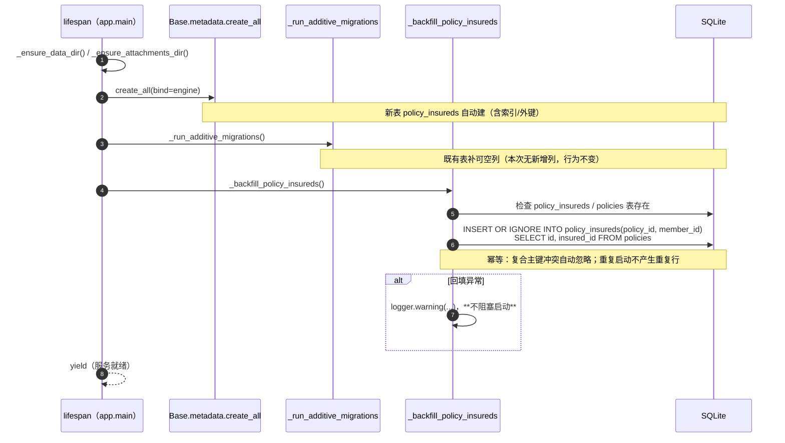
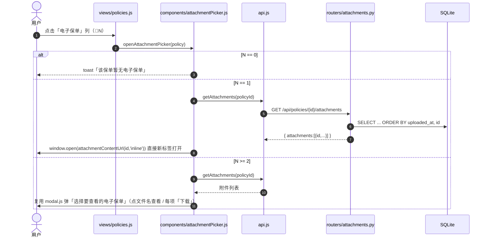
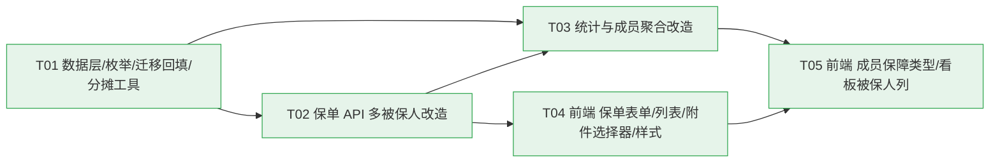

# 家庭保险整理工具 — v1.3 增量系统设计与任务分解

| 项目 | 内容 |
|---|---|
| 文档语言 | 简体中文 |
| 文档类型 | **增量设计**（仅描述本次变更；未提及处一律沿用 `docs/ARCHITECTURE.md` v1.0 ~ v1.3 与 `docs/PRD.md`） |
| 上游文档 | `docs/PRD-v13-increment.md`（= PRD 第 10 章增量，R-39 ~ R-48） |
| 项目代号 | `family_insurance_manager` |
| 技术栈 | **沿用且不更换**：Python 3.13 / FastAPI + SQLAlchemy 2.x + Pydantic v2 + SQLite；前端**原生 HTML + ES Module + 原生 CSS（无构建、零 CDN）** |
| 应用版本号 | v1.3（`app/__init__.py` → `1.3.0`） |
| 架构文档版本 | 本文档对应 `ARCHITECTURE.md` 的 **v1.4 增量**（其修订计数当前到 v1.3） |
| 作者 | 架构师 高见远 |
| 部署现状 | 已用 Docker 部署到极空间 NAS，**库内为真实家庭数据**（`members=1`，`policies=2`） |

---

## 0. 本次范围与已核实的关键事实

### 0.1 需求范围

| 编号 | 需求 | 优先级 | 本设计 |
|---|---|---|---|
| R-39 | 被保人**多选** + 指定 1 名**主被保人** | P0 | ✅ 做 |
| R-40 | 列表/看板**被保人列**展示与**包含式筛选** | P0 | ✅ 做 |
| R-41 | 多被保人**保费按人头分摊**（尾差归最后一名） | P0 | ✅ 做 |
| R-42 | 存量数据**幂等自动迁移** | P0 | ✅ 做 |
| R-43 | 成员页**已有保障类型**统计（险种 + 张数） | P0 | ✅ 做 |
| R-44 | 险种新增**「分红险」** | P0 | ✅ 做（**零迁移**，见 0.2） |
| R-45 | 列表**直达 PDF**（0/1/≥2 三种行为） | P0 | ✅ 做 |
| R-46 | 删除成员**同时校验投保人 + 被保人**（去重） | P0 | ✅ 做 |
| R-47 | 自定义分摊比例 | P2 | ❌ 不做 |
| R-48 | 保障缺口提示 | P2 | ❌ 不做 |

### 0.2 已核实事实（架构决策的直接依据）

> 以下 4 条为**实际侦察 + 实测**结论，本设计直接采信。

1. **`policies.insurance_type` 无 CHECK 约束**。真实库 `data/insurance.db` 建表语句为 `insurance_type VARCHAR(8) NOT NULL`，**无任何 CHECK**。原因：SQLAlchemy 2.x 的 `Enum(..., native_enum=False)` 的 `create_constraint` **默认 `False`**，不生成 CHECK。
   **→ 新增「分红险」是零迁移**：只改 `app/enums.py` 的枚举成员，**不重建 `policies` 表**。
2. **`docs/ARCHITECTURE.md` §3.1 描述不准确**（声称 `VARCHAR + CHECK`）；`app/enums.py` 模块 docstring 亦有同样表述（"并附带 CHECK 约束"）。**记为待修正项**（见 §10 待明确事项 U5）。
3. **`Policy.insured_id` 现状**：`VARCHAR(36) NOT NULL` + `FK → members(RESTRICT)`。本设计**保留该列作为「主被保人」**（`insuredId = primaryInsuredId`，向后兼容），另加关联表存**全部**被保人。
4. **迁移机制**：既有 `app/main.py` 的 `_ADDITIVE_COLUMNS`（仅用于给**既有表**加**可空列**）+ `Base.metadata.create_all`（**新表**自动建）。**`create_all` 不会给既有表加列**（本项目已踩过的坑）。

### 0.3 设计原则

1. **不引入新依赖**：本增量全部用既有技术栈实现（理由见 §1.2）。
2. **单一真源**：枚举真源 `app/enums.py`；被保人集合真源 `policy_insureds` 关联表；主被保人真源 `policies.insured_id`。
3. **向后兼容**：单被保人保单（含全部存量数据）行为与 v1.2 **逐值相同**。
4. **迁移幂等、失败不阻塞启动**（NAS 真实数据，红线）。

---

## 1. 实现方案概述与框架选型

### 1.1 整体方案（一段话）

在**不改技术栈、不引新依赖**的前提下，把「保单 → 被保人」由**单外键**升级为**「主被保人外键 + 关联表」**的混合模型：`policies.insured_id` **保留**并语义化为「主被保人」（兼容字段 `insuredId`），新增**关联表 `policy_insureds`** 存该保单的**全部**被保人（含主被保人本身）；启动时用一条 `INSERT OR IGNORE ... SELECT` 把存量 `insured_id` **幂等回填**进关联表。统计层把 `byInsured` 从「按 `insured_id` 分组」改为「按关联表展开、保费**按人头分摊**（`Decimal` 均摊、尾差归**规范排序**最后一名）」，而 `byPolicyholder` / 顶部卡片 / `insuredPersonCount` 口径**不变**。前端把被保人单选改多选（复选框 + 主被保人 radio）、列表新增「电子保单」直达列（复用既有附件接口），成员页新增「已有保障类型」标签列。

### 1.2 为什么不引入新依赖（选型说明）

| 需求点 | 常规做法 | **本设计做法** | 理由 |
|---|---|---|---|
| 多对多关系 | 引入关联对象 / 第三方 ORM 扩展 | **原生 SQLAlchemy 关联表**（`Table`/`declarative`） | SQLAlchemy 2.x 原生支持复合主键表，零成本 |
| 保费分摊 | `decimal` 库 / `numpy` | **既有 `decimal.Decimal`** + `ROUND_HALF_UP` | `calc.py` 已是金额单一真源，复用 `money()` 量化 |
| 多选被保人 UI | 引入多选组件库（如 Select2） | **原生 `<input type="checkbox">` + `<input type="radio">`** | 成员数量少（家庭），原生控件最直观、零依赖、零 CDN |
| PDF 直达 | 引入 PDF 预览库 | **复用既有 `inline` 查看接口**（`window.open`）+ 既有 `modal.js` | v1.2 已实现 `attachmentContentUrl`，直接复用 |
| 成员保障类型标签 | 引入 tag 组件 | **原生 CSS chip**（`<span class="chip">`） | 纯样式，无 JS 依赖 |

**结论**：**零新增依赖**（前后端均无）。`requirements.txt` / `requirements-dev.txt` **不改**。

### 1.3 架构模式（沿用）

后端「**Router → Service → ORM**」分层；前端「**单页多视图（hash 路由）+ 组件化**」。本增量**新增 1 个后端服务模块**（`app/services/insured_service.py`，被保人关联的单一真源）与 **1 个前端组件**（`attachmentPicker.js`），其余均为**就地修改**。

### 1.4 关键设计决策（覆盖/补充 PRD）

| # | 决策 | 内容 |
|---|---|---|
| D1 | **存储结构** | 保留 `policies.insured_id` = **主被保人**（NOT NULL）；新增关联表 `policy_insureds(policy_id, member_id)` 存**全部**被保人（含主被保人） |
| D2 | **被保人排序（唯一真源）** | `insured_sort_key(member) = (RELATION_ORDER[relation], member.name, member.id)`，即「本人0→配偶1→子女2→父亲3→母亲4→其他5，同关系按姓名、再按 id」。**展示顺序、分摊顺序、尾差归属**统一用它 |
| D3 | **保费分摊** | `calc.allocate_amounts(total, n)`：`base = money(total/n)`，前 `n-1` 份 = `base`，**最后一份 = `total - base*(n-1)`**（尾差归规范排序最后一名）；`Σ = total` 恒成立 |
| D4 | **分摊范围** | **仅 `byInsured` 的保费类指标**（年化 / 待缴 / 累计已缴）分摊；`policyCount`/`activePolicyCount` **全额**（每人各 +1）；`byPolicyholder`、顶部卡片、`byType` **不分摊** |
| D5 | **兼容字段** | 响应保留 `insuredId = primaryInsuredId`、`insuredName` = 主被保人姓名；**请求侧**同时接受旧 `insuredId`（单值）作为降级 |
| D6 | **筛选语义** | 查询参数 `insuredId` 由「等于」改「**包含（any-of）**」：命中「被保人集合含该成员」的全部保单 |
| D7 | **`insuredPersonCount`** | 口径不变：关联表中**去重** `member_id`，且保单 `in_coverage` 且 `status ∈ {生效中, 已缴清}` |
| D8 | **「至某年龄」基准** | 统一以**主被保人**生日为准（`calc_schedule(policy, primary, today)`）；单人保单逐值不变 |
| D9 | **分红险** | 仅改 `app/enums.py`，插入在 `年金险` 之后；**零迁移** |
| D10 | **列表 PDF** | **不整行点击**，独立「电子保单」列；`N=1` 直接 `window.open(inline)`；`N≥2` 复用 `modal.js` 弹选择层；`N=0` 显示「—」 |

---

## 2. 文件列表（区分新增 / 修改 / 不动）

> 路径均为**相对项目根目录**。

### 2.1 新增文件

| 相对路径 | 说明 |
|---|---|
| `app/services/insured_service.py` | **被保人关联单一真源**：关联表读写、规范排序、批量加载被保人、成员被引用计数（供删除保护） |
| `static/js/components/attachmentPicker.js` | 列表页「电子保单」只读选择器：按附件数 0/1/≥2 分三种行为（复用 `modal.js` + `api.js`） |
| `tests/test_v13_migrations.py` | v1.3 迁移测试：`policy_insureds` 建表 + 幂等回填 + 既有数据不丢 |
| `tests/test_multi_insured_api.py` | 多被保人保单 API 测试（写入/读取/校验/any-of 筛选/兼容字段） |
| `tests/test_multi_insured_stats.py` | 分摊统计测试（byInsured 分摊、尾差、`insuredPersonCount`、`coverageTypes`、删除保护、**算例集 A/B 回归**） |

### 2.2 修改文件

| 相对路径 | 变更摘要 |
|---|---|
| `app/__init__.py` | `__version__` → `"1.3.0"` |
| `app/enums.py` | `InsuranceType` 新增 `dividend = "分红险"`（插在 `annuity` 之后）；**修正** docstring 中"附带 CHECK 约束"的不准确表述 |
| `app/models.py` | 新增 `PolicyInsured` ORM（复合主键 + 索引）；`Policy.insured_id` **保留**（注释语义化为主被保人） |
| `app/calc.py` | 新增纯函数 `allocate_amounts(total, n)`（分摊 + 尾差归最后一名） |
| `app/main.py` | 新增 `_backfill_policy_insureds()`（幂等回填）；`lifespan` 中于 `_run_additive_migrations()` 之后调用 |
| `app/schemas.py` | `PolicyBase` 请求字段改多被保人（`insuredIds`/`primaryInsuredId` + 兼容 `insuredId`）；`PolicyOut` / `UpcomingItemOut` / `OverdueItemOut` 新增 `insuredIds`/`primaryInsuredId`/`insuredNames`；`MemberOut` 新增 `coverageTypes`；新增 `CoverageTypeStatOut` |
| `app/services/policy_service.py` | `create/update` 写关联表；`_to_out`/`_assemble` 加载全部被保人；`list_policies` 筛选改 any-of |
| `app/services/stats_service.py` | `byInsured` 分摊；`insuredPersonCount` 改关联表去重；`upcoming`/`overdue` 补 `insuredIds`/`insuredNames` |
| `app/services/member_service.py` | `_member_stats` 分摊 + 计算 `coverageTypes`；`delete_member` 引用计数**去重**（投保人 ∪ 被保人） |
| `static/js/format.js` | 新增 `fmtInsuredNames(names)`（≤2 全列 / ≥3 截断）与 `insuredTitle(names)` |
| `static/js/components/policyForm.js` | 被保人改**复选框多选 + 主被保人 radio**（含联动、回填、预览基准改主被保人） |
| `static/js/views/policies.js` | 被保人列多值渲染；筛选改 any-of；新增「电子保单」列（点击走 `attachmentPicker`） |
| `static/js/views/members.js` | 新增「已有保障类型」标签列 + 点击展开明细 |
| `static/js/views/dashboard.js` | 待缴清单 / 逾期面板「被保人」列改用 `insuredNames`（同列表规则） |
| `static/css/styles.css` | 新增 `.insured-options` / `.chip` / `.chip-row` / `.attachment-link` / `.muted` 等样式 |
| `tests/conftest.py` | `policy_factory` 支持 `insured_ids`/`primary_insured_id`（写关联表）；新增算例夹具复用 |

### 2.3 明确不动（与本次无关）

`app/database.py`、`app/deps.py`、`app/errors.py`、`app/types.py`、`app/config.py`、`app/routers/members.py`、`app/routers/stats.py`、`app/routers/meta.py`、`app/routers/attachments.py`、`app/services/attachment_service.py`、`static/index.html`、`static/js/main.js`、`static/js/api.js`、`static/js/store.js`、`static/js/chart.js`、`static/js/components/modal.js`、`static/js/components/memberForm.js`、`static/js/components/suggestions.js`、`static/js/components/batchEditModal.js`、`static/js/components/attachmentList.js`、`requirements.txt`、`requirements-dev.txt`、`docs/PRD.md`（上游只读）。

> 说明：`api.js` **无需新增函数**——多被保人走既有 `createPolicy`/`updatePolicy` 载荷；PDF 直达复用既有 `getAttachments` / `attachmentContentUrl`。

---

## 3. 数据结构与接口设计

### 3.1 新增表 `policy_insureds`（建表 SQL 级设计）

```sql
CREATE TABLE policy_insureds (
    policy_id  VARCHAR(36) NOT NULL,
    member_id  VARCHAR(36) NOT NULL,
    PRIMARY KEY (policy_id, member_id),
    FOREIGN KEY (policy_id) REFERENCES policies (id) ON DELETE CASCADE,
    FOREIGN KEY (member_id) REFERENCES members  (id) ON DELETE RESTRICT
);
CREATE INDEX idx_policy_insureds_member ON policy_insureds (member_id);
```

| 列 | 类型 | 约束 | 说明 |
|---|---|---|---|
| `policy_id` | `VARCHAR(36)` | PK（复合）, FK `policies.id` **ON DELETE CASCADE** | 归属保单；删保单自动连带删关联行 |
| `member_id` | `VARCHAR(36)` | PK（复合）, FK `members.id` **ON DELETE RESTRICT** | 被保人；被引用时禁止删成员（DB 双保险） |

**设计要点**：
- **复合主键 `(policy_id, member_id)`** 天然保证「同一保单同一成员不重复」，无需额外唯一约束；
- **关联表存全部被保人（含主被保人）**：`insuredIds` / `byInsured` / `insuredPersonCount` 均以本表为**单一真源**，避免"主被保人特判"分叉；
- **`member_id` 建索引**：服务于「筛选 any-of」与「按被保人分组」；
- **`ON DELETE CASCADE`（policy 侧）**：与既有 `policy_attachments` 同策略——关联行离开保单无独立意义；
- **`ON DELETE RESTRICT`（member 侧）**：与既有 `policies.insured_id` / `policyholder_id` 同策略——防止误删被引用成员，配合 `PRAGMA foreign_keys=ON` 生效。

**不变式（Invariant）**：对任一保单 `p`，`p.insured_id ∈ { pi.member_id : pi.policy_id = p.id }`（主被保人必在关联表内）。应用层保证，迁移回填保证。

### 3.2 `policies` 表（**不变**，语义强化）

| 列 | 变更 | 说明 |
|---|---|---|
| `insured_id` | **保留**（`VARCHAR(36) NOT NULL`，FK RESTRICT） | 语义 = **主被保人 id**；响应 `insuredId = primaryInsuredId` |
| `policyholder_id` | **不变** | 投保人仍单人 |

### 3.3 枚举 `InsuranceType`（新增 1 值）

```python
class InsuranceType(str, Enum):
    critical_illness = "重疾险"
    medical          = "医疗险"
    accident         = "意外险"
    life             = "寿险"
    annuity          = "年金险"
    dividend         = "分红险"     # ← v1.3 新增（插在 annuity 之后）
    education        = "教育金"
    auto             = "车险"
    property         = "财产险"
    other            = "其他"
```

> 前端下拉经 `GET /api/meta/enums` **自动获得**，**前端零硬编码改动**（R-44）。

### 3.4 类图（新增 / 变更部分）

```mermaid
classDiagram
    class Member {
        +str id
        +str name
        +Relation relation
        +date birth_date
        +Gender gender
        +str remark
        +int policy_count          %% 派生
        +int active_policy_count   %% 派生
        +Decimal annual_premium    %% 派生（分摊后）
        +list~CoverageTypeStatOut~ coverage_types  %% 派生（v1.3 新增）
    }

    class Policy {
        +str id
        +str company
        +InsuranceType insurance_type
        +str product_name
        +str policyholder_id       %% 投保人（单人，不变）
        +str insured_id            %% v1.3 语义=主被保人（保留）
        +date effective_date
        +PolicyStatus status
        +int paid_periods_override
        +datetime created_at
        +datetime updated_at
    }

    class PolicyInsured {
        +str policy_id   %% PK, FK policies CASCADE
        +str member_id   %% PK, FK members  RESTRICT
    }

    class PolicyBase {
        <<request>>
        +str company
        +InsuranceType insurance_type
        +str product_name
        +str policyholder_id
        +list~str~ insured_ids        %% v1.3 新增（≥1）
        +str primary_insured_id       %% v1.3 新增（∈ insured_ids）
        +str insured_id               %% v1.3 兼容（请求降级用）
        +date effective_date
        +PolicyStatus status
        +int paid_periods_override
        +validate_insureds()
    }

    class PolicyOut {
        <<response>>
        +str id
        +str policyholder_id
        +str policyholder_name
        +str insured_id               %% = primary_insured_id（兼容）
        +str primary_insured_id       %% v1.3 新增
        +list~str~ insured_ids        %% v1.3 新增（规范序）
        +list~str~ insured_names      %% v1.3 新增（规范序）
        +str insured_name             %% = 主被保人姓名（兼容）
        +int attachment_count
        +Decimal annualized_premium
        +int paid_periods
        +int overdue_periods
    }

    class UpcomingItemOut {
        <<response>>
        +str policy_id
        +str insured_id
        +str insured_name
        +list~str~ insured_ids        %% v1.3 新增
        +list~str~ insured_names      %% v1.3 新增
        +date due_date
        +int period_index
    }

    class OverdueItemOut {
        <<response>>
        +str policy_id
        +str insured_id
        +str insured_name
        +list~str~ insured_ids        %% v1.3 新增
        +list~str~ insured_names      %% v1.3 新增
        +int overdue_periods
    }

    class CoverageTypeStatOut {
        <<response>>
        +InsuranceType insurance_type
        +int count
        +int active_count
        +Decimal annual_premium       %% 分摊后
    }

    class calc {
        <<module>>
        +allocate_amounts(total, n) list~Decimal~
        +calc_schedule(policy, primary, today) Schedule
    }
    class insured_service {
        <<module>>
        +insured_sort_key(member) tuple
        +set_policy_insureds(db, policy_id, ids, primary)
        +get_insured_ids(db, policy_id) list~str~
        +load_insured_map(db, policy_ids) dict
        +count_policies_referencing_member(db, member_id) int
    }
    class policy_service {
        <<module>>
        +create_policy(db, data) PolicyOut
        +update_policy(db, policy_id, data) PolicyOut
        +_to_out(policy, insureds, holder, today, count) PolicyOut
        +_assemble(db, policies, today) list~PolicyOut~
        +list_policies(db, insured_id, ...) list~PolicyOut~
    }
    class stats_service {
        <<module>>
        +build_dashboard(db, today) DashboardOut
        +_group_by_member(...) list~MemberStatOut~
    }
    class member_service {
        <<module>>
        +list_members(db) list~MemberOut~
        +_member_stats(db, today) dict
        +delete_member(db, member_id) dict
    }

    Policy "1" --> "1..*" PolicyInsured : policy_id (CASCADE)
    Member "1" --> "0..*" PolicyInsured : member_id (RESTRICT)
    Policy --> Member : insured_id = 主被保人 (RESTRICT)
    Policy --> Member : policyholder_id (RESTRICT)
    PolicyOut ..> Policy : 装配（insuredIds/Names 来自关联表）
    MemberOut ..> CoverageTypeStatOut : coverageTypes
    policy_service ..> insured_service : 读写关联表
    stats_service ..> insured_service : 加载被保人集合
    member_service ..> insured_service : 加载被保人集合
    stats_service ..> calc : allocate_amounts
    member_service ..> calc : allocate_amounts
    insured_service ..> calc : enum_value
```



### 3.5 接口签名（新增 / 变更）

#### 3.5.1 请求字段（`PolicyCreate` / `PolicyUpdate`，camelCase）

| 字段 | 类型 | 必填 | 校验 |
|---|---|---|---|
| `insuredIds` | `string[]` | ✅（≥1） | 每项须存在于 `members`；**去重**（保序） |
| `primaryInsuredId` | `string` | ✅ | **必须 ∈ `insuredIds`**；缺省时默认 = `insuredIds[0]` |
| `insuredId` | `string` | ⚠️ 兼容 | **仅请求侧**接受：当 `insuredIds` 缺省时，降级为 `insuredIds=[insuredId]`、`primaryInsuredId=insuredId` |
| （其余字段） | — | 不变 | 与 v1.2 一致 |

**校验逻辑（`PolicyBase.@model_validator(mode="after")`，纯逻辑不查库）**：

```
ids = self.insured_ids or ([self.insured_id] if self.insured_id else [])
ids = dedupe_preserve_order(ids)
if not ids:                      → 422 "请至少选择 1 名被保人"
primary = self.primary_insured_id or self.insured_id or ids[0]
if primary not in ids:           → 422 "主被保人必须是已选被保人之一"
self.insured_ids = ids
self.primary_insured_id = primary
self.insured_id = primary        # 归一化兼容字段
```

**成员存在性校验**在 **Service 层**（需查库）：逐个 `insuredIds` + `policyholderId` 调 `_load_member`，不存在 → **422 `VALIDATION_ERROR`**（`detail.memberId` / `detail.role`），与既有行为一致。

#### 3.5.2 响应字段（camelCase）

| Schema | 字段 | 类型 | 说明 |
|---|---|---|---|
| `PolicyOut` | `insuredIds` | `string[]` | 全部被保人 id（**规范序**，见 D2） |
| `PolicyOut` | `primaryInsuredId` | `string` | 主被保人 id |
| `PolicyOut` | `insuredId` | `string` | **兼容** = `primaryInsuredId` |
| `PolicyOut` | `insuredNames` | `string[]` | 全部被保人姓名（**规范序**） |
| `PolicyOut` | `insuredName` | `string` | **兼容** = 主被保人姓名 |
| `UpcomingItemOut` / `OverdueItemOut` | `insuredIds` / `insuredNames` | `string[]` | v1.3 新增（规范序）；**保留** `insuredId`/`insuredName`（兼容） |
| `MemberOut` | `coverageTypes` | `CoverageTypeStatOut[]` | v1.3 新增（见下） |
| `CoverageTypeStatOut` | `insuranceType` / `count` / `activeCount` / `annualPremium` | enum/int/int/number | 成员「已有保障类型」；`annualPremium` 为**分摊后**年化保费（`@field_serializer` → number） |

> `attachmentCount`（既有）继续用于「电子保单」列。

#### 3.5.3 查询参数（`GET /api/policies`）

| 参数 | 变更 | SQL（any-of 语义） |
|---|---|---|
| `insuredId` | 语义由「等于」→「**包含**」 | `WHERE policies.id IN (SELECT policy_id FROM policy_insureds WHERE member_id = :insuredId)` |
| `policyholderId` / `insuranceType` / `status` / `paymentFrequency` / `keyword` / `sort` | **不变** | — |

#### 3.5.4 错误码

| 错误码 | HTTP | 场景 | 变更 |
|---|---|---|---|
| `VALIDATION_ERROR` | 422 | 未选被保人 / 主被保人不在列表 / 成员不存在 / 其余条件必填 | **复用** |
| `MEMBER_IN_USE` | 409 | 删除被引用成员（**投保人 ∪ 被保人**去重计数） | **语义扩展**（计数去重） |
| `NOT_FOUND` / `DUPLICATE_PRIMARY_MEMBER` / `INTERNAL_ERROR` | — | 不变 | — |

> **无新增错误码**。R-39/R-40/R-46 的校验全部落在既有 422 / 409 上。

#### 3.5.5 服务层函数签名（新增 / 变更）

```python
# app/services/insured_service.py（新增）
def insured_sort_key(member: Member) -> tuple[int, str, str]: ...
def set_policy_insureds(db: Session, policy_id: str,
                        insured_ids: list[str], primary_id: str) -> None: ...
def get_insured_ids(db: Session, policy_id: str) -> list[str]: ...
def load_insured_map(db: Session, policy_ids: list[str]) -> dict[str, list[Member]]: ...
def count_policies_referencing_member(db: Session, member_id: str) -> int: ...

# app/calc.py（新增）
def allocate_amounts(total: Decimal, n: int) -> list[Decimal]: ...

# 变更
policy_service._to_out(policy, insureds: list[Member], holder, today, attachment_count) -> PolicyOut
policy_service._assemble(db, policies, today) -> list[PolicyOut]
policy_service.list_policies(db, *, insured_id=None, ...) -> list[PolicyOut]   # insured_id 改 any-of
stats_service._group_by_member(policies, members, insured_map, schedules, upcoming_by_policy, key_fn) -> list[MemberStatOut]
member_service._member_stats(db, today) -> dict[str, dict]   # 分摊 + coverageTypes
```

### 3.6 分摊算法（`calc.allocate_amounts`，唯一真源）

```python
def allocate_amounts(total: Decimal, n: int) -> list[Decimal]:
    """把 total 均摊到 n 份：保留 2 位小数，尾差归**最后一份**，保证 Σ = total。

    返回长度 n 的列表；调用方须按「规范排序」传入被保人，故最后一份
    即「排序最后一名被保人」。
    """
    total = money(total)                    # ROUND_HALF_UP，2 位
    if n <= 0:
        return []
    if n == 1:
        return [total]
    base = money(total / n)                 # 每份基础额（ROUND_HALF_UP）
    shares = [base] * n
    shares[-1] = money(total - base * (n - 1))   # 尾差归最后一份
    return shares
```

**量化规则**：全程 `Decimal` + `ROUND_HALF_UP` + 2 位小数（复用既有 `money()`，与 §0.5 一致）。
**不变式**：`Σ allocate_amounts(total, n) == money(total)`（对任意 `n ≥ 1`、任意非负 `total` 成立）。

**规范排序（唯一真源，D2）**：

```python
def insured_sort_key(member):
    return (RELATION_ORDER.get(enum_value(member.relation), 99), member.name, member.id)
```

---

## 4. 程序调用流程（时序图）

### 4.1 新增 / 编辑「多被保人」保单

```mermaid
sequenceDiagram
    autonumber
    actor U as 用户
    participant PF as components/policyForm.js
    participant API as api.js
    participant RT as routers/policies.py
    participant PS as policy_service
    participant IS as insured_service
    participant CALC as calc.py
    participant DB as SQLite

    U->>PF: 勾选被保人（≥1）+ 选主被保人 + 填写其余字段 + 保存
    PF->>PF: 校验「至少 1 名」「主被保人 ∈ 已选」；预览以主被保人生日算年龄
    PF->>API: createPolicy/updatePolicy({ insuredIds, primaryInsuredId, ... })
    API->>RT: POST/PUT /api/policies
    RT->>RT: Pydantic 校验（_validate_insureds：≥1 / 主被保人 ∈ 列表）
    alt 校验失败
        RT-->>API: 422 VALIDATION_ERROR
        API-->>PF: 抛出 → 表单提示
    else 校验通过
        RT->>PS: create_policy / update_policy
        PS->>DB: SELECT members WHERE id IN (policyholderId + insuredIds)
        alt 有成员不存在
            PS-->>RT: 422 VALIDATION_ERROR（memberId/role）
        else 全部存在
            PS->>DB: INSERT/UPDATE policies（insured_id = primaryInsuredId）
            PS->>IS: set_policy_insureds(db, policy_id, insuredIds, primaryInsuredId)
            IS->>DB: DELETE FROM policy_insureds WHERE policy_id=?; INSERT 全部被保人
            PS->>DB: COMMIT
            PS->>IS: load_insured_map(db, [policy_id])  （规范序）
            PS->>CALC: calc_schedule(policy, 主被保人, today)
            PS-->>RT: PolicyOut（insuredIds/primaryInsuredId/insuredNames/insuredId）
            RT-->>API: 201/200
            API-->>PF: 成功 → 关闭弹窗 + 刷新
        end
    end
```

### 4.2 启动时幂等回填迁移



### 4.3 看板「按被保人」分摊 + 成员保障类型

```mermaid
sequenceDiagram
    autonumber
    actor U as 用户
    participant V as views/dashboard.js · views/members.js
    participant RT as routers/stats.py · routers/members.py
    participant SS as stats_service · member_service
    participant IS as insured_service
    participant CALC as calc.py
    participant DB as SQLite

    U->>V: 打开看板 / 成员页
    V->>RT: GET /api/stats/dashboard · GET /api/members
    RT->>SS: build_dashboard / list_members
    SS->>DB: SELECT * FROM policies; SELECT * FROM members
    SS->>IS: load_insured_map(db, policy_ids)  （每单被保人，规范序）
    loop 每张保单
        SS->>CALC: calc_schedule(policy, 主被保人, today)  → 年化/累计/待缴
        SS->>CALC: allocate_amounts(指标, N=被保人数)  → 分摊份额
        Note over SS: byInsured：每个被保人 += 份额；<br/>policyCount 每人各 +1（全额）
    end
    SS->>SS: insuredPersonCount = 关联表被保人**去重**（in_coverage 且 生效中/已缴清）
    SS->>SS: coverageTypes：按 (成员,险种) 聚合张数/生效中/分摊年化（仅 生效中/已缴清）
    SS-->>RT: DashboardOut / MemberOut[]
    RT-->>V: 200 JSON
    V-->>U: 看板分摊后数值 / 成员「已有保障类型」标签
```

### 4.4 列表「电子保单」直达（0/1/≥2）



---

## 5. 依赖包列表

```text
（无变更）
```

| 项 | 结论 |
|---|---|
| `requirements.txt` | **不新增** |
| `requirements-dev.txt` | **不新增** |
| 前端 | **不新增**（无 npm / 无 CDN；`<datalist>`、`<input type=checkbox/radio>`、`<span class="chip">` 均为原生） |
| 新增第三方包总数 | **0** |

---

## 6. 有序任务列表

> 共 **5 个任务**（硬性上限内）。粒度 = 一个可独立验证的产出。**关键路径**：T01 → T02 → T03 → T04 → T05。
> **文件归属**：每个文件**只归属一个任务**，避免并行编辑冲突（遵循本机"编辑可能不落盘"陷阱的规避约定）。

| 任务编号 | 任务名称 | 涉及文件 | 依赖 | 优先级 |
|---|---|---|---|---|
| **T01** | **数据层、枚举、迁移回填与分摊工具** | `app/enums.py`、`app/models.py`、`app/services/insured_service.py`、`app/calc.py`、`app/main.py`、`app/__init__.py`、`tests/conftest.py`、`tests/test_v13_migrations.py` | — | P0 |
| **T02** | **保单 API 多被保人改造** | `app/schemas.py`、`app/services/policy_service.py`、`app/routers/policies.py`、`tests/test_multi_insured_api.py` | T01 | P0 |
| **T03** | **统计与成员聚合改造（分摊 / 保障类型 / 删除保护）** | `app/services/stats_service.py`、`app/services/member_service.py`、`tests/test_multi_insured_stats.py` | T01, T02 | P0 |
| **T04** | **前端：保单表单多选 + 列表被保人/电子保单列 + 附件选择器 + 样式** | `static/js/components/policyForm.js`、`static/js/views/policies.js`、`static/js/components/attachmentPicker.js`、`static/js/format.js`、`static/css/styles.css` | T02 | P0 |
| **T05** | **前端：成员保障类型列 + 看板被保人列** | `static/js/views/members.js`、`static/js/views/dashboard.js` | T03, T04 | P0 |

### 6.1 各任务验收标准

| 任务 | 验收标准 |
|---|---|
| **T01** | ① `create_all` 建出 `policy_insureds`（复合主键 / 索引 / 两个外键 ondelete 正确）；② `InsuranceType` 含「分红险」共 10 值且顺序正确；③ `_backfill_policy_insureds()` 对既有库把每张保单 `insured_id` 写入关联表，**连跑两次幂等**、既有数据不丢、失败不阻塞启动（`tests/test_v13_migrations.py` 全绿）；④ `allocate_amounts`：`Σ == total`、`n=1` 恒等、尾差归最后一份（单测覆盖除不尽用例，如 `1000/3 → [333.33,333.33,333.34]`） |
| **T02** | ① 新建多被保人保单（2 人）后重开回填 `insuredIds`/`primaryInsuredId` 正确；② 未选被保人 / 主被保人不在列表 / 成员不存在 → 422；③ 响应含 `insuredIds`/`primaryInsuredId`/`insuredNames` 且 `insuredId == primaryInsuredId`、`insuredName == 主被保人姓名`；④ `GET /api/policies?insuredId=mX` 返回「被保人含 mX」的全部保单（any-of）；⑤ **单人保单请求/响应与 v1.2 等价** |
| **T03** | ① 2 人保单 `byInsured` 年化 = 全额 ÷ 2，`Σ = 全额`，尾差归规范排序最后一名；② 顶部卡片 / `byType` / `byPolicyholder` **数值与 v1.2 逐值相同**；③ `insuredPersonCount` 去重口径不变；④ `coverageTypes` 张数/生效中/分摊年化正确、排序「张数降序 → 险种枚举顺序」；⑤ 删除被引用成员（投保人 ∪ 被保人）→ 409 且**计数去重**；⑥ **算例集 A/B/C 全部逐值通过**（回归） |
| **T04** | ① 表单被保人为复选框（≥1 校验）+ 主被保人 radio（仅已选可选、必选）；取消勾选主被保人自动转移；② 预览年龄以主被保人为准；③ 列表「被保人」列 ≤2 全列 / ≥3 截断 + `title` 全量；④ 筛选下拉语义 any-of；⑤ 「电子保单」列 `N=0` 显示「—」、`N=1` 新标签直达、`N≥2` 弹选择层（可查看/下载）；⑥ 无 CDN、无构建 |
| **T05** | ① 成员页新增「已有保障类型」标签列（`险种×张数`，张数降序→枚举序），无保障显示「暂无保障」；② 点击标签展开明细（张数 / 分摊年化 / 生效中张数）；③ 看板待缴清单 / 逾期面板「被保人」列展示规则同列表；④ 单人场景展示与 v1.2 一致 |

### 6.2 任务依赖图



---

## 7. 共享知识（跨文件约定，Engineer 必守）

| 项 | 约定 |
|---|---|
| **被保人集合真源** | 关联表 `policy_insureds(policy_id, member_id)`，**含主被保人**；读写一律经 `app/services/insured_service.py` |
| **主被保人真源** | `policies.insured_id`（NOT NULL，FK RESTRICT）；**不变式**：主被保人必在关联表内 |
| **被保人规范排序（唯一真源）** | `insured_sort_key = (RELATION_ORDER[relation], name, id)`；**展示顺序、分摊顺序、尾差归属**统一用它 |
| **保费分摊** | `calc.allocate_amounts(total, n)`；`ROUND_HALF_UP` + 2 位小数；`base = money(total/n)`；**尾差归规范排序最后一名**；不变式 `Σ == money(total)` |
| **分摊范围** | **仅** `byInsured` 的 `annualPremium`/`upcoming60Premium`/`paidToDatePremium` 分摊；`policyCount`/`activePolicyCount` **全额**；`byPolicyholder`/顶部卡片/`byType` **不分摊** |
| **API 命名** | 请求/响应字段 **camelCase**（`insuredIds`/`primaryInsuredId`/`insuredNames`/`coverageTypes`）；DB 列 **snake_case**（`policy_insureds`） |
| **兼容字段** | 响应 `insuredId = primaryInsuredId`、`insuredName = 主被保人姓名`；请求侧接受旧 `insuredId`（单值降级） |
| **筛选语义** | `insuredId` 查询参数 = **any-of（包含）**，SQL 用 `policies.id IN (SELECT policy_id FROM policy_insureds WHERE member_id=:id)` |
| **错误格式** | `{code, message, detail}`；本增量**复用** `VALIDATION_ERROR`(422) 与 `MEMBER_IN_USE`(409)，**不新增错误码** |
| **枚举单一真源** | `app/enums.py`；「分红险」经 `/api/meta/enums` 自动下发，**前端零硬编码** |
| **「至某年龄」基准** | `calc_schedule(policy, 主被保人, today)`；单人保单逐值不变 |
| **`insuredPersonCount`** | 关联表 `member_id` **去重**，且 `in_coverage` 且 `status ∈ {生效中, 已缴清}` |
| **`coverageTypes` 口径** | 仅统计 `生效中 / 已缴清` 保单；`annualPremium` 仅计入「生效中且未缴清」的分摊年化；排序「`count` 降序 → 险种枚举顺序」 |
| **迁移** | 新表由 `create_all` 建；回填用 `INSERT OR IGNORE ... SELECT`（**幂等**）；`_backfill_policy_insureds()` 失败仅 `WARNING`，**不阻塞启动** |
| **版本号** | `app/__init__.py` → `"1.3.0"`（`/api/health` 返回） |
| **金额序列化** | 分摊结果仍走 `@field_serializer` → JSON **number**（Pydantic v2 默认会输出字符串，**必须**加） |
| **前端无外部依赖** | 禁 CDN / npm / 构建；多选用原生 `checkbox`/`radio`，标签用原生 `.chip` |

> ⚠️ **硬性工程约定（本机致命陷阱，沿用 ARCHITECTURE §6.9）**：本机**文件编辑可能「报告成功但未落盘」**。因此：① **禁止对同一文件并行编辑**（一次只改一个文件）；② **每次编辑后立即 `Read` 回读磁盘确认**；③ **验证必须验行为**（真实 HTTP / 真实浏览器），不要只验源码文本。

---

## 8. 验收基准回归声明（★ 必须继续成立）

> **基准来源**：`docs/ARCHITECTURE.md` §5.6 算例集 **A / B / C**（`today = 2025-05-20`）。

**本设计如何保证算例 A/B/C 逐值不变**：

1. **单人保单分摊系数 = 1**。算例 A/B/C 中每张保单均**只有 1 名被保人**（`N = 1`），`allocate_amounts(total, 1) == [total]`（恒等），故 `byInsured` 全部保费类指标**逐值不变**。
2. **`insuredPersonCount` 去重口径不变**。单被保人保单下，关联表去重集合 = 原 `{p.insured_id}` 集合，故数值不变（A 为 3、B 为 2）。
3. **顶部卡片 / `byType` / `byPolicyholder` 不分摊**，且按保单去重，故与 v1.2 逐值相同（A 年度总保费 17000 / 待缴 4000 与 3 笔；B 2400 / 0 与 0 笔）。
4. **`calc_schedule` 以主被保人为基准**；单人时主被保人 = 唯一被保人，故 `k_max` / 总期数 / 累计 / 进度 / 在保 / 下次缴费日**逐值不变**（含算例 C 的 5 条边界）。
5. **`policyCount` / `activePolicyCount` 全额**：单被保人时每人 +1 即原值，不变。

**回归落点**：`tests/test_multi_insured_stats.py` 必须包含「用 `seed_example_a` / `seed_example_b` 数据断言 overview + byInsured + byType 与 §5.6 期望值完全一致」的回归用例；`tests/test_calc.py` 既有算例**不得改动**（`allocate_amounts` 为纯新增，不影响既有函数）。

### 8.1 ★ v1.4 增量：看板保费双口径

> **需求**：首页需要区分「当年我实际需要支付的总保费（含已缴与未缴）」与「其中尚未缴的部分」。

- **`annualTotalPremium`（当年应缴总保费，字段名不变、语义变更）**：`Σ sched.annualized_premium`，`status ∈ {生效中, 已缴清}`（含已缴清、含已缴完的生效中）；
- **`unpaidAnnualPremium`（当年未缴费金额，新增字段）**：`Σ sched.annualized_premium`，`status == 生效中 且 not sched.is_paid_off`。**逐值等于 v1.3 旧「年度总保费」**（故 v1.3 相关断言中的旧值 17000 / 2400 现归此字段）；
- **不变式**：
  1. `annualTotalPremium − unpaidAnnualPremium == 已缴部分 == Σ annualized WHERE status=='已缴清' OR (status=='生效中' AND is_paid_off)`；
  2. `Σ(byInsured.annualPremium) == unpaidAnnualPremium`（**分摊守恒；不是 `annualTotalPremium`**）；
  3. `byType` / `byPolicyholder` / `byInsured` 的 `annualPremium` **口径不变**（仍为「生效中且未缴清」）。
- **算例落点**：A `unpaidAnnualPremium = annualTotalPremium = 17000.00`（唯一已缴清 D 为趸交、年化 0）；B `unpaidAnnualPremium = 2400.00`、`annualTotalPremium = 14400.00`（+ 已缴清的 F 年化 12000）。
- **回归落点**：`tests/test_v14_premium_calibers.py` 断言上述两不变式 + 算例 A/B 新旧值。

---

## 9. 与既有功能的兼容性对照（PRD 10.7 落地）

| # | 既有功能 | 本设计落地 |
|---|---|---|
| 1 | 存量保单数据 | `_backfill_policy_insureds()` 幂等回填（§4.2） |
| 2 | 年度总保费 / 近 60 天待交卡片 | **不分摊、按保单去重** → 逐值不变（§8） |
| 3 | 按成员统计（byMember） | `byInsured` 分摊（N=1 时系数 1，不变）；`byPolicyholder` 不变 |
| 4 | 在保人数 | 关联表去重，口径不变 |
| 5 | `calc_schedule`（含 `k_max`/期限） | 以主被保人为基准，单人逐值不变 |
| 6 | 删除成员 409 | 引用计数 = 投保人 ∪ 被保人**去重**（§3.5.5） |
| 7 | 保单筛选 `insuredId` | 「等于」→「包含」any-of（§3.5.3） |
| 8 | 列表附件（编辑弹窗内） | **原路径保留**；列表页仅新增只读直达入口 |
| 9 | 批量编辑（v1.2） | 不涉及被保人字段，**不受影响** |
| 10 | 险种枚举 | 前端经 `/api/meta/enums` 自动获得「分红险」 |
| 11 | API 字段 `insuredId` | 响应保留 = `primaryInsuredId`；请求侧兼容旧值 |
| 12 | **枚举 CHECK 兼容性风险** | **已核实：无 CHECK**，分红险**零迁移**（§0.2） |

---

## 10. 待明确事项（均已给出默认决策，如无异议按此实现）

| 编号 | 事项 | 本设计默认决策 |
|---|---|---|
| U1 | 请求侧是否接受旧 `insuredId`（单值）？ | **接受**（降级为 `insuredIds=[insuredId]`），最大化兼容旧脚本；新前端统一发 `insuredIds` |
| U2 | 被保人展示顺序 = 用户勾选顺序还是规范顺序？ | **规范顺序**（D2），与成员列表排序一致、可横向比较、尾差归属稳定 |
| U3 | 取消勾选「主被保人」时？ | **自动转移**给剩余已选成员的第一位（PRD Q17 倾向） |
| U4 | `coverageTypes.annualPremium` 是否含已缴清保单？ | **不含**（仅「生效中且未缴清」计年化），与成员 `annualPremium` 口径一致；张数/生效中张数仍含「已缴清」 |
| U5 | `ARCHITECTURE.md` §3.1 与 `enums.py` docstring 的「CHECK」表述 | **记为待修正**：实际为纯 `VARCHAR` 无 CHECK；本次增量文档已澄清，建议后续同步修正上游文档（**不阻塞本次实现**） |
| U6 | 增量图表是否覆盖 `docs/class-diagram.mermaid` / `sequence-diagram.mermaid`？ | **不覆盖**（二者对应 v1.0 基线架构）；本增量图表**内联**于本文档 |
| U7 | 列表「电子保单」列的附件 id 来源 | 列表响应仅含 `attachmentCount`（沿用"不返回附件明细"决策），点击时**按需** `GET .../attachments`；`N=1` 直达、`N≥2` 弹选择层 |

---

## 11. 任务与文件映射总览

| 文件 | 归属任务 | 新增/修改 |
|---|---|---|
| `app/enums.py` | T01 | 修改 |
| `app/models.py` | T01 | 修改 |
| `app/services/insured_service.py` | T01 | **新增** |
| `app/calc.py` | T01 | 修改 |
| `app/main.py` | T01 | 修改 |
| `app/__init__.py` | T01 | 修改 |
| `tests/conftest.py` | T01 | 修改 |
| `tests/test_v13_migrations.py` | T01 | **新增** |
| `app/schemas.py` | T02 | 修改 |
| `app/services/policy_service.py` | T02 | 修改 |
| `app/routers/policies.py` | T02 | 修改 |
| `tests/test_multi_insured_api.py` | T02 | **新增** |
| `app/services/stats_service.py` | T03 | 修改 |
| `app/services/member_service.py` | T03 | 修改 |
| `tests/test_multi_insured_stats.py` | T03 | **新增** |
| `static/js/components/policyForm.js` | T04 | 修改 |
| `static/js/views/policies.js` | T04 | 修改 |
| `static/js/components/attachmentPicker.js` | T04 | **新增** |
| `static/js/format.js` | T04 | 修改 |
| `static/css/styles.css` | T04 | 修改 |
| `static/js/views/members.js` | T05 | 修改 |
| `static/js/views/dashboard.js` | T05 | 修改 |

---

*增量文档结束 — 版本 v1.3（对应 ARCHITECTURE.md v1.4 增量）。工程师请以 §0 决策、§3 数据结构与接口、§6 任务列表、§7 共享约定、§8 回归声明为验收基准。*
