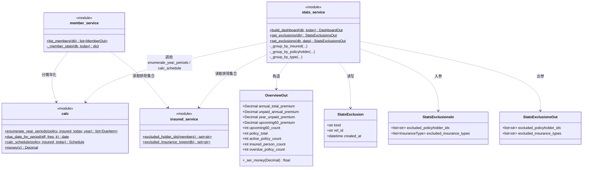
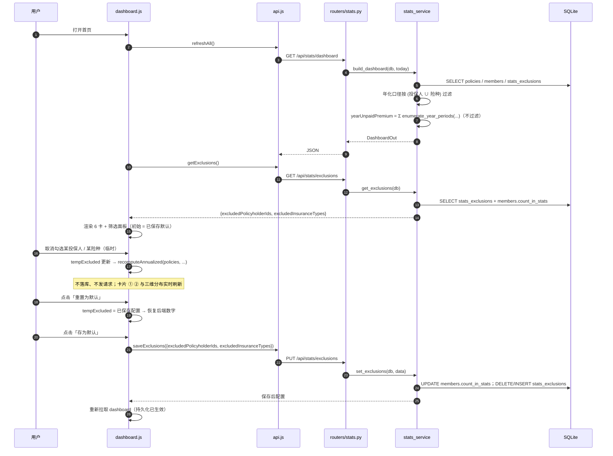

# 家庭保险整理工具 — v1.7 增量架构设计与任务分解

> **基线**：v1.6.0，全量测试 **358 passed**（`.venv/Scripts/python.exe -m pytest tests/ -q`）。
> **本文范围**：仅描述 v1.7 增量；未提及处一律沿用 `docs/ARCHITECTURE.md`（第 0 ~ 5 章，含 §5.5 / §5.6 口径）与 `docs/ARCHITECTURE-v13-increment.md`。
> **业务口径唯一真源**：`docs/ARCHITECTURE.md` §5（核心算法）与 §5.5 / §5.6（口径与算例 A/B/C）。
> **版本号**：`app/__init__.py` → **1.7.0**。
> **硬约束**：前端零 CDN / 无构建 / 零新增依赖；不硬编码枚举（经 `/api/meta/enums`）；金额 DB 存分、计算 `Decimal`、API 输出 **JSON number**（`@field_serializer`）；不新增错误码；**默认全部计入 → 用户现有数字一个都不许变**；**算例集 A/B/C 逐值不变**。

---

## 1. 实现方案总览与关键设计决策

v1.7 含**两个正交需求**：

| 需求 | 一句话 | 影响面 |
|---|---|---|
| **A** | 新增「当年未缴费金额」`yearUnpaidPremium`（**真实待缴口径**：本日历年到期且未标记已缴的期次金额合计），并把旧卡「当年未缴费金额」`unpaidAnnualPremium` **仅改显示名**为「年化保费合计」 | `calc.py` / `schemas.py` / `stats_service.py` / `dashboard.js` / `styles.css` |
| **B** | 首页「不计入统计」筛选（**按投保人 + 按险种**）；临时勾选不落库、可「存为默认」落库；与既有「计入家庭保费统计」开关**合并成一套** | `models.py` / `insured_service.py` / `stats_service.py` / `member_service.py` / `routers/stats.py` / 前端全部 |

### 1.1 需求 A：期次枚举函数（关键设计）

**问题**：现有 `enumerate_upcoming(policy, insured, today, window_days)` 是「**未来 N 天**」窗口（下界 `due >= today`、上界 `today + window_days`），**不适用**于「缴费日落在**本日历年**」的枚举（需含**已逾期**期次、且含**本年度未来**期次）。

**方案**：在 `app/calc.py` 新增纯函数

```python
def enumerate_year_periods(policy, insured, today, year=None) -> list[DueItem]:
    """枚举「缴费日落在 year 年（默认 today.year） 且 尚未标记已缴」的期次。

    口径（唯一真源，v1.7 定稿）：
    - 纳入：`status ∈ {生效中, 已缴清}`（已退保 / 已失效 → []）；含**已逾期**期次；
    - 期次 k（0 基）满足：`due(k).year == year` 且 `k >= paid_periods`（未缴）
      且 `0 <= k < total_periods`；
    - 金额 = 每期保费（`premium_per_period`），**不是**年化保费。
    """
```

**实现要点（复用既有逻辑，不发明日历算术）**：

```python
def enumerate_year_periods(policy, insured, today, year=None):
    year = today.year if year is None else year
    if enum_value(policy.status) not in INSURED_STATUSES:   # {生效中, 已缴清}
        return []
    sched = calc_schedule(policy, insured, today)
    total = sched.total_periods
    if total <= 0:
        return []
    freq = enum_value(policy.payment_frequency)
    eff = policy.effective_date
    premium = money(Decimal(str(policy.premium_per_period)))
    paid = sched.paid_periods          # 已含 paid_periods_override 语义
    items = []
    for k in range(total):             # due(k) 单调不减 → year 单调不减，可安全 break
        due = due_date_for_period(eff, freq, k + 1)   # ★ 复用既有函数（含月末钳制）
        if due.year > year:
            break
        if due.year < year or k < paid:
            continue
        items.append(DueItem(policy_id=policy.id, due_date=due,
                             period_index=k + 1, total_periods=total, amount=premium))
    return items
```

- **不违反 §5.2 铁律**：`k_max` 仍由 `due(k) < today` 反推（本函数根本不依赖 `k_max`）；年份判定直接用 `due(k).year == year`，`due(k)` 由 `due_date_for_period` 产出，**无任何自造日历算术**。
- **复杂度**：`O(total_periods)`（≤ ~1200），家庭规模下可忽略；`due` 单调不减保证 `break` 正确。
- **已缴判定**：`k < paid_periods` 为已缴（`paid_periods` 来自 `Schedule`，已含 `paid_periods_override`）。

### 1.2 需求 A：口径边界（逐场景定稿）

| 场景 | 表现 | 说明 |
|---|---|---|
| **趸交（total_periods = 1）** | 唯一期次 `k=0`，`due(0)=生效日`。仅当**生效日落在本年度**且**未缴**时计入（金额 = 趸交保费，可能为大额） | `paid_periods`：`eff<today`→1（已缴，不计）；`eff>=today`→0（未缴，若在本年度则计） |
| **生效日在未来** | **计入**其「本年度到期」的期次（例：生效 2025-08-01、月缴 200、today 2025-05-20 → 8~12 月共 5 期 = **1000**） | 定义是「缴费日落在本年度」，与是否已开始无关。**见 §9 待明确①** |
| **已退保 / 已失效** | **不计入**（`status ∉ {生效中, 已缴清}` → `[]`） | 退保后无需缴费 |
| **已缴清** | **恒为 0**（`is_paid_off` → `paid_periods == total_periods` → 无 `k >= paid` 的期次） | 天然归零，无需特判 |
| **生效中但今年已缴完** | 今年已缴期次不计；仅计今年**未缴**期次 | 与「已逾期」一致按 `k >= paid` 判定 |
| **已逾期（过去未缴）** | **计入**（不设 `due >= today` 下界） | 用户明确要求「含已逾期」 |
| **本年度未来期次** | **计入**（如 12 月到期、现在 5 月 → 计入） | 用户示例：月缴 500、今年 12 期、已缴 3 → **4500**（9×500） |

### 1.3 需求 A：与既有指标的关系

| 指标 | 口径 | 与新指标关系 |
|---|---|---|
| `annualTotalPremium` / `unpaidAnnualPremium` | **年化保费**（月缴×12 / 年缴×1 / 趸交 0） | **不同**：新指标用**每期实缴**、按**日历年**枚举；**不纳入其两卡对账体系** |
| `upcoming60Premium` | 未来 **60 天**闭区间、**不含已逾期**、仅 `生效中` | **不同**：新指标窗口 = **日历年**、**含已逾期**、含 `已缴清`（恒 0）；二者**可能重叠但不等价** |
| `overdue[]` / `overduePeriods` | 过去未缴期次 | 新指标**包含**本年度内的逾期期次金额（重叠） |

> **一句话**：`yearUnpaidPremium` 是**独立现金流指标**（「今年到底还欠多少保费」），**不是**年化保费，**不参与** `annualTotalPremium` 对账。

### 1.4 需求 A：卡片布局（5 张 → 6 张）

首页 6 张卡：① 当年应缴总保费 · ② 年化保费合计（原「当年未缴费金额」改名）· ③ **当年未缴费金额（新）** · ④ 近 60 天待缴 · ⑤ 保单总数 · ⑥ 在保人数。

**布局方案（定稿）**：`6` 可被 `3` 与 `2` 整除 → 用「**3 列 × 2 行（桌面）/ 2 列 × 3 行（窄屏）**」保证**任何视口都不出现孤行**。

| 视口 | 列数 | 表现 |
|---|---|---|
| **1440px** | **3 列 × 2 行** | 每卡约 440px，金额 `clamp(19px,2.2vw,26px)` 充裕不折行 |
| **768px** | **2 列 × 3 行**（≤1100 断点） | 每卡约 360px，2 行内 3 组，无孤行 |
| **390px** | **2 列 × 3 行**（≤640 断点） | 每卡约 180px，金额最小 19px，`overflow-wrap:anywhere` 兜底 |

**CSS 改动（唯一真源）**：

```css
.metrics { display: flex; flex-wrap: wrap; gap: 16px; margin-bottom: 20px; }
.metric-card { flex: 1 1 calc(33.333% - 12px); /* ★ 原为 calc(20% - 14px)（5 列）→ 改 3 列 */ }
@media (max-width: 1100px) { .metric-card { flex-basis: calc(50% - 10px); } } /* ★ 原 33.333% → 改 2 列 */
@media (max-width: 640px)  { .metric-card { flex-basis: calc(50% - 10px); } } /* 保持 2 列 */
```

- **原 ≤1100 断点**由「3 列」改为「**2 列**」（否则 6 张卡在 768px 会是 3+3，与桌面无区别、失去层级）。
- 卡片 ② ③ 建议加 `accent` 类（浅色描边）相邻高亮，强化「年化合计 vs 当年实缴」对照。

**否决的方案**：
- ❌ **断点改 6 列（一行 6 张）**：1440px 每卡仅约 210px，内宽约 174px；金额如 `¥120,000.00` 在 26px 下约 200px → **溢出/折行**，可读性差。**否决**。
- ❌ **4 列 + 2 列**：第 2 行孤零零 2 张（`6 = 4 + 2`），破坏「行行撑满」的既有设计哲学。**否决**。

### 1.5 需求 B：持久化存储（关键设计决策）

| 维度 | 存储 | 变更 |
|---|---|---|
| **投保人** | `Member.count_in_stats`（v1.5 已有） | **沿用，不改** |
| **险种** | **新增表 `stats_exclusions(kind, ref_id)`** | 新增（`create_all` 建表） |

**决策：不把投保人维度迁进新表，而是「双存储、单读写接口」**。

- **为什么**：现有 `Member.count_in_stats=False` 的存量数据**语义必须保持不变**。若改成「迁移进 `stats_exclusions` + 弃用 `count_in_stats`」，需在 `lifespan` 里做一次性数据搬迁 + 改 `MemberOut` / 成员页语义 → **迁移面大、NAS 真实数据有风险**。保持 `count_in_stats` 原样，**零迁移、零风险**。
- **`kind` 列的作用**：为未来维度（如「按保单排除」）预留；v1.7 **只写入 `kind='insurance_type'`** 的行。`ref_id` 对险种存**中文枚举值**（如 `"车险"`）。
- **存量数据**：`stats_exclusions` 为空 = 全部险种计入 → 与 v1.6 完全一致；**无需回填**。

**否决的方案**：
- ❌ **全量统一到 `stats_exclusions`（迁移 `count_in_stats=False`）**：迁移风险高、需改成员页语义。**否决**。
- ❌ **在 `members` 加 `excluded_types` JSON 列**：无外键约束、查询需反序列化、与「按险种」语义错位。**否决**。
- ❌ **新增可空列**：险种排除是**集合**语义，列存不适合；且新表由 `create_all` 自动建，比 ALTER 更干净。

### 1.6 需求 B：过滤范围与「两套过滤逻辑不打架」的分工

| 过滤主体 | 谁执行 | 作用对象 |
|---|---|---|
| **持久化配置**（`count_in_stats` + `stats_exclusions`） | **后端** `stats_service` / `member_service` | 全部**年化保费**口径 |
| **临时筛选**（首页勾选，不落库） | **前端** `dashboard.js` | 仅首页展示的**年化保费**口径（卡片 ① ② + 三维分布） |

**只过滤「年化保费」口径**（沿用 v1.5/v1.6 铁律）：
- ✅ 过滤：`overview.annualTotalPremium` / `overview.unpaidAnnualPremium` / `byInsured[].annualPremium` / `byPolicyholder[].annualPremium` / `byType[].annualPremium` / `/api/members` 的 `annualPremium` 与 `coverageTypes[].annualPremium`；
- ❌ **一律不过滤**：`policyTotal` / `activePolicyCount` / `insuredPersonCount`、各维度 `policyCount` / `activePolicyCount`、`upcoming60Premium` / `upcoming60Count` / `upcoming[]` / `overdue[]`、`paidToDatePremium`；
- ❌ **新指标 `yearUnpaidPremium` 也不过滤**（理由见下）。

> **⚠️ 明确结论：新增的「当年未缴费金额」`yearUnpaidPremium` 【不】受该筛选影响。**
> **理由**：① 它是**现金流口径**（每期实缴 × 未缴期数），**不是年化保费**，而 v1.5/v1.6 确立的过滤铁律**只作用于年化保费口径**；② 与 `upcoming60Premium` / `overdue[]` / `paidToDatePremium`（均为实际现金流/已发生）保持一致——**统计口径的偏好不应改变「你今年实际要交多少钱」**；③ 若过滤它，会与 `upcoming60Premium` 产生不一致（一个过滤、一个不过滤），反而制造新的对账困惑。

**「不打架」的关键设计**：前端临时重算**只在「临时筛选 ≠ 已保存默认」时触发**；相等时**直接使用后端返回数字**（保证默认态与 v1.6 **逐字节一致**）。且前端重算从**保单列表**（`/api/policies`，含 `annualizedPremium` / `status` / `isPaidOff` / `policyholderId` / `insuranceType` / `insuredIds`）出发，对**并集（持久化 ∪ 临时）**一次性重算，**从根本上避免「先扣投保人、再扣险种」的重复扣减**。

### 1.7 需求 B：前端临时筛选实现（前端重算，不请求后端）

**临时筛选状态**：`dashboard.js` 内闭包变量 `tempExcludedHolders: Set<string>`、`tempExcludedTypes: Set<string>`，初始 = 已保存配置；**刷新 / 切页即重置**（不落库）。

**重算函数（单一真源，镜像后端口径）**：

```js
// 从 policies 重算「年化保费」口径（并集过滤，避免两维重复扣减）
function recomputeAnnualized(policies, members, exclHolders, exclTypes) {
  let annualTotal = 0, unpaidAnnual = 0;
  const byType = new Map(), byHolder = new Map(), byInsured = new Map();
  for (const p of policies) {
    if (exclHolders.has(p.policyholderId) || exclTypes.has(p.insuranceType)) continue;
    if (p.status !== '生效中' && p.status !== '已缴清') continue;   // INSURED_STATUSES
    const annual = Number(p.annualizedPremium) || 0;
    annualTotal += annual;
    byType.set(p.insuranceType, (byType.get(p.insuranceType) || 0) + annual);
    byHolder.set(p.policyholderId, (byHolder.get(p.policyholderId) || 0) + annual);
    // byInsured：按「规范序（关系权重→姓名→id）」分摊，尾差归最后一名（镜像 calc.allocate_amounts）
    const ordered = canonicalInsuredOrder(p.insuredIds, members);
    const shares = allocateAmounts(annual, ordered.length);
    ordered.forEach((mid, i) => byInsured.set(mid, (byInsured.get(mid) || 0) + shares[i]));
    if (p.status === '生效中' && !p.isPaidOff) unpaidAnnual += annual;
  }
  return { annualTotal, unpaidAnnual, byType, byHolder, byInsured };
}
```

- `allocateAmounts` / `canonicalInsuredOrder`：镜像后端 `calc.allocate_amounts` 与 `insured_service.insured_sort_key`（关系权重取自 `enums.relation` 顺序，**不硬编码**）。
- **仅在「临时 ≠ 默认」时**用重算结果覆盖卡片 ① ② 与三维分布；否则直接用后端数字。
- **不进 `/api/members`**：临时筛选仅首页生效，成员页始终反映**持久化配置**。

### 1.8 需求 B：与既有「计入家庭保费统计」开关的合并

- **移除** `memberForm.js` 的「计入家庭保费统计」复选框（及其 `collect()` 里的 `countInStats`）。
- **保留** `MemberCreate.countInStats` 字段（兼容旧脚本 / 旧前端 POST；默认 `True`）——**仅前端不再暴露该输入**。
- `members.js` 的「计入统计」列**保留为只读状态列**（数据仍来自 `MemberOut.countInStats`），列标题改「统计状态」并加提示「在首页『统计范围筛选』中修改」。

### 1.9 默认值保证「数字不变」

- `stats_exclusions` 为空 + 全部 `Member.count_in_stats=True` → **零排除** → 所有年化口径与 v1.6 **逐值相同**。
- 前端临时筛选初始 = 已保存配置（默认空）→ **不触发重算** → 首页与 v1.6 **逐字节一致**。

---

## 2. 文件清单

| 文件（相对路径） | 新增/修改 | 一句话说明 |
|---|---|---|
| `app/__init__.py` | 修改 | 版本号 `1.6.0` → **`1.7.0`** |
| `app/calc.py` | 修改 | 新增 `enumerate_year_periods()`（§1.1）；导出 |
| `app/models.py` | 修改 | 新增 ORM `StatsExclusion`（`stats_exclusions` 表） |
| `app/schemas.py` | 修改 | `OverviewOut` 增 `yearUnpaidPremium` + `@field_serializer`；新增 `StatsExclusionsIn/Out` |
| `app/services/insured_service.py` | 修改 | 新增 `excluded_insurance_types(db)` 与 `INSURANCE_TYPE_KIND` 常量；口径唯一真源扩展 |
| `app/services/stats_service.py` | 修改 | 三维 + overview 叠加**险种**过滤；计算并填充 `yearUnpaidPremium`（**不过滤**）；新增 `get_exclusions` / `set_exclusions` |
| `app/services/member_service.py` | 修改 | `annualPremium` / `coverageTypes[].annualPremium` 叠加**险种**过滤 |
| `app/routers/stats.py` | 修改 | 新增 `GET` / `PUT /api/stats/exclusions` |
| `app/main.py` | **不改** | 新表由 `create_all` 自动建；无新增可空列 → 无需登记 `_ADDITIVE_COLUMNS`（`from . import models` 已注册） |
| `static/js/api.js` | 修改 | 新增 `getExclusions()` / `saveExclusions(payload)` |
| `static/js/store.js` | 修改 | 缓存 `exclusions`；`refreshAll()` 一并拉取 |
| `static/js/views/dashboard.js` | 修改 | 6 张卡；筛选面板；临时重算（§1.7）；卡片 ② 改名 |
| `static/js/components/memberForm.js` | 修改 | 移除「计入家庭保费统计」开关 |
| `static/js/views/members.js` | 修改 | 「计入统计」列改只读状态列 + 提示 |
| `static/css/styles.css` | 修改 | 6 卡布局（§1.4）+ 筛选面板样式 + `.metric-card.accent` |
| `tests/test_v17_year_unpaid.py` | 新增 | 新指标单测（含 A/B 期望值、边界） |
| `tests/test_v17_exclusions.py` | 新增 | 排除配置 API + 过滤范围 + 迁移单测 |
| `docs/ARCHITECTURE-v17-increment.md` | 新增 | 本文档 |
| `docs/class-diagram-v17.mermaid` | 新增 | 增量类图 |
| `docs/sequence-diagram-v17.mermaid` | 新增 | 增量时序图 |

---

## 3. 数据结构与接口

### 3.1 新表 DDL：`stats_exclusions`

```sql
CREATE TABLE stats_exclusions (
    kind       VARCHAR(16)  NOT NULL,   -- v1.7 仅 'insurance_type'
    ref_id     VARCHAR(64)  NOT NULL,   -- 险种中文枚举值，如 '车险'
    created_at DATETIME     NOT NULL,
    PRIMARY KEY (kind, ref_id)
);
```

```python
# app/models.py
class StatsExclusion(Base):
    """统计排除配置（v1.7）。复合主键 (kind, ref_id)。

    v1.7 只写入 kind='insurance_type'（ref_id = 险种中文值）；
    投保人维度沿用 members.count_in_stats（见 ARCHITECTURE-v17-increment §1.5）。
    """
    __tablename__ = "stats_exclusions"
    kind: Mapped[str] = mapped_column(String(16), primary_key=True)
    ref_id: Mapped[str] = mapped_column(String(64), primary_key=True)
    created_at: Mapped[datetime] = mapped_column(
        DateTime(timezone=True), nullable=False, default=_now
    )
```

> **迁移**：新表 → `Base.metadata.create_all` 自动创建（`app/main.py` 的 `_ADDITIVE_COLUMNS` **无需**登记，也**无**数据回填）。**存量库零手工操作**。

### 3.2 Pydantic 字段（`app/schemas.py`）

```python
class OverviewOut(CamelModel):
    annual_total_premium: Decimal
    unpaid_annual_premium: Decimal = Decimal(0)
    # ★ v1.7 新增：本日历年到期且未标记已缴的期次金额合计（现金流口径，不受排除筛选影响）
    year_unpaid_premium: Decimal = Decimal(0)
    upcoming60_premium: Decimal
    upcoming60_count: int
    policy_total: int
    active_policy_count: int
    insured_person_count: int
    overdue_policy_count: int = 0

    @field_serializer(
        "annual_total_premium", "unpaid_annual_premium",
        "year_unpaid_premium", "upcoming60_premium",   # ★ 必须加入，否则 Pydantic v2 输出字符串
    )
    def _ser_money(self, value: Decimal) -> float:
        return float(value)


class StatsExclusionsIn(CamelModel):
    """写入排除配置（PUT 请求体）。"""
    excluded_policyholder_ids: list[str] = []
    excluded_insurance_types: list[InsuranceType] = []   # 非法险种 → 422 VALIDATION_ERROR


class StatsExclusionsOut(CamelModel):
    """读取排除配置（GET 响应 / PUT 回显）。"""
    excluded_policyholder_ids: list[str] = []
    excluded_insurance_types: list[str] = []
```

### 3.3 API 契约

#### 3.3.1 `GET /api/stats/dashboard`（既有，字段增补）

`overview` 新增 `yearUnpaidPremium`（camelCase，JSON number）。

**示例（算例 A，`today=2025-05-20`）**：

```json
{
  "overview": {
    "annualTotalPremium": 17000.00,
    "unpaidAnnualPremium": 17000.00,
    "yearUnpaidPremium": 14500.00,
    "upcoming60Premium": 4000.00,
    "upcoming60Count": 3,
    "policyTotal": 4,
    "activePolicyCount": 3,
    "insuredPersonCount": 3,
    "overduePolicyCount": 0
  }
}
```

#### 3.3.2 `GET /api/stats/exclusions`

| 项 | 内容 |
|---|---|
| 方法 / 路径 | `GET /api/stats/exclusions` |
| 请求体 | 无 |
| 成功响应 | `200` + `StatsExclusionsOut` |

```json
{ "excludedPolicyholderIds": ["m_abc123"], "excludedInsuranceTypes": ["车险", "财产险"] }
```

#### 3.3.3 `PUT /api/stats/exclusions`

| 项 | 内容 |
|---|---|
| 方法 / 路径 | `PUT /api/stats/exclusions` |
| 请求体 | `StatsExclusionsIn`（**全量替换**语义） |
| 成功响应 | `200` + `StatsExclusionsOut`（保存后配置） |
| 错误 | `422 VALIDATION_ERROR`（险种不在枚举内 / 投保人 id 不存在）；**不新增错误码** |

```json
// 请求
{ "excludedPolicyholderIds": ["m_abc123"], "excludedInsuranceTypes": ["车险"] }
```

**写入语义（`stats_service.set_exclusions`）**：
1. `excludedPolicyholderIds`：对**全部成员**执行 `member.count_in_stats = (member.id NOT IN excludedPolicyholderIds)`；
2. `excludedInsuranceTypes`：`DELETE FROM stats_exclusions WHERE kind='insurance_type'` 后，按传入集合 `INSERT`（全量替换）；
3. 校验：`excludedPolicyholderIds` 中每个 id 必须存在（否则 422）；险种由 Pydantic `InsuranceType` 枚举校验；
4. **单事务提交**（`db.commit()`），失败回滚。

---

## 4. 类图 / 时序图（Mermaid）

### 4.1 类图（新增 / 变更部分）



### 4.2 时序图：打开首页 → 临时筛选 → 存为默认



---

## 5. 任务列表（有序，含依赖，标注关键路径）

> 依赖约定：`T02` 依赖 `T01`；`T03` 依赖 `T02`；`T04` 依赖 `T03`（复用排除配置读取）；`T05` 依赖 `T01–T04`。**关键路径 = T01 → T02 → T03 → T05**。

| Task ID | 任务名 | 源文件 | 依赖 | 优先级 | 关键路径 |
|---|---|---|---|---|---|
| **T01** | **后端数据模型与核心算法** | `app/calc.py`（`enumerate_year_periods`）、`app/models.py`（`StatsExclusion`）、`app/__init__.py`（1.7.0） | — | P0 | ✅ |
| **T02** | **后端统计服务与排除配置接口** | `app/schemas.py`、`app/services/insured_service.py`、`app/services/stats_service.py`、`app/services/member_service.py`、`app/routers/stats.py` | T01 | P0 | ✅ |
| **T03** | **前端数据层与看板（含筛选面板）** | `static/js/api.js`、`static/js/store.js`、`static/js/views/dashboard.js`、`static/css/styles.css` | T02 | P0 | ✅ |
| **T04** | **前端成员页整合** | `static/js/components/memberForm.js`、`static/js/views/members.js` | T03 | P0 | — |
| **T05** | **测试与回归验证** | `tests/test_v17_year_unpaid.py`、`tests/test_v17_exclusions.py`（可含 `tests/conftest.py` 复用） | T01–T04 | P0 | ✅ |

**任务边界说明**：
- **T01** 只做「纯函数 + ORM 模型 + 版本号」，**不含**业务编排；`app/main.py` **不改**。
- **T02** 承载全部后端业务逻辑与接口（新指标填充 + 双维过滤 + 排除配置读写）；这是**口径落地的关键路径**。
- **T03** 是前端主体（6 卡布局 + 筛选面板 + 临时重算），逻辑最重，但**不改成员页**。
- **T04** 为**小型收尾任务**（移除开关 + 列改只读），文件数少属**有意为之**（删减/重构，非新功能）。
- **T05** 独立回归，**必须**包含算例 A/B 逐值断言与默认全计入「数字不变」断言。

---

## 6. 依赖包列表

**零新增**（`requirements.txt` / 前端均不变）：
- 后端：复用 FastAPI / SQLAlchemy / Pydantic v2（均已在用）；
- 前端：零 CDN、零构建、零依赖（原生 DOM + 内联 SVG）。

---

## 7. 共享知识（跨文件约定，Engineer 必守）

1. **新字段名**：`OverviewOut.year_unpaid_premium` ↔ JSON **`yearUnpaidPremium`**；**必须**加入 `@field_serializer`（否则输出字符串）。
2. **排除配置字段**：`excludedPolicyholderIds: string[]`（成员 id）、`excludedInsuranceTypes: string[]`（险种**中文枚举值**）。
3. **过滤范围（唯一真源）**：仅「年化保费」口径受排除筛选影响；**计数 / `upcoming60*` / `overdue[]` / `paidToDatePremium` / `yearUnpaidPremium` 一律不过滤**。
4. **投保人排除**：读 `Member.count_in_stats == False`；**写**只经 `PUT /api/stats/exclusions`（内部改 `count_in_stats`）。
5. **险种排除**：读 `stats_exclusions WHERE kind='insurance_type'`；`ref_id` = 险种中文值。
6. **`yearUnpaidPremium` 口径**：`status ∈ {生效中, 已缴清}`、`due(k).year == today.year`、`k >= paid_periods`、金额 = `premium_per_period`（**非年化**）；**含已逾期、含本年度未来期次**。
7. **日期计算**：一律复用 `due_date_for_period` / `add_months`（月末钳制），**禁止**自造日历算术；`k_max` 铁律不变。
8. **金额**：DB 存分（`Money` 类型）、计算 `Decimal` + `ROUND_HALF_UP` + 2 位小数（`money()`）、API 输出 **JSON number**。
9. **默认全部计入**：`stats_exclusions` 空 + 全 `count_in_stats=True` ⇒ 与 v1.6 **逐值相同**。
10. **前端临时筛选**：不落库、不发请求、刷新/切页即重置；**仅当「临时 ≠ 默认」时**才重算；重算从 `/api/policies` 出发、对**并集**一次性重算（避免两维重复扣减）。
11. **枚举不硬编码**：险种 / 关系权重均取自 `/api/meta/enums`。
12. **错误码不新增**：复用 `VALIDATION_ERROR` / `NOT_FOUND` 等。

---

## 8. 验收标准 + 回归声明

### 8.1 逐任务验收判据

| Task | 可测判据 |
|---|---|
| **T01** | ① `enumerate_year_periods` 对算例 A 的 `p_A` 返回 **7** 条（k=63..69，2025-06-15 ~ 2025-12-15）；② 对 `p_D`（趸交、2019 生效）返回 **0** 条；③ 对 `status=已退保` 返回 `[]`；④ `StatsExclusion` 出现在 `Base.metadata.tables`；⑤ `/api/health` 的 `version == "1.7.0"` |
| **T02** | ① 算例 A `overview.yearUnpaidPremium == 14500.00`；② 算例 B `== 1000.00`；③ `yearUnpaidPremium` 为 JSON **number**（`'"yearUnpaidPremium":"' not in raw`）；④ `GET/PUT /api/stats/exclusions` 往返一致；⑤ PUT 非法险种 → 422；⑥ 排除某投保人后，`annualTotalPremium` 变化而 `yearUnpaidPremium` / `upcoming60Premium` / 计数**不变**；⑦ 排除某险种后，`byType` 该行 `annualPremium` 变化而 `policyCount` / `paidToDatePremium` 不变 |
| **T03** | ① 首页渲染 **6** 张卡（② 显示名「年化保费合计」、③「当年未缴费金额」）；② 1440/768/390 下无孤行（3×2 / 2×3 / 2×3）；③ 临时取消勾选 → 卡片 ① ② 与三维分布实时变化且**无网络请求**；④「重置为默认」恢复后端数字；⑤「存为默认」后刷新仍生效 |
| **T04** | ① 成员表单**无**「计入家庭保费统计」复选框；② 成员页「统计状态」列只读、与首页筛选一致；③ 编辑成员不再改动 `countInStats` |
| **T05** | 全量 `pytest tests/ -q` **全绿**（≥ 358 + 新增）；算例 A/B/C 逐值断言通过 |

### 8.2 回归声明（算例 A/B/C 期望值）

**默认全部计入**（`stats_exclusions` 空、全 `count_in_stats=True`）下：

| 指标 | 算例 A | 算例 B | 是否变化 |
|---|---|---|---|
| `annualTotalPremium` | 17000.00 | 14400.00 | ❌ **不变** |
| `unpaidAnnualPremium`（显示名改「年化保费合计」） | 17000.00 | 2400.00 | ❌ **不变** |
| `upcoming60Premium` / `upcoming60Count` | 4000.00 / 3 | 0.00 / 0 | ❌ **不变** |
| `policyTotal` / `activePolicyCount` / `insuredPersonCount` | 4 / 3 / 3 | 3 / 3 / 2 | ❌ **不变** |
| `byInsured` / `byPolicyholder` / `byType` 的 `annualPremium` | 张三6000 / 李四8000 / 小张3000；Σ=17000 | 张三2400 / 王五12000；Σ=14400 | ❌ **不变** |
| `overdue[]` / `paidToDatePremium` | — | — | ❌ **不变** |
| **`yearUnpaidPremium`（新增）** | **14500.00** | **1000.00** | ✅ **新增字段**（不影响既有断言） |

**`yearUnpaidPremium` 推演（today = 2025-05-20）**：

- **算例 A**：`p_A` 月缴 500、2025 年内期次 k=58..69、已缴 63 → 未缴 k=63..69 = **7×500 = 3500**；`p_B` 年缴 8000、2025-08-01（k=4，未缴）→ **8000**；`p_C` 年缴 3000、2025-06-01（k=1，未缴）→ **3000**；`p_D` 趸交 2019 生效 → **0**。**合计 14500.00**。
- **算例 B**：`p_E` 月缴 200、生效 2025-08-01、2025 年内 k=0..4（8~12 月）、未缴 → **5×200 = 1000**；`p_F` 交至 60 岁已于 2019 缴清 → **0**；`p_G` 趸交 2019 生效 → **0**。**合计 1000.00**。
- **算例 C（边界，仅示意期次数）**：C1（生效 2020-01-31、today 2020-04-30）2020 年内 k=0..11、已缴 3 → **未缴 9 期**；C5（生效=今天）2020 年内 k=0..9、已缴 0 → **未缴 10 期**。

> **结论**：v1.7 **仅新增** `yearUnpaidPremium` 一个字段；**所有既有指标在默认态下逐值不变**，算例 A/B/C 的既有断言**全部保持通过**。

---

## 9. 待明确事项

| # | 事项 | 我的默认决策 | 影响 |
|---|---|---|---|
| ① | 「当年未缴费金额」是否包含**生效日在未来**的保单本年度期次？ | **包含**（定义即「缴费日落在本年度」） | 算例 B 的 `p_E` 贡献 **1000**；若用户希望排除，B 值变 **0**（`enumerate_year_periods` 加 `eff <= today` 判断即可） |
| ② | 趸交保单若**生效日落在本年度且未标记已缴**，是否计入（可能是一笔大额）？ | **按规则计入**（现金流口径，确实「今年要交」） | 若用户不希望趸交计入，加 `payment_term_type != 趸交` 过滤 |
| ③ | 首页**临时**筛选是否也实时影响「成员保费分布 / 险种保费分布」明细表？ | **影响**（前端从 `/api/policies` 一次性重算，含按人头分摊） | 实现成本略高（镜像 `allocate_amounts`）；若只需影响顶部卡片，可裁剪重算范围 |

> 上述均为**边界口径**，不阻塞开发（默认决策已可交付）；请主理人按需转达用户确认。

---

## 10. 增量迁移与兼容性小结

| 项 | 结论 |
|---|---|
| 新增表 | `stats_exclusions` 由 `create_all` 自动建，**无需** `_ADDITIVE_COLUMNS`、**无需**回填 |
| 新增列 | **无**（投保人排除沿用 `members.count_in_stats`） |
| 存量数据 | 默认全计入 → 语义与 v1.6 **完全一致** |
| 前端 | 零依赖、零构建；旧前端（未更新）仍可用（新字段向后兼容，旧字段不变） |
| 兼容字段 | `MemberCreate.countInStats` 保留（仅前端不再暴露输入） |
| 版本 | `app/__init__.py` → `1.7.0`；`/api/health` 与 `/docs` 同步 |
