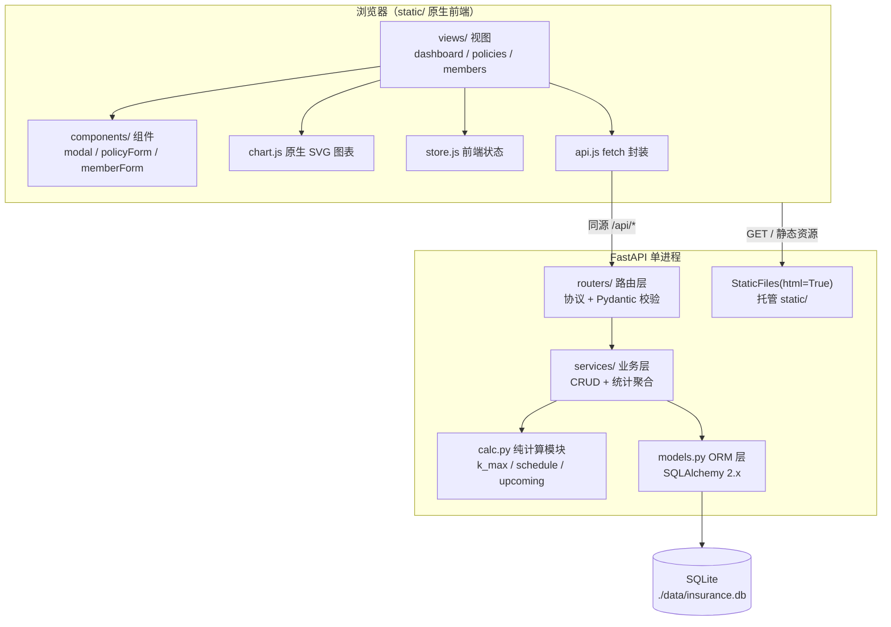
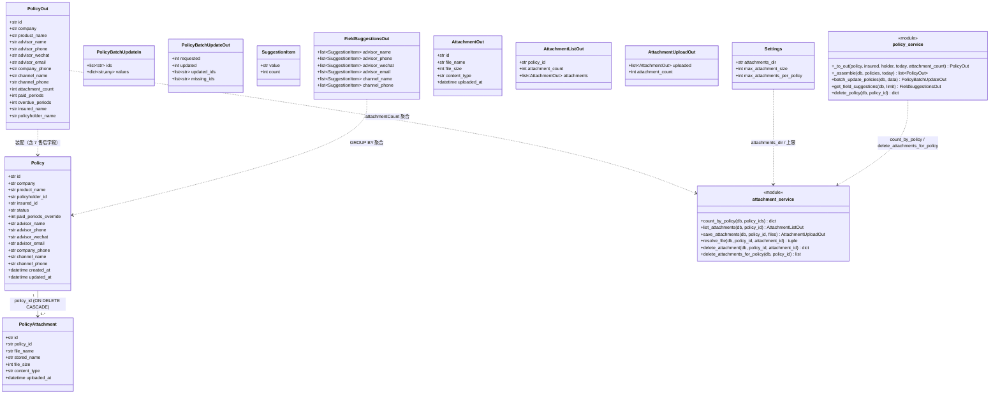
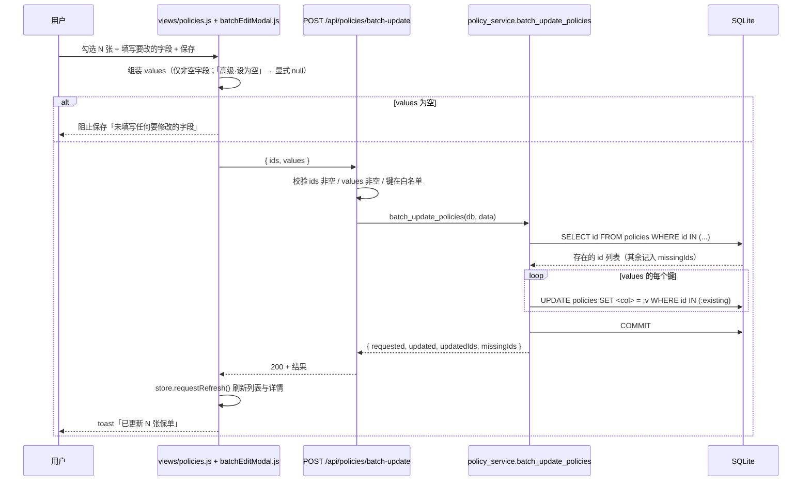
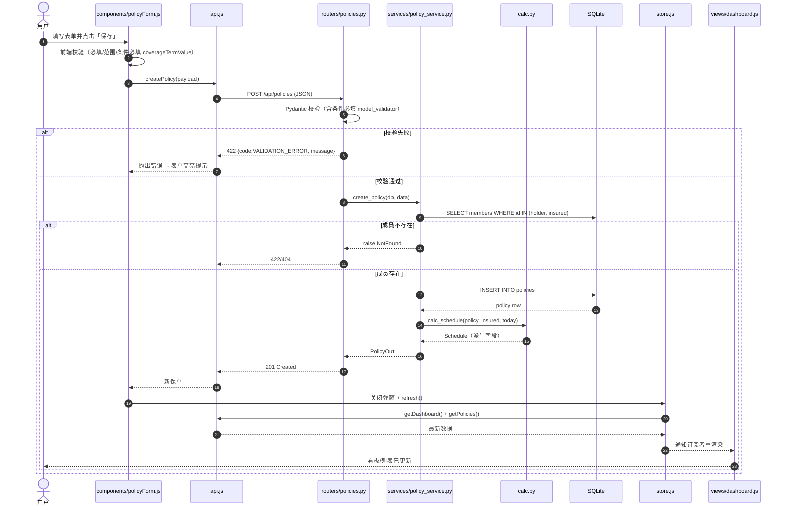
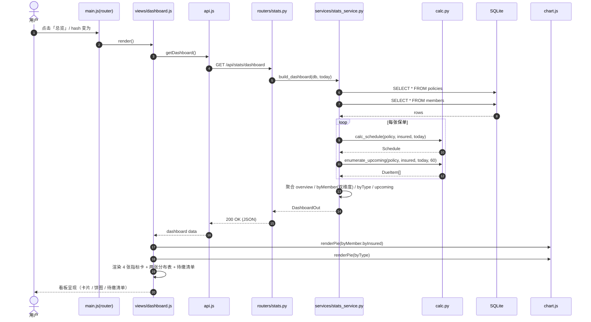
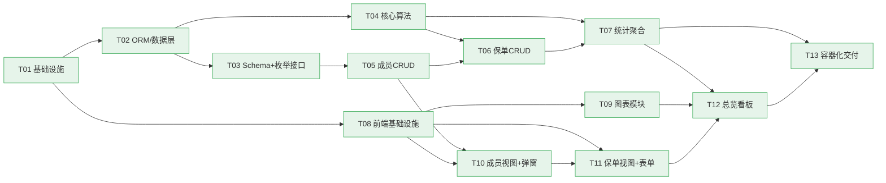

# 家庭保险整理工具 — 系统架构设计与任务分解（ARCHITECTURE.md）

| 项目 | 内容 |
|---|---|
| 文档语言 | 简体中文 |
| 上游文档 | `docs/PRD.md`（v1.2 = v1.0 + 第 8 章增量需求 + 第 9 章增量需求，产品经理 许清楚） |
| 项目代号 | `family_insurance_manager` |
| 技术栈 | Python 3.13 / FastAPI + SQLAlchemy 2.x + Pydantic v2 + SQLite；前端原生 HTML + ES Module + 原生 CSS（**无构建步骤**） |
| 架构模式 | 后端「分层架构（Router → Service → ORM）」+ 前端「单页多视图（hash 路由）」，由 FastAPI `StaticFiles` 托管前端 |
| 版本 | v1.3（应用版本号 `1.2.0`） |
| 作者 | 架构师 高见远 |

---

## 修订记录

### v1.3（本次修订，依据 `docs/PRD.md` 第 9 章「v1.2 增量需求」：保单售后信息 · 批量编辑 · 电子保单 PDF 导入）

> 说明：本架构文档的修订计数已到 v1.2（= PRD 第 8 章「缴费记录与逾期」），故本次增量在**本文件**中记为 **v1.3**；而**产品/应用版本号**按 PRD 口径取 **1.2.0**（`app/__init__.py`）。详见第 6 章。

| # | 修订项 | 位置 | 内容 | 影响 |
|---|---|---|---|---|
| 1 | **`policies` 新增 7 个售后信息可空列** | 6.2 | `advisor_name` / `advisor_phone` / `advisor_wechat` / `advisor_email` / `company_phone` / `channel_name` / `channel_phone`，全部 `VARCHAR` 可空 | 支持 R-28（售后信息录入） |
| 2 | **新增表 `policy_attachments`** | 6.2 | 附件记录表；FK `policies.id` **ON DELETE CASCADE**；`stored_name` 唯一 | 支持 R-34 ~ R-37 |
| 3 | **新增批量编辑接口** | 6.3 | `POST /api/policies/batch-update`；`values` 三态语义（键缺失=不改 / string=设值 / `null`=清空） | 支持 R-32 / R-33 |
| 4 | **新增常用值聚合接口** | 6.3 | `GET /api/policies/suggestions`；6 个字段一次返回，按出现次数降序 | 支持 R-29 |
| 5 | **新增附件接口** | 6.3 | 上传 / 列表 / 查看下载 / 删除；**服务端生成落盘名** + **magic bytes 校验** + **流式限流** | 支持 R-34 ~ R-36 |
| 6 | **`PolicyOut` 扩展** | 6.3 | 新增 7 个售后字段 + `attachmentCount`（聚合得到，**不返回附件明细**） | R-30 / R-37 |
| 7 | **`DELETE /api/policies/{id}` 级联** | 6.3 / 6.5 | 连带删除附件记录（CASCADE）+ 磁盘文件（best-effort），响应新增 `deletedAttachments` | R-32 / B-22 |
| 8 | **附件目录配置 + `lifespan`** | 6.2 / 6.9 | `settings.attachments_dir`（默认 `./data/attachments`），启动时确保目录存在 | B-23 / Docker 卷 |
| 9 | **新增依赖** | 6.8 | `python-multipart==0.0.20`（纯 Python，无编译依赖） | `UploadFile` / `File()` |
| 10 | **应用版本号** | 6.9 | `app/__init__.py` `__version__` → `"1.2.0"` | `/api/health` |
| 11 | **P2 延后** | 6.1 | PDF 自动识别预填（R-38）本次不实现，仅预留扩展点 | 与决策 Q11 一致 |

### v1.2（本次修订，增量需求：缴费记录与逾期）

| # | 修订项 | 位置 | 内容 | 影响 |
|---|---|---|---|---|
| 1 | **新增 `policies.paid_periods_override` 可空列** | 3.3 / 5.7 | `INTEGER`，`NULL` = 按生效日自动推算（默认，兼容既有数据）；非 `NULL` = 以用户手动记录为准 | 支持「已缴几期 / 当年是否已缴」录入 |
| 2 | **派生量拆为「应缴 / 已缴 / 逾期」双路径** | 5.7 | 新增 `expectedPeriodsToDate`（纯按时间推算）、`overduePeriods = max(0, expected − paid)`；`paidPeriods` 手动优先 | 漏缴（手动记录少于应缴）得以显式暴露 |
| 3 | **新增 `POST /api/policies/{id}/pay-next`** | 5.7 | 把「最早未缴期次」标记为已缴（写 `paid_periods_override = paid + 1`）；逾期优先补缴最早一期；已缴清 → 422 | 看板待缴清单「已缴」按钮的后端契约 |
| 4 | **`enumerate_upcoming` 起点改为 `max(paid_periods, k_max + 1)`** | 5.7 | 提前缴时从 `paid_periods` 起算，避免把已缴期次误列为待缴 | 修正提前缴场景的待缴清单 |
| 5 | **看板新增 `overdue` 清单与 `overview.overduePolicyCount`** | 5.7 | 仅纳入状态为「生效中 / 已缴清」且 `overduePeriods > 0` 的保单，按 `(earliestDueDate, policyId)` 升序 | 逾期未缴单独成区并顶部警示 |
| 6 | **轻量增量迁移** | 5.7 | 启动时 `PRAGMA` 检查 + `ALTER TABLE ... ADD COLUMN`（幂等，失败不阻塞） | 既有数据库无需手工迁移 |

> **向后兼容保证**：`paid_periods_override` 为 `NULL` 时，`paidPeriods` / `cumulativePaid` / `nextDueDate` / `isPaidOff` / `progressPercent` 与 v1.1 旧公式**逐值相同**。

### v1.1（本次修订，依据 QA 独立验证结论 + team-lead 裁定）

| # | 修订项 | 位置 | 内容 | 影响 |
|---|---|---|---|---|
| 1 | **`k_max` 重定义** | 5.2 | 改为由 `due(k) = add_months(effective, k×period_months)` **反推**：`k_max = max{ k≥0 : due(k) < today }`，`effective >= today` 时取 -1。**不再使用纯日历算术**（原公式与月末钳制不可调和） | 修正 2 类边界误算（月末生效漏算、精确周年日多算一期） |
| 2 | **「缴费日 = 今天」口径裁定** | 5.2 / 5.3 / 5.4 | 采用 **PRD 闭区间口径**：缴费日恰好等于今天的期次**计入待缴、不计为已缴**。`k_max` 用**严格小于**，故 `due(k_max+1)` 可能**恰好等于今天**（待缴清单第一期）；`next_due_date` 允许等于今天；趸交分支同步改为严格比较 | 消除 5.2/5.4 规格冲突 |
| 3 | **`insuredPersonCount` 口径修正** | 5.5 | 增加状态过滤 `AND p.status IN ('生效中','已缴清')` | 修正「已退保但终身保障」保单被误计入在保人数 |
| 4 | **新增「算例集 C — 边界」** | 5.6 | 收录 5 条边界用例（含期望值）；并确认算例集 A/B 数值不受本次修订影响 | 为 QA 提供边界基准 |

> **作废声明**：v1.0 第 5.2 节的「日历差值 + `today.day < effective.day`」`k_max` 公式、第 5.4 节「`k ≤ k_max` 视为已缴（故缴费日 = 今天不计入）」的口径、以及第 5.5 节未加状态过滤的 `insuredPersonCount` 定义，**自 v1.1 起全部作废**，以本版为准。

### v1.0

初始版本（系统架构设计 + 任务分解）。v1.0 → v1.1 期间另有一处文档笔误修正（5.6 算例集 A `byInsured 张三` 行漏算保单 D），已在 v1.1 前修正。

---

## 0. 关键设计决策（与 PRD 的差异说明，必读）

本节的 4 条决策**覆盖/修正**了 PRD 中的对应内容，是后续所有设计的基准，工程师必须以此为准。

### 0.1 覆盖 PRD 第 7 节 Q4：放弃浏览器本地持久化，一步到位采用「后端 + SQLite」

| 项 | 内容 |
|---|---|
| PRD 原假设 | Q4：P0 用 IndexedDB / localStorage，Docker 阶段再引入后端 |
| **本设计决策** | **作废该假设。P0 即采用「FastAPI 后端 + SQLite」** |
| 理由 | 用户明确要求后期 Docker 部署。若先做纯前端本地存储，Docker 阶段必须重写整个数据层并做数据迁移，属于纯返工；且本地存储无法被 Docker 容器内的服务端复用 |
| 落地方式 | 「本地网页测试」= 本机启动后端服务 + 浏览器访问 `http://127.0.0.1:8000`；Docker 阶段**仅把同一套代码容器化**，数据模型与 API 接口**零改动** |

### 0.2 技术栈硬约束

- **后端**：Python 3.12+（实测 3.13.14）/ FastAPI + SQLAlchemy 2.x + Pydantic v2 + SQLite，ASGI 服务器 uvicorn。
- **前端**：**无构建步骤**——禁止 Vite / npm / webpack / React 编译链 / TypeScript。使用原生 HTML + `<script type="module">` 原生 ES Module + 原生 CSS，由 FastAPI `StaticFiles` 托管。
- **禁止 CDN 外部依赖**：所有 JS/CSS/图标/字体随项目本地化（本项目图标使用内联 SVG），保证 Docker 容器内网离线可用。

### 0.3 图表方案：原生 SVG 自绘（零依赖）

| 方案 | 结论 |
|---|---|
| **✅ 采用** | **原生 SVG 自绘饼图 + 柱状图**（`static/js/chart.js`，约 150 行纯函数） |
| 理由 | ① 零第三方依赖，镜像体积最小；② 完全离线可用，无 CDN 风险；③ 本项目图表形态固定（2 个饼图），自绘成本低、可控性高 |
| 放弃 | Chart.js / ECharts（本地 vendored 后体积 200KB~1MB，对 2 个饼图属过度设计） |

### 0.4 修正 PRD 第 5.0 节 `k_max` 边界缺陷（重要）

| 项 | 内容 |
|---|---|
| PRD 原文 | `已到期期数 = min(k_max + 1, 总缴费期数)`，同时说「若 k_max 为负（生效日在未来）则取 0 处理」 |
| 缺陷 | 两条组合后，**保单生效日在未来时会算出「已缴 1 期」**（`min(0+1, N) = 1`），与业务事实矛盾 |
| **修正方案** | 保单 `effectiveDate > today` 时，令 **`k_max = -1`**，则 `已到期期数 = max(0, min(k_max + 1, 总缴费期数)) = 0` |
| 适用范围 | 本文档第 5 节算法、后端 `app/calc.py`、QA 验收算例（见 5.4 算例集 B） |

### 0.5 金额精度决策（PRD 未定，本设计定稿）

| 层 | 表示 | 说明 |
|---|---|---|
| 数据库 | **整数「分」**（`INTEGER`） | 通过 `Money` TypeDecorator 自动 Decimal ⇄ 分 转换，杜绝 SQLite 浮点误差 |
| 后端计算 | `decimal.Decimal` | 全程 Decimal 运算，四舍五入 `ROUND_HALF_UP` |
| API 请求 JSON | number 或 string（如 `500.00`） | Pydantic `Decimal` 字段两者皆可解析 |
| API 响应 JSON | **number** | 已实测 Pydantic v2 默认把 `Decimal` 序列化为**字符串**（`"500.00"`），故**必须**在响应 Schema 上加 `@field_serializer` 输出 `float`，保证前端拿到 number |

---

## 1. 实现方案概述与选型理由

### 1.1 整体架构（一段话）

本项目是一个**单进程、单仓库、前后端同源**的应用：Python **FastAPI** 应用同时承担两件事——① 在 `/api/*` 下提供 REST JSON 接口（`Router` 层负责协议与校验 → `Service` 层负责业务与统计 → `SQLAlchemy ORM` 层负责持久化，数据落到**单文件 SQLite**）；② 通过 `StaticFiles(html=True)` 把 `static/` 目录挂载到根路径，直接托管**无构建**的原生 HTML/ES Module/CSS 前端。前端是**单页多视图（SPA）**，用 `hash` 路由在「总览 / 保单列表 / 家庭成员」三个视图间切换，所有数据都通过 `fetch` 调用同源 `/api` 接口获得。**进程模型**：本地开发用 `uvicorn app.main:app` 起一个进程；Docker 阶段用同一命令在容器内起一个进程，SQLite 文件通过 volume 挂载到宿主机持久化。

### 1.2 为什么满足「本地跑通 + 一条命令转 Docker」

| 目标 | 实现方式 |
|---|---|
| 本地跑通 | `start.bat` / `start.sh` 一键完成「建 venv → 装依赖 → 起 uvicorn → 浏览器访问」，无需任何前端构建工具 |
| 一条命令转 Docker | 因为**前后端同源、无构建产物、无外部 CDN**，`Dockerfile` 只需 `pip install` + `COPY` + `uvicorn` 三步；`docker compose up` 即完成部署。数据模型与 API 与本地**完全一致**，零迁移 |
| 数据持久化 | SQLite 路径由环境变量 `DB_PATH` 控制，默认 `./data/insurance.db`；Compose 把 `./data` 挂载为 volume |
| 可测试 | `calc.py` 是**无副作用纯函数模块**，可脱离 FastAPI/DB 独立单测；Service 层可用内存 SQLite 单测；API 层可用 `TestClient` 端到端测试 |

### 1.3 分层与职责



---

## 2. 项目目录结构

> 全部为**相对项目根目录**的路径。一句话职责见每行右侧。

```
保险整理工具/
├── app/                              # 后端应用包
│   ├── __init__.py                   # 包标识，暴露 __version__
│   ├── main.py                       # FastAPI 应用入口：注册路由、CORS(无需)、挂载 StaticFiles、启动建表
│   ├── config.py                     # 配置：DB_PATH / PORT / 静态目录 / 应用版本（读取环境变量）
│   ├── database.py                   # SQLAlchemy engine / SessionLocal / Base / get_db 依赖 / 启用 PRAGMA foreign_keys
│   ├── types.py                      # 自定义 Money 类型（Decimal ⇄ 整数分 TypeDecorator）
│   ├── enums.py                      # 全部业务枚举（Python Enum，值存中文字符串）
│   ├── models.py                     # ORM 模型：Member / Policy（表、字段、外键、索引、约束）
│   ├── schemas.py                    # Pydantic v2 Schema：请求/响应模型 + 派生字段 + 金额 field_serializer
│   ├── deps.py                       # 依赖注入辅助（get_db 再导出、公共查询参数）
│   ├── calc.py                       # 【核心】纯计算：k_max / calc_schedule / enumerate_upcoming / 年龄与日期工具
│   ├── services/                     # 业务层
│   │   ├── __init__.py
│   │   ├── member_service.py         # 成员 CRUD 业务逻辑（含"本人"唯一、被引用禁止删除）
│   │   ├── policy_service.py         # 保单 CRUD 业务逻辑（含筛选/搜索、派生字段装配）
│   │   └── stats_service.py          # 统计聚合（overview / byMember 双维度 / byType / upcoming）
│   └── routers/                      # 路由层
│       ├── __init__.py
│       ├── meta.py                   # GET /api/health、GET /api/meta/enums
│       ├── members.py                # /api/members CRUD
│       ├── policies.py               # /api/policies CRUD + 筛选搜索
│       └── stats.py                  # /api/stats/dashboard
├── static/                           # 前端静态资源（无构建，直接托管）
│   ├── index.html                    # 唯一 HTML 入口：骨架 + 三个视图容器 + <script type="module" src="js/main.js">
│   ├── favicon.svg                   # 内联式本地图标（无 CDN）
│   ├── css/
│   │   └── styles.css                # 全局样式：布局、卡片、表格、表单、弹窗、进度条、响应式
│   └── js/
│       ├── main.js                   # 入口：初始化、hash 路由、视图切换、全局事件绑定
│       ├── api.js                    # fetch 封装：baseURL=/api、统一错误处理、各接口函数
│       ├── store.js                  # 轻量状态：缓存 members/enums/dashboard，提供订阅与刷新
│       ├── format.js                 # 格式化：金额(¥)、日期、期次、百分比
│       ├── chart.js                  # 原生 SVG 饼图/柱状图绘制（零依赖）
│       ├── views/
│       │   ├── dashboard.js          # 总览看板视图：指标卡 + 分布图 + 近60天待缴清单
│       │   ├── policies.js           # 保单列表视图：筛选/搜索/汇总/行内操作
│       │   └── members.js            # 家庭成员视图：列表 + 成员统计
│       └── components/
│           ├── modal.js              # 通用弹窗容器（打开/关闭/确认）
│           ├── policyForm.js         # 保单新增/编辑表单（含实时预览总期数与年化保费）
│           └── memberForm.js         # 成员新增/编辑表单
├── tests/                            # 后端测试
│   ├── __init__.py
│   ├── conftest.py                   # 测试夹具：内存 SQLite、TestClient、示例数据
│   ├── test_calc.py                  # 【重点】算法单测：k_max 修正、schedule、upcoming、2 组算例
│   ├── test_members_api.py           # 成员接口测试（含 409 场景）
│   ├── test_policies_api.py          # 保单接口测试（含筛选/搜索/校验）
│   └── test_stats_api.py             # 统计接口测试（数值与算例一致）
├── data/                             # SQLite 数据目录（运行时生成）
│   └── .gitkeep                      # 占位，保证目录被版本控制与 Docker 挂载
├── docs/                             # 文档
│   ├── PRD.md                        # 产品需求文档（上游）
│   ├── ARCHITECTURE.md               # 本文档
│   ├── class-diagram.mermaid         # 类图（单独文件）
│   └── sequence-diagram.mermaid      # 时序图（单独文件）
├── requirements.txt                  # Python 依赖（== 锁定）
├── Dockerfile                        # 单阶段镜像（python:3.12-slim）
├── docker-compose.yml                # 服务编排 + SQLite 数据卷持久化
├── .dockerignore                     # 镜像构建排除（venv/data/docs/tests 等）
├── .gitignore                        # 忽略 venv/data/__pycache__ 等
├── start.bat                         # Windows 一键启动脚本
├── start.sh                          # 类 Unix 一键启动脚本
└── README.md                         # 使用说明（本地启动 + Docker 启动）
```

---

## 3. 数据模型设计

### 3.1 枚举定义（`app/enums.py`）

**表达方式**：后端用 `class Xxx(str, Enum)` 定义，**枚举值（value）即中文字符串**；数据库列使用 SQLAlchemy `Enum(Xxx, native_enum=False, length=...)`，即存 `VARCHAR`（**不用 SQLite 原生 enum**，便于迁移与可读）。Pydantic 直接复用同一 Enum 做校验。

> ⚠️ **勘误（2026-09-18 核实）**：本文档此前写作「存 `VARCHAR` + `CHECK` 约束」，**这是不准确的**。
> SQLAlchemy 2.x 的 `Enum(native_enum=False)` 的 `create_constraint` **默认为 `False`**，
> 因此**不会生成 CHECK 约束**。已做两项核实：
>
> ① 真实库 `data/insurance.db` 的建表语句：`insurance_type VARCHAR(8) NOT NULL,`（无 CHECK）
>
> ② 用本项目完全相同的写法实测生成的 DDL（SQLAlchemy 2.0.54）：
>
> ```
> -- 默认写法（= 本项目当前用法）
> CREATE TABLE probe ( insurance_type VARCHAR(8) NOT NULL )          -- 无 CHECK
>
> -- 显式 create_constraint=True 才会生成：
> CREATE TABLE probe ( insurance_type VARCHAR(8) NOT NULL,
>     CONSTRAINT insurancetype CHECK (insurance_type IN ('重疾险', ..., '其他')) )
> ```
>
> **实际影响**：新增枚举值（如 v1.3 的「分红险」）**不需要任何表结构迁移**，只改 `app/enums.py` 即可。
> 枚举的取值合法性由 **Python 侧**（SQLAlchemy `Enum` 类型 + Pydantic）保证，数据库侧不做约束。
> 若日后确实需要库级约束，必须显式传 `create_constraint=True`，并自行处理存量表迁移（SQLite 需重建表）。

| 枚举类 | 值（存储字符串） | 列长度 |
|---|---|---|
| `InsuranceType` | 重疾险 / 医疗险 / 意外险 / 寿险 / 年金险 / 教育金 / 车险 / 财产险 / 其他 | 8 |
| `PolicyStatus` | 生效中 / 已缴清 / 已退保 / 已失效 | 8 |
| `CoverageTermType` | 终身 / 固定年限 / 至某年龄 | 8 |
| `PaymentTermType` | 趸交 / 固定年限 / 交至某年龄 | 10 |
| `PaymentFrequency` | 月缴 / 年缴 | 4 |
| `Relation` | 本人 / 配偶 / 子女 / 父亲 / 母亲 / 其他 | 4 |
| `Gender` | 男 / 女 / 未知 | 4 |

> 备注：`Relation` 排序权重（用于成员展示排序）另在 `calc.py`/`stats_service.py` 内定义常量字典：本人=0，配偶=1，子女=2，父亲=3，母亲=4，其他=5。

### 3.2 `members` 表

| 列名 | 类型 | 约束 | 默认值 | 索引 |
|---|---|---|---|---|
| `id` | `String(36)` | PRIMARY KEY, NOT NULL | 应用生成 `"m_" + uuid4().hex[:12]` | PK |
| `name` | `String(20)` | NOT NULL | — | — |
| `relation` | `Enum(Relation, native_enum=False, length=4)` | NOT NULL | — | — |
| `birth_date` | `Date` | NOT NULL（须 ≤ 今天，应用层校验） | — | — |
| `gender` | `Enum(Gender, native_enum=False, length=4)` | NOT NULL | `'未知'` | — |
| `remark` | `String(100)` | NULL | NULL | — |
| `created_at` | `DateTime` | NOT NULL | `datetime.now(UTC)` | — |
| `updated_at` | `DateTime` | NOT NULL | `now(UTC)`，`onupdate=now(UTC)` | — |

### 3.3 `policies` 表

| 列名 | 类型 | 约束 | 默认值 | 索引 |
|---|---|---|---|---|
| `id` | `String(36)` | PRIMARY KEY, NOT NULL | 应用生成 `"p_" + uuid4().hex[:12]` | PK |
| `company` | `String(50)` | NOT NULL | — | — |
| `insurance_type` | `Enum(InsuranceType, native_enum=False, length=8)` | NOT NULL | — | `idx_policies_type` |
| `product_name` | `String(80)` | NOT NULL | — | — |
| `policyholder_id` | `String(36)` | **FK → members.id ON DELETE RESTRICT**, NOT NULL | — | `idx_policies_holder` |
| `insured_id` | `String(36)` | **FK → members.id ON DELETE RESTRICT**, NOT NULL | — | `idx_policies_insured` |
| `effective_date` | `Date` | NOT NULL | — | — |
| `coverage_term_type` | `Enum(CoverageTermType, ..., length=8)` | NOT NULL | — | — |
| `coverage_term_value` | `Integer` | NULL；`终身` 时必须为空，其余必填 1–120 | NULL | — |
| `payment_term_type` | `Enum(PaymentTermType, ..., length=10)` | NOT NULL | — | — |
| `payment_term_value` | `Integer` | NULL；`趸交` 时必须为空，其余必填 1–120 | NULL | — |
| `payment_frequency` | `Enum(PaymentFrequency, ..., length=4)` | NOT NULL（趸交时忽略其值） | — | — |
| `premium_per_period` | `Money`（底层 `INTEGER` 分） | NOT NULL，> 0 | — | — |
| `insured_amount` | `Money`（底层 `INTEGER` 分） | NULL，≥ 0 | NULL | — |
| `status` | `Enum(PolicyStatus, ..., length=8)` | NOT NULL | `'生效中'` | `idx_policies_status` |
| `remark` | `String(200)` | NULL | NULL | — |
| `paid_periods_override` | `Integer` | NULL；手动记录的已缴期数（`NULL` = 按生效日自动推算）。非负，且「趸交 / 固定年限」下须 ≤ 总期数（应用层校验） | NULL | — |
| `created_at` | `DateTime` | NOT NULL | `now(UTC)` | — |
| `updated_at` | `DateTime` | NOT NULL | `now(UTC)`，`onupdate=now(UTC)` | — |

### 3.4 外键关系与删除行为（PRD R-05）

```
members.id  ──<  policies.policyholder_id   (1 : 0..*，投保人)
members.id  ──<  policies.insured_id        (1 : 0..*，被保人)
```

| 项 | 设计 |
|---|---|
| 数据库层 | 两个外键均设 `ondelete="RESTRICT"`；`database.py` 中为 SQLite 注册 `PRAGMA foreign_keys=ON`（SQLite 默认不启用外键，**必须显式开启**） |
| 应用层（主） | `member_service.delete_member()` 先 `SELECT COUNT(*) FROM policies WHERE policyholder_id=? OR insured_id=?`；> 0 则抛业务异常 → 路由返回 **409 `MEMBER_IN_USE`**，消息含关联保单数 N（对应 PRD「该成员关联 N 份保单，无法删除」） |
| 双保险 | 即便应用层漏判，数据库 RESTRICT 也会阻止删除并抛 `IntegrityError`，路由兜底转 409 |
| 不做级联删除 | 明确**不**使用 CASCADE，避免误删保单（符合 R-05「禁止或要求先处理」） |

### 3.5 `createdAt` / `updatedAt` 自动维护

- 采用 **Python 侧默认值**（非 DB 触发器，便于跨 SQLite/未来 PG 一致）：
  - `created_at: Mapped[datetime] = mapped_column(DateTime(timezone=True), default=lambda: datetime.now(UTC), nullable=False)`
  - `updated_at: Mapped[datetime] = mapped_column(DateTime(timezone=True), default=lambda: datetime.now(UTC), onupdate=lambda: datetime.now(UTC), nullable=False)`
- API 输出为 ISO 8601（含时区，如 `2025-05-20T10:00:00+00:00`）。前端展示时只用到日期部分。

### 3.6 金额类型 `Money`（`app/types.py`）

```python
from decimal import Decimal, ROUND_HALF_UP
from sqlalchemy import Integer
from sqlalchemy.types import TypeDecorator

class Money(TypeDecorator):
    """以整数「分」存储的金额类型，读写自动在 Decimal 与分之间转换。"""
    impl = Integer
    cache_ok = True
    EXP = Decimal("0.01")

    def process_bind_param(self, value, dialect):
        if value is None:
            return None
        return int((Decimal(str(value)).quantize(self.EXP, ROUND_HALF_UP) * 100))

    def process_result_value(self, value, dialect):
        if value is None:
            return None
        return (Decimal(value) / 100).quantize(self.EXP, ROUND_HALF_UP)
```

---

## 4. API 接口定义

### 4.1 统一约定

- **baseURL**：前端同源，`api.js` 中 `const BASE = '/api'`。
- **成功响应**：直接返回资源对象/数组（不额外包 `code/data` 外壳，保持 REST 简洁）。
- **错误响应统一格式**（所有 4xx/5xx）：

```json
{
  "code": "MEMBER_IN_USE",
  "message": "该成员关联 2 份保单，无法删除",
  "detail": { "memberId": "m_001", "policyCount": 2 }
}
```

| 错误码 | HTTP | 场景 |
|---|---|---|
| `VALIDATION_ERROR` | 422 | Pydantic 校验失败 / 业务条件必填缺失 |
| `NOT_FOUND` | 404 | 资源 id 不存在 |
| `MEMBER_IN_USE` | 409 | 删除被保单引用的成员 |
| `DUPLICATE_PRIMARY_MEMBER` | 409 | 新增/编辑第二个「本人」 |
| `INTERNAL_ERROR` | 500 | 兜底 |

### 4.2 元数据与健康检查（`routers/meta.py`）

| 方法 | 路径 | 说明 | 响应 |
|---|---|---|---|
| GET | `/api/health` | Docker `HEALTHCHECK` 用 | `{"status":"ok","db":"ok","version":"1.0.0","time":"..."}`；DB 异常时 `status:"degraded"` + 503 |
| GET | `/api/meta/enums` | 前端下拉框字典（一次取全） | `{"insuranceType":["重疾险",...],"policyStatus":[...],"coverageTermType":[...],"paymentTermType":[...],"paymentFrequency":[...],"relation":[...],"gender":[...]}` |

### 4.3 家庭成员（`routers/members.py`）

| 方法 | 路径 | 请求体 | 响应 | 状态码 / 错误 |
|---|---|---|---|---|
| GET | `/api/members` | — | `MemberOut[]`（**含派生字段** `policyCount`、`activePolicyCount`、`annualPremium`）按 `relation` 权重排序 | 200 |
| POST | `/api/members` | `MemberCreate` | `MemberOut` | 201；422；409 `DUPLICATE_PRIMARY_MEMBER` |
| PUT | `/api/members/{id}` | `MemberUpdate` | `MemberOut` | 200；404；422；409（改成第二个「本人」） |
| DELETE | `/api/members/{id}` | — | `{"deleted": true, "id": "..."}` | 200；404；**409 `MEMBER_IN_USE`** |

**`MemberCreate` / `MemberUpdate` 字段**：

| 字段 | 类型 | 必填 | 校验 |
|---|---|---|---|
| `name` | string | 是 | 1–20 字 |
| `relation` | enum | 是 | Relation 之一；「本人」全局唯一 |
| `birthDate` | date | 是 | `YYYY-MM-DD`，≤ 今天 |
| `gender` | enum | 否 | 默认 `未知` |
| `remark` | string | 否 | ≤ 100 字 |

**`MemberOut` 附加派生字段**：`policyCount`(int)、`activePolicyCount`(int)、`annualPremium`(number, 口径同 5.1)。

### 4.4 保单（`routers/policies.py`）

| 方法 | 路径 | 请求/查询 | 响应 | 状态码 / 错误 |
|---|---|---|---|---|
| GET | `/api/policies` | 查询参数（见下） | `PolicyOut[]`（含全部派生字段） | 200 |
| POST | `/api/policies` | `PolicyCreate` | `PolicyOut` | 201；422（含投保人/被保人不存在） |
| GET | `/api/policies/{id}` | — | `PolicyOut` | 200；404 |
| PUT | `/api/policies/{id}` | `PolicyUpdate` | `PolicyOut` | 200；404；422 |
| DELETE | `/api/policies/{id}` | — | `{"deleted": true, "id": "..."}` | 200；404 |

**GET `/api/policies` 查询参数**（全部可选，组合 AND）：

| 参数 | 类型 | 说明 |
|---|---|---|
| `insuredId` | string | 按被保人筛选 |
| `policyholderId` | string | 按投保人筛选 |
| `insuranceType` | enum | 按险种筛选 |
| `status` | enum | 按状态筛选 |
| `paymentFrequency` | enum | 按缴费方式筛选 |
| `keyword` | string | 关键词，模糊匹配 `company` / `productName`（大小写不敏感，`LIKE %kw%`） |
| `sort` | string | 默认 `effectiveDate,desc`（可选 `premiumPerPeriod`、`createdAt`） |

**`PolicyCreate` / `PolicyUpdate` 字段**（与 PRD 4.1 一致）：

| 字段 | 类型 | 必填 | 校验 |
|---|---|---|---|
| `company` | string | 是 | 1–50 字 |
| `insuranceType` | enum | 是 | InsuranceType 之一 |
| `productName` | string | 是 | 1–80 字 |
| `policyholderId` | string | 是 | 必须存在于 `members` |
| `insuredId` | string | 是 | 必须存在于 `members` |
| `effectiveDate` | date | 是 | `YYYY-MM-DD` |
| `coverageTermType` | enum | 是 | 终身 / 固定年限 / 至某年龄 |
| `coverageTermValue` | int\|null | 条件必填 | `固定年限`→1–100；`至某年龄`→1–120；`终身`→必须为 null |
| `paymentTermType` | enum | 是 | 趸交 / 固定年限 / 交至某年龄 |
| `paymentTermValue` | int\|null | 条件必填 | `固定年限`→1–100；`交至某年龄`→1–120；`趸交`→必须为 null |
| `paymentFrequency` | enum | 是 | 月缴 / 年缴 |
| `premiumPerPeriod` | number | 是 | > 0，2 位小数 |
| `insuredAmount` | number\|null | 否 | ≥ 0，2 位小数 |
| `status` | enum | 否 | 默认 `生效中` |
| `remark` | string\|null | 否 | ≤ 200 字 |

> 条件必填用 Pydantic `@model_validator(mode="after")` 实现，违反返回 422 `VALIDATION_ERROR`。

**`PolicyOut` 派生字段**（实时计算，不落库）：`annualizedPremium`、`totalPeriods`、`paidPeriods`、`cumulativePaid`、`remainingPeriods`、`isPaidOff`、`progressPercent`、`inCoverage`、`nextDueDate`、`insuredName`、`policyholderName`。

### 4.5 统计（`routers/stats.py`）

**设计决策：看板数据用「一次请求返回全部」的单一接口**，理由：① 看板是一个原子视图，用户一次进入即需全部数据，单请求可避免 4~5 次往返与前端拼装时序问题；② 数据量小（家庭保单通常几十条），一次聚合成本极低；③ 便于保证「待缴清单合计」与「待缴卡片」口径**同源**、绝对一致。

| 方法 | 路径 | 查询参数 | 说明 |
|---|---|---|---|
| GET | `/api/stats/dashboard` | `today`（可选，`YYYY-MM-DD`，默认服务端当天；用于测试与复现） | 返回看板全部数据 |

**响应结构**：

```json
{
  "asOfDate": "2025-05-20",
  "overview": {
    "annualTotalPremium": 17000.00,
    "upcoming60Premium": 4000.00,
    "upcoming60Count": 3,
    "policyTotal": 4,
    "activePolicyCount": 3,
    "insuredPersonCount": 3
  },
  "byMember": {
    "byInsured": [
      {"memberId":"m_001","name":"张三","relation":"本人","policyCount":2,
       "activePolicyCount":1,"annualPremium":6000.00,
       "upcoming60Premium":1000.00,"paidToDatePremium":81500.00}
    ],
    "byPolicyholder": [ /* 同结构，按投保人分组 */ ]
  },
  "byType": [
    {"insuranceType":"医疗险","policyCount":1,"annualPremium":8000.00,
     "upcoming60Premium":0.00,"paidToDatePremium":32000.00}
  ],
  "upcoming": [
    {"policyId":"p_xxx","company":"平安","productName":"综合意外",
     "insuredId":"m_003","insuredName":"小张","premiumPerPeriod":3000.00,
     "dueDate":"2025-06-01","periodIndex":2,"totalPeriods":20}
  ]
}
```

> 另提供便捷接口 `GET /api/stats/upcoming?days=60`（可选实现，P1），返回与 `upcoming` 相同结构，供未来「缴费日历/提醒」复用。P0 前端只调 `dashboard`。

### 4.6 前端静态页面路由

| 路径 | 处理方式 |
|---|---|
| `/` | `StaticFiles(directory="static", html=True)` 自动返回 `static/index.html` |
| `/css/*`、`/js/*`、`/favicon.svg` | 同上，静态托管 |
| 视图切换 | **前端 hash 路由**（`#/dashboard`、`#/policies`、`#/members`），**不产生服务端请求**，因此无需 SPA 通配回退 |
| 未匹配的 `/api/*` | FastAPI 返回 404（静态挂载在 `/api` 路由之后注册，不会吞掉 API） |

---

## 5. 核心业务算法设计（重点）

> 所有算法实现于 `app/calc.py`（纯函数，无 IO）。约定：`today` 为**仅取年月日的 `date`**；`每年期数 = 月缴 ? 12 : 1`；所有金额用 `Decimal`，舍入 `ROUND_HALF_UP`。

### 5.1 工具函数

```
FUNCTION age_years(birth: date, on: date) -> int:
    # 返回 on 时点的「已满周岁」
    years = on.year - birth.year
    IF (on.month, on.day) < (birth.month, birth.day): years -= 1
    RETURN years

FUNCTION add_years(d: date, n: int) -> date:
    # 加 n 年，2/29 溢出时回退到 2/28
    TRY: RETURN date(d.year + n, d.month, d.day)
    EXCEPT ValueError: RETURN date(d.year + n, d.month, 28)

FUNCTION money(x) -> Decimal:
    RETURN Decimal(str(x)).quantize(Decimal("0.01"), ROUND_HALF_UP)

FUNCTION pct(num, den) -> Decimal:          # 百分比，1 位小数
    IF den == 0: RETURN Decimal("100.0")
    RETURN (Decimal(num) / Decimal(den) * 100).quantize(Decimal("0.1"), ROUND_HALF_UP)
```

### 5.2 `k_max` 计算（唯一真源：由 `due(k)` 反推）★ v1.1 重定义

> **★ 铁律**：`k_max` **必须与 `add_months` 的月末钳制行为保持一致，不得再用纯日历算术**。v1.0 的「日历差值 + `today.day < effective.day`」公式已作废——它在「月末生效」与「精确周年日」两类场景会误算（见 5.6 算例集 C）。

```
FUNCTION due(effective: date, k: int, freq: str) -> date:
    # 第 k 期缴费日；add_months 对月末做钳制（如 01-31 加 1 月 → 02-29 / 02-28）
    period_months = 1 IF freq == "月缴" ELSE 12
    RETURN add_months(effective, k * period_months)

FUNCTION compute_k_max(effective: date, freq: str, today: date) -> int:
    # 定义（唯一真源）：k_max = max{ k >= 0 : due(k) < today }     —— 严格小于
    #                    = -1  若 effective >= today
    IF effective >= today:                     # ★ 0.4 修正：生效日在今天或未来 → 尚无任何已缴期次
        RETURN -1

    # 实现：日历公式仅作「估算起点」（用于加速），再用有界修正循环对齐到 due()
    est = 日历估算(effective, freq, today)
    guard = 0
    WHILE due(effective, est + 1, freq) < today AND guard < 24:
        est += 1; guard += 1                   # 向上对齐
    guard = 0
    WHILE est >= 0 AND due(effective, est, freq) >= today AND guard < 24:
        est -= 1; guard += 1                   # 向下对齐
    RETURN est
```

日历估算（**仅作起点，非真源；必须经上面的修正循环收敛**）：
- 月缴：`est = (today.year − effective.year) × 12 + (today.month − effective.month)`
- 年缴：`est = today.year − effective.year`

> **不变式**（由定义直接得到）：`due(k_max) < today ≤ due(k_max + 1)`。注意 `due(k_max + 1)` **可能恰好等于 `today`**——按 v1.1 口径，缴费日 = 今天的期次**计入待缴、不计为已缴**（见 5.4）。

> **实现提示（可选优化）**：两个修正循环均为**单调收敛**——`k_max` 必落在估算起点附近（`k_max ∈ {est₀−1, est₀}`），每轮 `est` 朝目标单向移动，故数学上**必然终止**（通常迭代 1~2 次）。伪代码中的 `guard < 24` 仅为**防御性兜底**，实现**可省略**（工程师实现即采用无 guard 的 while，结果一致）。照文档实现时**不必**把 `guard` 视为必需项。

### 5.3 `calc_schedule(policy, insured_member, today)` → `Schedule`

```
FUNCTION calc_schedule(policy, insured, today) -> Schedule:
    freq       = policy.payment_frequency        # 月缴 / 年缴
    per_year   = 12 IF freq == "月缴" ELSE 1
    eff        = policy.effective_date

    # ---------- 1) 年化保费 ----------
    IF policy.payment_term_type == "趸交":
        annualized = 0                            # 趸交无持续年支出
    ELIF freq == "年缴":
        annualized = policy.premium_per_period
    ELSE:                                         # 月缴
        annualized = policy.premium_per_period * 12

    # ---------- 2) 总缴费期数 ----------
    IF policy.payment_term_type == "趸交":
        total_periods = 1
    ELIF policy.payment_term_type == "固定年限":
        total_periods = policy.payment_term_value * per_year
    ELSE:                                         # 交至某年龄 A
        age_at_eff = age_years(insured.birth_date, eff)
        total_periods = max(0, policy.payment_term_value - age_at_eff) * per_year

    # ---------- 3) 已到期期数（含 k_max 修正） ----------
    IF policy.payment_term_type == "趸交":
        k_max = 0 IF eff < today ELSE -1          # ★ v1.1：严格比较（缴费日 = 今天视为待缴，不计已缴）
        paid_periods = 1 IF eff < today ELSE 0
    ELSE:
        k_max = compute_k_max(eff, freq, today)
        paid_periods = max(0, min(k_max + 1, total_periods))   # ★ 关键：max(0, ...)

    # ---------- 4) 其余派生量 ----------
    remaining     = max(0, total_periods - paid_periods)
    is_paid_off   = (remaining == 0)
    progress      = pct(paid_periods, total_periods)            # total=0 → 100.0
    cumulative    = money(paid_periods * policy.premium_per_period)

    # ---------- 5) 是否在保障期内 ----------
    IF policy.coverage_term_type == "终身":
        in_coverage = TRUE
    ELIF policy.coverage_term_type == "固定年限":
        in_coverage = today <= add_years(eff, policy.coverage_term_value)
    ELSE:  # 至某年龄 A
        in_coverage = today <= add_years(insured.birth_date, policy.coverage_term_value)

    # ---------- 6) 下次缴费日 ----------
    IF is_paid_off:
        next_due = None
    ELIF policy.payment_term_type == "趸交":
        next_due = eff
    ELSE:
        period_months = 1 IF freq == "月缴" ELSE 12
        next_due = eff + (k_max + 1) * period_months 个月      # 月加用 (year, month) 安全进位

    RETURN Schedule(
        annualized_premium = money(annualized),
        total_periods      = total_periods,
        paid_periods       = paid_periods,
        cumulative_paid    = cumulative,
        remaining_periods  = remaining,
        is_paid_off        = is_paid_off,
        progress_percent   = progress,
        in_coverage        = in_coverage,
        next_due_date      = next_due,
    )
```

### 5.4 近 60 天待缴期次枚举（闭区间）★ v1.1 口径澄清

> **裁定（以 PRD 为准）**：缴费日**恰好等于今天**的期次**计入待缴、不计为已缴**。三条落地结论：
> 1. `k_max` 用**严格小于**（`due(k) < today`，见 5.2），故 `due(k_max+1)` **可能恰好等于今天**——它就是待缴清单的第一期。
> 2. 下文的 `IF due >= today` 判断由 v1.0 的「冗余保险」升级为**必要判断**（防止漏掉今天到期的期次），**务必保留**。
> 3. `next_due_date` **允许等于今天**；待缴窗口**上界仍为闭区间** `today + 60天`（不变）。

```
FUNCTION enumerate_upcoming(policy, insured, today, window_days = 60) -> List[DueItem]:
    # 边界规则：闭区间 [today, today+60]；不含已逾期(k <= k_max)；不含已缴清保单
    IF policy.status != "生效中": RETURN []
    sched = calc_schedule(policy, insured, today)
    IF sched.is_paid_off: RETURN []

    end = today + window_days 天
    freq = policy.payment_frequency
    eff  = policy.effective_date

    items = []
    k = sched.k_max + 1                     # 下一未缴期次（由定义 due(k_max+1) >= today，可能恰好等于 today）
    guard = 0
    WHILE guard < 4:                        # 60 天窗口最多容纳 3 期（月缴），guard 兜底
        IF k >= sched.total_periods: BREAK
        due = due(eff, k, freq)             # 与 5.2 同一 due() 定义（含月末钳制），不得另用日历算术
        IF due > end: BREAK                 # 上界：闭区间 [today, today+60]
        IF due >= today:                    # ★ 必要判断：纳入 due == today 的期次（PRD 闭区间口径）
            items.append(DueItem(
                policy_id=policy.id, due_date=due, period_index=k + 1,   # 展示期次 = k+1（1 基）
                total_periods=sched.total_periods,
                amount=money(policy.premium_per_period)))
        k += 1
        guard += 1
    RETURN items
```

> **期次展示口径（消除 PRD 6.1 与 5.2 的 off-by-one）**：内部 `k` 为 **0 基**；对外展示期次统一为 **`k + 1`（1 基）**。故「已缴 63 期」= 内部 k=0..62，「下一期」内部 k=63 → 展示「第 64 期」。

### 5.5 聚合方式

```
FUNCTION build_dashboard(db, today):
    policies = SELECT * FROM policies
    members  = {m.id: m for m in SELECT * FROM members}
    schedules = {p.id: calc_schedule(p, members[p.insured_id], today) for p in policies}

    # ---- overview ----
    # ★ v1.4 双口径（一次遍历同时累加；两者均要求 schedules[p] 存在，缺失则跳过）：
    #   annual_total  = 当年应缴总保费：status ∈ {生效中, 已缴清} 的年化合计
    #                   （含已缴清保单、含「已缴完的生效中」保单；**值较 v1.3 增大**）
    #   unpaid_annual = 当年未缴费金额：status == '生效中' AND NOT is_paid_off 的年化合计
    #                   （**逐值等于 v1.3 旧「年度总保费」，口径不变**）
    annual_total  = Σ schedules[p].annualized_premium WHERE p.status IN ('生效中', '已缴清')
    unpaid_annual = Σ schedules[p].annualized_premium WHERE p.status == '生效中' AND NOT schedules[p].is_paid_off
    upcoming_all = flatMap(enumerate_upcoming(p, members[p.insured_id], today) for p in policies)
    upcoming_premium = Σ item.amount over upcoming_all
    overview = {
        annualTotalPremium : money(annual_total),     # 当年应缴总保费（含已缴清）
        unpaidAnnualPremium: money(unpaid_annual),    # 当年未缴费金额（= 旧「年度总保费」）
        upcoming60Premium  : money(upcoming_premium),
        upcoming60Count    : len(upcoming_all),
        policyTotal        : len(policies),
        activePolicyCount  : COUNT(p.status == "生效中"),
        insuredPersonCount : DISTINCT p.insured_id
                             WHERE schedules[p].in_coverage
                               AND p.status IN ('生效中', '已缴清'),   # ★ v1.1：排除 已退保/已失效
    }
    # ★ v1.1 口径说明：insuredPersonCount 必须按 status 过滤——「已缴清」保单保障仍有效、要计入；
    #   只有「已退保 / 已失效」排除（退保后不再提供任何保障，不应计入在保人数）。
    # ★ v1.4 口径不变式：
    #   ① 应缴 − 未缴 == 已缴部分 == Σ annualized WHERE status=='已缴清' OR (status=='生效中' AND is_paid_off)
    # ★ v1.6 口径变更（**重要**）：三个维度的 annualPremium **放宽为与主卡片同口径**
    #   ② Σ(byInsured.annualPremium) == annualTotalPremium（**不再是** unpaidAnnualPremium）
    #   ③ byType / byPolicyholder 的 annualPremium 同样放宽为 `status ∈ {生效中, 已缴清}`（不分摊）
    #   变更理由：原口径（生效中且未缴清）会把「1 年期已缴完」的保单算成 0——
    #   例如一张年缴 120、交 1 年、已缴完的医疗险，在「险种保费分布」里显示 ¥0，
    #   与主卡片「当年应缴总保费」对不上账，用户会以为数据丢了。
    #   ⚠️ 计数类（policyCount / activePolicyCount / insuredPersonCount）、
    #      upcoming60Premium、paidToDatePremium、upcoming[]、overdue[] **一律不变**。

    # ---- byMember（双维度，同一份数据改分组键） ----
    byInsured      = group_by(policies, key = p.insured_id)
    byPolicyholder = group_by(policies, key = p.policyholder_id)
    # 每个分组行指标：
    #   policyCount        = 组内保单数
    #   activePolicyCount  = 组内 status=="生效中" 数
    #   annualPremium      = Σ annualized WHERE status ∈ {生效中, 已缴清}   (★ v1.6 放宽，口径同主卡片)
    #   upcoming60Premium  = Σ 组内 enumerate_upcoming 金额               (口径同 5.2)
    #   paidToDatePremium  = Σ schedules[p].cumulative_paid               (口径同 5.0)
    # ★ v1.1 口径说明（避免 QA 误判）：
    #   policyCount 与 paidToDatePremium 对**全部状态**的保单生效（含 已退保/已失效，体现历史已缴金额）；
    #   而 annualPremium（v1.6 起要求 status ∈ {生效中, 已缴清}）与 upcoming60Premium（要求「生效中」）**天然排除**它们。
    # 排序：byInsured 按 relation 权重（本人0→配偶1→子女2→父亲3→母亲4→其他5），
    #       byPolicyholder 同样按该成员 relation 权重

    # ---- byType ----
    byType = group_by(policies, key = p.insurance_type)   # 指标同上；排序：annualPremium 降序
    # 说明：byType 只输出「出现过的险种」；如需展示全部 9 类含 0 值，由前端用 enums 字典补零。

    # ---- upcoming 清单 ----
    upcoming = sort(upcoming_all, by = (due_date ASC, policy_id ASC))

    RETURN Dashboard(asOfDate=today, overview, byMember={byInsured,byPolicyholder},
                     byType, upcoming)
```

### 5.6 验收算例（QA 与工程师的硬基准）

> **v1.1 影响确认**：算例集 A / B 的**全部数值经推演不受 v1.1 修订影响**——A 的 `k_max` 仍为 62 / 3 / 0（今天 `2025-05-20` 与各缴费日均不同日），B 的 E 仍为 -1、F 仍为 10；年度总保费 **17000**、待缴 **4000 / 3 笔**、算例集 B 的 **2400** 与 **0 / 0 笔** 均不变。新增「算例集 C — 边界」专门覆盖 v1.1 触及的边界场景。

> **v1.4 口径变更**：原「年度总保费」（= 生效中且未缴清）**更名为「当年未缴费金额」`unpaidAnnualPremium`，逐值不变**；新增「当年应缴总保费」`annualTotalPremium` = `status ∈ {生效中, 已缴清}` 的年化合计（含已缴清、含已缴完的生效中）。因此 A 的应缴总保费仍为 **17000.00**（唯一已缴清保单 D 为趸交、年化 0，无差异）；B 的应缴总保费变为 **14400.00**（= 旧 2400 + 已缴清的 F 年化 12000）。

> **★ v1.6 口径变更（三个维度的年化保费放宽）**：`byInsured` / `byType` / `byPolicyholder` 的 `annualPremium`
> 由「生效中**且未缴清**」**放宽为 `status ∈ {生效中, 已缴清}`**，与主卡片「当年应缴总保费」同口径。
>
> **为什么改**：旧口径会把「已缴完」的保单算成 0。一张**年缴 120、交 1 年、已缴完**的医疗险
> 在「险种保费分布」里显示 **¥0**，而主卡片却把它算进去了 → **同一份数据两个地方对不上账**，用户会以为数据丢了。
>
> **对账关系随之变更**：`Σ维度年化 == annualTotalPremium`（当年应缴总保费），**不再** `== unpaidAnnualPremium`。
>
> **不受影响**（一律不变）：`policyCount` / `activePolicyCount` / `insuredPersonCount`、
> `upcoming60Premium` / `upcoming60Count` / `upcoming[]` / `overdue[]`、`paidToDatePremium`、
> `PolicyOut.annualizedPremium`（保单自身的事实数据）。
>
> **算例影响**：A 的三个维度合计仍为 **17000.00**（D 趸交年化 0，无差异）；
> **B 的 `byInsured 王五` 由 0.00 变为 12000.00**（已缴清的 F 现计入），`byType` 首位由「寿险」变为「**年金险 12000**」，
> `Σ维度年化` 由 2400 变为 **14400.00**（= `annualTotalPremium`）。

#### 算例集 A — 复现 PRD 5.1 / 5.2（`today = 2025-05-20`）

成员：`m1 张三/本人/1988-06-01`、`m2 李四/配偶/1990-03-12`、`m3 小张/子女/2015-09-20`

| 保单 | 险种 | 投保人 | 被保人 | 生效日 | 保多久 | 交多久 | 方式 | 每期 | 状态 |
|---|---|---|---|---|---|---|---|---|---|
| A | 重疾险 | m1 | m1 | 2020-03-15 | 终身 | 固定年限 20 | 月缴 | 500 | 生效中 |
| B | 医疗险 | m1 | m2 | 2021-08-01 | 固定年限 30 | 固定年限 10 | 年缴 | 8000 | 生效中 |
| C | 意外险 | m1 | m3 | 2024-06-01 | 固定年限 1 | 固定年限 20 | 年缴 | 3000 | 生效中 |
| D | 重疾险 | m1 | m1 | 2019-01-01 | 终身 | 趸交 | 月缴(忽略) | 50000 | 已缴清 |

**逐单期望值**：

| 保单 | 年化保费 | 总期数 | k_max | 已到期 | 累计已缴 | 剩余 | 已缴清 | 进度% | 在保 | 下次缴费日 |
|---|---|---|---|---|---|---|---|---|---|---|
| A | 6000.00 | 240 | 62 | 63 | 31500.00 | 177 | false | 26.3 | true | 2025-06-15 |
| B | 8000.00 | 10 | 3 | 4 | 32000.00 | 6 | false | 40.0 | true | 2025-08-01 |
| C | 3000.00 | 20 | 0 | 1 | 3000.00 | 19 | false | 5.0 | true | 2025-06-01 |
| D | 0.00 | 1 | 0 | 1 | 50000.00 | 0 | true | 100.0 | true | — |

**聚合期望值**：

| 指标 | 期望值 | 校验点 |
|---|---|---|
| 当年未缴费金额（`unpaidAnnualPremium`） | **17000.00** | A+B+C（生效中且未缴清；D 趸交已缴清，排除） |
| 当年应缴总保费（`annualTotalPremium`） | **17000.00** | 生效中 + 已缴清：A+B+C + D（D 趸交年化 0，故与上一行相等） |
| 近 60 天待交保费 | **4000.00** | A: k=63→06-15(500) + k=64→07-15(500)；C: k=1→06-01(3000)；B 下次 08-01 超窗 |
| 待缴笔数 | **3** | 06-01(C) / 06-15(A) / 07-15(A) |
| 保单总数 | 4 | 含已缴清 |
| 生效中保单数 | 3 | A/B/C |
| 在保人数 | 3 | m1/m2/m3（去重被保人） |
| byInsured 张三 | count 2, annual 6000.00, upcoming 1000.00, paid 81500.00 | A + D（D 趸交已缴清：计入 count 与 paid，但年化 0、不产生待缴） |
| byInsured 李四 | count 1, annual 8000.00, upcoming 0.00, paid 32000.00 | — |
| byInsured 小张 | count 1, annual 3000.00, upcoming 3000.00, paid 3000.00 | — |
| Σ byInsured.annualPremium | 17000.00 | **== `annualTotalPremium`（★ v1.6 起对账的是主卡片，不再是 `unpaidAnnualPremium`）** |
| byType 排序 | 医疗险 8000 → 重疾险 6000 → 意外险 3000 | annualPremium 降序（v1.6 口径下 A 无差异，D 趸交年化 0） |
| upcoming 顺序 | 2025-06-01(小张) → 2025-06-15(张三) → 2025-07-15(张三) | dueDate 升序 |

#### 算例集 B — 验证 `k_max` 修正 + 趸交 + 交至某年龄（`today = 2025-05-20`）

成员：`m1 张三/本人/1988-06-01`、`m4 王五/父亲/1960-02-10`

| 保单 | 险种 | 投保人 | 被保人 | 生效日 | 保多久 | 交多久 | 方式 | 每期 | 状态 |
|---|---|---|---|---|---|---|---|---|---|
| E | 寿险 | m1 | m1 | **2025-08-01** | 固定年限 20 | 固定年限 10 | 月缴 | 200 | 生效中 |
| F | 年金险 | m4 | m4 | 2015-03-01 | 终身 | **交至某年龄 60** | 年缴 | 12000 | 生效中 |
| G | 重疾险 | m1 | m1 | 2019-01-01 | 终身 | 趸交 | 月缴(忽略) | 50000 | 生效中 |

**逐单期望值**：

| 保单 | 年化保费 | 总期数 | k_max | 已到期 | 累计已缴 | 剩余 | 已缴清 | 进度% | 在保 | 下次缴费日 | 说明 |
|---|---|---|---|---|---|---|---|---|---|---|---|
| E | 2400.00 | 120 | **-1** | **0** | 0.00 | 120 | false | 0.0 | true | 2025-08-01 | ★ 生效日在未来 → 已缴 0 期（**未修正会错算为 4 期**） |
| F | 12000.00 | **5** | 10 | 5 | 60000.00 | 0 | true | 100.0 | true | — | 交至 60 岁：生效时 55 岁 → 5 期，已缴清 |
| G | 0.00 | 1 | 0 | 1 | 50000.00 | 0 | true | 100.0 | true | — | 趸交，年化 0 |

> F 的 `age_at_eff = age_years(1960-02-10, 2015-03-01) = 55`（生日 02-10 已过），`total = (60-55) × 1 = 5`。

**聚合期望值**：

| 指标 | 期望值 |
|---|---|
| 当年未缴费金额（`unpaidAnnualPremium`） | **2400.00**（仅 E；F/G 已缴清排除） |
| 当年应缴总保费（`annualTotalPremium`） | **14400.00**（E 2400 + F 12000 + G 0；F 为「已缴清的生效中」保单） |
| 近 60 天待交保费 / 笔数 | **0.00 / 0**（E 下次 08-01 超窗，F/G 已缴清） |
| 保单总数 / 生效中 / 在保人数 | 3 / 3 / 2（m1, m4） |
| byInsured 张三 | count 2, annual 2400.00, upcoming 0.00, paid 50000.00（E+G；G 趸交年化 0） |
| byInsured 王五 | count 1, annual **12000.00**（★ v1.6：F 虽已缴清，但年化口径已放宽为含已缴清）, upcoming 0.00, paid 60000.00 |
| byType 排序 | **年金险 12000** → 寿险 2400 → 重疾险 0（★ v1.6：首位由「寿险」变为「年金险」） |
| Σ byInsured.annualPremium | **14400.00 == `annualTotalPremium`**（★ v1.6；旧口径下为 2400 == `unpaidAnnualPremium`） |

#### 算例集 C — 边界（验证 v1.1 的 `k_max` 重定义 + 闭区间口径）

> 假设各保单 `total_periods` 足够大（如「固定年限 20 年」：月缴 = 240 期、年缴 = 20 期），故 `paid = min(k_max + 1, total) = k_max + 1`。以下 5 条覆盖月末钳制、精确周年日、缴费日=今天、生效日=今天四类边界。

| # | 生效日 | 频率 | today | `k_max` | `paid` | `nextDueDate` | 验证点 |
|---|---|---|---|---|---|---|---|
| C1 | 2020-01-31 | 月缴 | 2020-04-30 | 2 | 3 | **2020-04-30** | 月末钳制（01-31→02-29→03-31→04-30）；缴费日 = 今天 → 计入待缴（清单第一期） |
| C2 | 2020-01-31 | 月缴 | 2020-02-29 | 0 | 1 | **2020-02-29** | 闰年月末钳制（01-31 +1 月 = 02-29）；缴费日 = 今天 → 计入待缴 |
| C3 | 2020-03-15 | 月缴 | 2025-05-15 | **61** | 62 | **2025-05-15** | 精确周年日：严格小于 → 61（**旧日历公式会多算为 62**） |
| C4 | 2021-08-01 | 年缴 | 2025-08-01 | 3 | 4 | **2025-08-01** | 年缴 + 缴费日 = 今天 → 计入待缴 |
| C5 | 2020-03-15 | 月缴 | 2020-03-15 | **-1** | **0** | **2020-03-15** | 生效日 = 今天 → 尚无任何已缴期次（`paid = 0`，不因「等于今天」而计已缴）；`nextDueDate = 今天` |

**逐条推演**（`due(k) = add_months(生效日, k × period_months)`，`k_max = max{k≥0 : due(k) < today}`）：

- C1：`due(2)=2020-03-31 < 2020-04-30` ✓，`due(3)=2020-04-30` 不 `<` → `k_max=2`；`due(3)=今天` → 待缴清单第一期。
- C2：`due(0)=2020-01-31 < 2020-02-29` ✓，`due(1)=2020-02-29` 不 `<` → `k_max=0`。
- C3：`due(61)=2025-04-15 < 2025-05-15` ✓，`due(62)=2025-05-15` 不 `<` → `k_max=61`。
- C4：`due(3)=2024-08-01 < 2025-08-01` ✓，`due(4)=2025-08-01` 不 `<` → `k_max=3`。
- C5：`生效日 = today` → `k_max = -1`、`paid = 0`。

> **C5 的待缴含义**：`nextDueDate = today`，若该保单 `status = 生效中` 且未缴清，则今天到期的第 1 期应出现在近 60 天待缴清单中（下界闭区间，`due >= today` 成立）。

### 5.7 缴费记录与逾期 ★ v1.2 增量

> **需求**：用户需要记录「这张保单已经缴了几年（几期）」「今年是否已缴」。方案为「**填期数 + 单期打勾**」：① 录/改保单时可填「已缴期数」，留空则按生效日自动推算（保持既有行为）；② 看板待缴清单每行提供「已缴」按钮，点一下登记一期。

#### 5.7.1 数据模型：`policies.paid_periods_override`

| 取值 | 含义 |
|---|---|
| `NULL`（默认） | **按生效日自动推算**（兼容全部既有数据，行为与 v1.1 完全一致） |
| 非 `NULL` 整数 | **以用户手动记录为准**，用于纠正漏缴 / 提前缴 / 补录历史 |

约束：非负；上限 1200 期；「趸交 / 固定年限」下 ≤ 总缴费期数（应用层 `PolicyBase` 校验）。「交至某年龄」的总期数依赖被保人出生日期，无法在请求校验阶段判定，由 `calc_schedule` 做**防御性钳制**。

#### 5.7.2 派生量：应缴 / 已缴 / 逾期（双路径）

```
# ---------- 3) 期次：应缴 / 已缴 / 逾期（v1.2 替换 v1.1 的「已到期期数」单路径）----------
# k_max 语义同 5.2：严格 due(k) < today 才算已到期；趸交唯一一期 due(0) = effective
IF policy.payment_term_type == "趸交":
    k_max = 0 IF eff < today ELSE -1
ELSE:
    k_max = compute_k_max(eff, freq, today)

# 应缴期数：纯按时间推算（不含手动记录）
expected_periods = max(0, min(k_max + 1, total_periods))

# 已缴期数：手动记录优先；None = 按时间自动推算（兼容既有数据）
override = policy.paid_periods_override
IF override IS None:
    paid_periods = expected_periods
ELSE:
    paid_periods = max(0, min(override, total_periods))     # ★ 防御性钳制

# 逾期期数：应缴 > 已缴 的部分
overdue_periods = max(0, expected_periods - paid_periods)
```

| 派生量 | 定义 | 说明 |
|---|---|---|
| `expectedPeriodsToDate` | `max(0, min(k_max + 1, totalPeriods))` | 纯按时间推算的应缴期数 |
| `paidPeriods` | `expectedPeriodsToDate`（`override` 为 `NULL`）或 `clamp(override, 0, totalPeriods)` | 已缴期数 |
| `overduePeriods` | `max(0, expectedPeriodsToDate − paidPeriods)` | **手动覆盖的必然结果**：用户填的期数少于应缴，说明这些期次过了缴费日却没交，必须暴露，否则漏缴反而在界面上「看不见」 |
| `remainingPeriods` | `max(0, totalPeriods − paidPeriods)` | 剩余期数 |
| `isPaidOff` | `remainingPeriods == 0` | 是否缴清 |
| `progressPercent` | `pct(paidPeriods, totalPeriods)` | 进度（`total=0` → 100.0） |
| `nextDueDate` | `due_date_for_period(eff, freq, paidPeriods + 1)`；`isPaidOff` 时 `None` | 最早未缴期次的应缴日。**若存在逾期，该日期落在过去**，由前端配合 `overduePeriods > 0` 呈现为「逾期」 |

其中 `due_date_for_period(effective, freq, period_index)`（**1 基**）与 `compute_k_max` 同源：
`due_date_for_period(eff, freq, k + 1) == due(k) = add_months(effective, k × period_months)`；趸交（`period_index == 1`）返回生效日本身。

> **向后兼容不变式**：`paid_periods_override` 为 `NULL` 时，`paidPeriods = max(0, min(k_max+1, totalPeriods))`、`overduePeriods = 0`、`nextDueDate` / `cumulativePaid` / `isPaidOff` / `progressPercent` 与 v1.1 旧公式**逐值相同**。

#### 5.7.3 `enumerate_upcoming` 起点（v1.2 修订）

```
items = []
# 起点：自动/逾期 = k_max+1；提前缴 = paid_periods（否则会把已缴期次误列为待缴）
k = max(sched.paid_periods, sched.k_max + 1)
guard = 0
WHILE guard < 4:                            # 60 天窗口最多 3 期（月缴）
    IF k >= sched.total_periods: BREAK
    due = due(eff, k, freq)
    IF due > end: BREAK
    IF due >= today: items.append(DueItem(..., period_index = k + 1, ...))
    k += 1; guard += 1
RETURN items
```

三种情形：

| 情形 | `paid` 与 `k_max+1` 关系 | 起点 | 结果 |
|---|---|---|---|
| 自动推算 | 相等 | `k_max + 1` | 与 v1.1 一致 |
| 提前缴 | `paid > k_max + 1` | `paid` | 已缴期次**不**进入待缴清单 |
| 逾期 | `paid < k_max + 1` | `k_max + 1` | 逾期期次（`k ≤ k_max`）**不**进入待缴清单 |

#### 5.7.4 接口契约：`POST /api/policies/{policy_id}/pay-next`

把「最早未缴期次」标记为已缴：写入 `paid_periods_override = paid_periods + 1`。若存在逾期期次，该操作**优先补缴最早那一期**（`paid_periods` 增 1，`overduePeriods` 减 1）。

| 项 | 内容 |
|---|---|
| 方法 / 路径 | `POST /api/policies/{policy_id}/pay-next` |
| 请求体 | 无 |
| 成功响应 | `200` + 更新后的 `PolicyOut`（含 `paidPeriods` / `paidPeriodsOverride` / `overduePeriods` 等派生字段） |
| 错误 | `404 NOT_FOUND`（保单不存在）；`422 VALIDATION_ERROR`（已缴清 / 无缴费期次，`totalPeriods == 0`） |

#### 5.7.5 看板增量

`GET /api/stats/dashboard` 响应新增：

- `overview.overduePolicyCount`：存在逾期未缴期次的保单数；
- `overdue[]`（`OverdueItemOut`）：仅纳入状态为「生效中 / 已缴清」且 `overduePeriods > 0` 的保单，按 `(earliestDueDate, policyId)` 升序。字段（camelCase）：`policyId` / `company` / `productName` / `insuredId` / `insuredName` / `premiumPerPeriod` / `overduePeriods` / `earliestDueDate`（= 最早未缴期次应缴日，落在过去）/ `amount`（= 逾期期数 × 每期保费）。

#### 5.7.6 前端增量

| 文件 | 增量 |
|---|---|
| `js/api.js` | 新增 `payNextPeriod(id)` |
| `js/components/policyForm.js` | 新增「已缴期数（缴费记录）」输入框 + 提示文案；`collect()` 校验并写入 `paidPeriodsOverride` |
| `js/views/dashboard.js` | 待缴清单新增「操作」列（每张保单最早一行给「已缴」按钮；有逾期则提示先补缴）；新增「逾期未缴」面板 + 顶部警示横幅；`onPayClick` 事件委托挂在每次渲染重建的 `#upcoming-table` / `#overdue-table` 上（不挂在 `container`，避免监听器累积） |
| `js/views/policies.js` | 「缴费进度」列直接显示「已缴 x/y 期」，手动记录加「手动」徽章；「状态」列在逾期时附加「逾期 N 期」徽章 |
| `css/styles.css` | 新增 `.field-hint` / `.alert.warn` / `.badge.warn` / `.badge.manual` |

#### 5.7.7 增量迁移

`app/main.py` 的 `_ADDITIVE_COLUMNS` 登记 `policies.paid_periods_override`，`lifespan` 中于 `create_all` 之后执行 `_run_additive_migrations()`：`PRAGMA` 检查列是否存在，缺失则 `ALTER TABLE ... ADD COLUMN`（幂等，失败仅告警不阻塞启动）。既有数据库无需手工迁移。

---

## 6. v1.3 增量设计：保单售后信息 · 批量编辑 · 电子保单 PDF 导入

> **版本映射**：本章对应 `docs/PRD.md` **第 9 章**（PRD 记为「v1.2 增量」）。因本架构文档的修订计数已到 **v1.2**（= PRD 第 8 章「缴费记录与逾期」），故本次增量在**本文件**中记为 **v1.3**；而**产品/应用版本号**按 PRD 口径取 **1.2.0**（见 6.9）。
> **范围**：仅描述本次变更；未提及处一律沿用 v1.0 ~ v1.2（第 0 ~ 5 章）。

### 6.1 设计目标与范围

三组**正交**目标：

| 组 | 目标 | 对应需求 | 优先级 |
|---|---|---|---|
| A | **售后信息归档**：在保单上记录服务顾问（姓名/电话/微信/邮箱）、保险公司联系电话、投保渠道（名称/电话），随保单查 / 改 / 删 | R-28、R-29、R-30 | P0 / P1 |
| B | **批量编辑**：列表多选后一次性修改售后字段，**只覆盖显式填写的字段**（严禁留空即清空） | R-31、R-32、R-33 | P0 |
| C | **电子保单 PDF**：上传 / 查看 / 下载 / 删除 / 计数，落盘目录可被 Docker 卷挂载持久化 | R-34 ~ R-37 | P1 |

**范围小结**：P0（R-28/29/31/32/33）+ P1（R-30/34 ~ 37）**本次交付**；**P2（R-38 PDF 自动识别预填）本次不实现**。

**为什么 P2 延后（决策 Q11）**：真实中文电子保单 PDF 版式差异大、纯 Python 离线环境**无 OCR 能力**，字段识别准确率不可控。本工具是「**防漏缴**」工具——**静默填错比不填更危险**，故不做自动预填。

**P2 扩展点（将来加 R-38 时需要动什么 / 不动什么）**：

| 需要动 | 说明 |
|---|---|
| 新增 `app/services/pdf_extract_service.py`（**独立模块**） | 输入 PDF 字节流，输出「建议字段 dict」；失败返回空 dict |
| `attachment_service.save_attachments` 返回体**新增可选键** `suggestions` | 仅在识别成功时带上；**不改动已有键**（`uploaded` / `attachmentCount`） |
| 前端 `attachmentList.js` 收到 `suggestions` 时提示「已识别 N 项，点击预填」 | 纯增量，不阻塞上传（B-20） |

| **不要动** | 理由 |
|---|---|
| 现有 6 个接口的**路径、请求体、成功响应的已有键** | 保持契约稳定（`suggestions` 是**新增可选键**，向后兼容） |
| `policy_attachments` 表结构（已保留 `file_name` / `file_size` 原始信息） | 识别所需元数据已具备，无需改表 |
| 上传 / 查看 / 下载 / 删除流程 | 识别是「上传成功后」的**旁路**，不影响主流程 |

### 6.2 数据模型变更

#### 6.2.1 `policies` 表新增列（7 个，全部可空）

| 列名（snake_case） | SA 类型 | 长度 | 可空 | 默认 | camelCase | 中文名 |
|---|---|---|---|---|---|---|
| `advisor_name` | `String` | 20 | ✅ | `None` | `advisorName` | 服务顾问姓名 |
| `advisor_phone` | `String` | 30 | ✅ | `None` | `advisorPhone` | 服务顾问电话 |
| `advisor_wechat` | `String` | 50 | ✅ | `None` | `advisorWechat` | 服务顾问微信号 |
| `advisor_email` | `String` | 80 | ✅ | `None` | `advisorEmail` | 服务顾问邮箱 |
| `company_phone` | `String` | 50 | ✅ | `None` | `companyPhone` | 保险公司联系电话 |
| `channel_name` | `String` | 30 | ✅ | `None` | `channelName` | 投保渠道名称 |
| `channel_phone` | `String` | 30 | ✅ | `None` | `channelPhone` | 投保渠道电话 |

ORM（`app/models.py`，`Policy` 类内、`paid_periods_override` 之后）：

```python
    # ---- v1.3 售后信息（全部选填；NULL = 未填）----
    advisor_name: Mapped[Optional[str]] = mapped_column(String(20), nullable=True, default=None)
    advisor_phone: Mapped[Optional[str]] = mapped_column(String(30), nullable=True, default=None)
    advisor_wechat: Mapped[Optional[str]] = mapped_column(String(50), nullable=True, default=None)
    advisor_email: Mapped[Optional[str]] = mapped_column(String(80), nullable=True, default=None)
    company_phone: Mapped[Optional[str]] = mapped_column(String(50), nullable=True, default=None)
    channel_name: Mapped[Optional[str]] = mapped_column(String(30), nullable=True, default=None)
    channel_phone: Mapped[Optional[str]] = mapped_column(String(30), nullable=True, default=None)
```

> 公司名**复用既有 `company`**，不新增列（B-11）。

#### 6.2.2 新增表 `policy_attachments`

| 列名 | 类型 | 约束 | 说明 |
|---|---|---|---|
| `id` | `VARCHAR(36)` | PK | `"a_" + uuid4().hex[:12]`（新增 `new_attachment_id()`） |
| `policy_id` | `VARCHAR(36)` | NOT NULL，FK `policies.id` **ON DELETE CASCADE**，有索引 | 归属保单 |
| `file_name` | `VARCHAR(255)` | NOT NULL | 客户端**原始文件名**（仅展示 / 下载；入库前已剥离路径分隔符与控制字符） |
| `stored_name` | `VARCHAR(64)` | NOT NULL，**UNIQUE** | 服务端生成的落盘文件名 `uuid4().hex + ".pdf"` |
| `file_size` | `INTEGER` | NOT NULL | 字节数（上传时**流式累计**） |
| `content_type` | `VARCHAR(100)` | NOT NULL，default `'application/pdf'` | 固定值 |
| `uploaded_at` | `DATETIME` | NOT NULL，default now(UTC) | 上传时间 |

索引 / 约束：`Index("idx_attachments_policy", "policy_id")`、`UniqueConstraint("stored_name", name="uq_attachments_stored")`。

等价 DDL（由 `create_all` 生成）：

```sql
CREATE TABLE policy_attachments (
    id           VARCHAR(36)  NOT NULL PRIMARY KEY,
    policy_id    VARCHAR(36)  NOT NULL,
    file_name    VARCHAR(255) NOT NULL,
    stored_name  VARCHAR(64)  NOT NULL,
    file_size    INTEGER      NOT NULL,
    content_type VARCHAR(100) NOT NULL DEFAULT 'application/pdf',
    uploaded_at  DATETIME     NOT NULL,
    CONSTRAINT uq_attachments_stored UNIQUE (stored_name),
    FOREIGN KEY (policy_id) REFERENCES policies (id) ON DELETE CASCADE
);
CREATE INDEX idx_attachments_policy ON policy_attachments (policy_id);
```

**外键 `ondelete` 取舍（决策 Q12）**：采用 **`ON DELETE CASCADE`**（DB 层）。附件记录离开保单无独立意义，CASCADE 保证「保单没了、附件记录必然没了」，不会出现悬挂记录。`PRAGMA foreign_keys=ON` 已在 `database.py` 启用，CASCADE 真实生效。**磁盘文件**不归 DB 管，由应用层在删除后 best-effort 清理（顺序见 6.5③）。

#### 6.2.3 迁移策略（两条路径，必须都做）

| 变更 | 路径 | 要点 |
|---|---|---|
| `policies` 7 个新列 | **登记 `_ADDITIVE_COLUMNS`**（`app/main.py:47-51`） | 既有表加可空列，`create_all` **不会**补列；启动时 `_run_additive_migrations()` 用 `ALTER TABLE policies ADD COLUMN ...` 幂等补齐 |
| `policy_attachments` 新表 | **`Base.metadata.create_all()` 自动建** | 新表无需迁移代码 |

`_ADDITIVE_COLUMNS` 登记项（在既有 `paid_periods_override` 之后追加 7 项）：

```python
_ADDITIVE_COLUMNS: dict[str, dict[str, str]] = {
    "policies": {
        "paid_periods_override": "INTEGER",
        "advisor_name": "VARCHAR(20)",
        "advisor_phone": "VARCHAR(30)",
        "advisor_wechat": "VARCHAR(50)",
        "advisor_email": "VARCHAR(80)",
        "company_phone": "VARCHAR(50)",
        "channel_name": "VARCHAR(30)",
        "channel_phone": "VARCHAR(30)",
    },
}
```

**硬性要求**：① 保持**幂等**（列已存在则跳过，现有逻辑已具备）；② **失败不阻塞启动**（`try/except` + WARNING，现有逻辑已具备）；③ 新增列**全部可空**，故 `ALTER TABLE ... ADD COLUMN` 无需 `DEFAULT`，对既有数据零影响。

#### 6.2.4 附件目录与配置项

`app/config.py` 的 `Settings` 新增（env 名自动映射为 `ATTACHMENTS_DIR` / `MAX_ATTACHMENT_SIZE` / `MAX_ATTACHMENTS_PER_POLICY`）：

| 配置项 | 类型 | 默认值 | 用途 |
|---|---|---|---|
| `attachments_dir` | `str` | `"./data/attachments"` | 附件落盘目录 |
| `max_attachment_size` | `int` | `20 * 1024 * 1024`（20MB，Q9） | 单文件大小上限（字节） |
| `max_attachments_per_policy` | `int` | `10`（Q10） | 单保单附件数上限 |

**目录持久化**：`attachments_dir` 默认落在 **`./data/` 之下**，与既有 SQLite 的 `./data/insurance.db` **同源**。因此 Docker **只需挂载 `./data:/app/data` 一个卷**，即可**同时**持久化数据库与附件——**无需新增第二个卷**（B-23 满足）。

**`lifespan` 顺序调整**（`app/main.py:83-89`）：在 `_ensure_data_dir()` 之后、`create_all` 之前，**确保附件目录存在**：

```python
@asynccontextmanager
async def lifespan(app: FastAPI) -> AsyncIterator[None]:
    _ensure_data_dir()
    _ensure_attachments_dir()          # ← 新增：确保 settings.attachments_dir 存在
    Base.metadata.create_all(bind=engine)
    _run_additive_migrations()
    yield
```

> `_ensure_attachments_dir()` 用 `os.makedirs(settings.attachments_dir, exist_ok=True)`，与既有 `_ensure_data_dir()` 同风格。

### 6.3 接口设计

统一约定沿用 **4.1**（成功直接返回资源、错误统一 `{code, message, detail}`）。新增错误码：

| 错误码 | HTTP | 场景 |
|---|---|---|
| `POLICY_IDS_EMPTY` | 422 | 批量编辑 `ids` 为空数组 |
| `FIELD_VALUES_EMPTY` | 422 | 批量编辑 `values` 为空对象 |
| `UNKNOWN_UPDATE_FIELD` | 422 | `values` 含白名单外字段 |
| `INVALID_FILE_TYPE` | 422 | 非 PDF（magic bytes ≠ `%PDF`）或空文件 |
| `FILE_TOO_LARGE` | 413 | 单文件超过 `maxAttachmentSize` |
| `ATTACHMENT_LIMIT_EXCEEDED` | 409 | 附件数超过 `maxAttachmentsPerPolicy` |
| `ATTACHMENT_NOT_FOUND` | 404 | 附件 id 不存在 / 不属于该保单 / 磁盘文件缺失 |

#### 6.3.1 批量编辑

| 项 | 内容 |
|---|---|
| 方法 / 路径 | `POST /api/policies/batch-update` |
| 请求体 | `PolicyBatchUpdateIn`（见下） |
| 成功响应 | `200` + `PolicyBatchUpdateOut` |
| 错误 | `422 POLICY_IDS_EMPTY` / `422 FIELD_VALUES_EMPTY` / `422 UNKNOWN_UPDATE_FIELD` / `422 VALIDATION_ERROR`（值超长或类型非法） |

请求体：

```json
{
  "ids": ["p_aaa111", "p_bbb222"],
  "values": { "advisorName": "李丽", "advisorPhone": null }
}
```

**`values` 三态语义（契约，必须严格实现）**：

| 情况 | 含义 | 动作 |
|---|---|---|
| 键**不存在** | 不改该字段 | 不动 |
| 键存在且为**字符串** | 设为该值 | 写入（先 `trim`；**trim 后为空串按「不改」处理**，避免「留空即清空」） |
| 键存在且为 **`null`** | **显式清空** | 写 `NULL` |

> **前端约定**：「留空 = 不改」= **不发该键**；「高级 · 设为空」= **显式发 `null`**。服务端据此区分，杜绝误清空（B-16 / B-17）。
> **白名单字段（仅这 7 个）**：`advisorName` / `advisorPhone` / `advisorWechat` / `advisorEmail` / `companyPhone` / `channelName` / `channelPhone`。

校验：`ids` 去重后非空；`values` 至少 1 键且键 ∈ 白名单；字符串值长度按 9.4（advisorName ≤ 20、advisorPhone ≤ 30、advisorWechat ≤ 50、advisorEmail ≤ 80、companyPhone ≤ 50、channelName ≤ 30、channelPhone ≤ 30）。

**不存在的 id 处理（决策）**：**忽略**，计入 `missingIds`，其余照常更新，返回**实际更新条数**。理由：批量操作面向「用户当前勾选的集合」，并发 / 缓存可能让个别 id 失效；**不应因一个失效 id 让整批失败**；且天然幂等、便于重试。

成功响应：

```json
{ "requested": 2, "updated": 2, "updatedIds": ["p_aaa111", "p_bbb222"], "missingIds": [] }
```

**服务端实现**（`policy_service.batch_update_policies`）：一次事务内，对 `values` 的**每个键**发一条 `UPDATE policies SET <col> = :v WHERE id IN (:existing_ids)`（≤ 7 条），避免逐行加载；`null` 与字符串分别绑定。

#### 6.3.2 常用值聚合

| 项 | 内容 |
|---|---|
| 方法 / 路径 | `GET /api/policies/suggestions?limit=20` |
| 查询参数 | `limit`（可选，默认 20，范围 1 ~ 50）：**每个字段**返回的最大条数 |
| 成功响应 | `200` + `FieldSuggestionsOut` |
| 错误 | `422 VALIDATION_ERROR`（limit 越界） |

> ⚠️ **路由声明顺序**：本路由**必须声明在 `GET /api/policies/{policy_id}` 之前**，否则 `suggestions` 会被 `{policy_id}` 吞掉（FastAPI 按声明顺序匹配）。

响应：

```json
{
  "advisorName":   [ {"value": "王小明", "count": 8}, {"value": "李丽", "count": 3} ],
  "advisorPhone":  [ {"value": "13800000000", "count": 5} ],
  "advisorWechat": [],
  "advisorEmail":  [],
  "channelName":   [ {"value": "支付宝蚂蚁保", "count": 6} ],
  "channelPhone":  []
}
```

- 聚合范围：**全部保单**中该字段的**历史非空值**（`IS NOT NULL AND TRIM(...) <> ''`）去重；
- 排序：`count DESC, value ASC`（次数降序、同次数按值升序，保证稳定）；
- **一次请求返回 6 个字段**（前端不再发 6 次请求）；
- **`companyPhone` 不参与聚合**（与公司强绑定，历史值提示会张冠李戴）；
- 无历史值 → 空数组（前端 datalist 为空即不出现，B-12）。

**单次 SQL（`UNION ALL`）**：

```sql
SELECT 'advisorName'  AS field, advisor_name  AS value, COUNT(*) AS cnt
  FROM policies WHERE advisor_name  IS NOT NULL AND TRIM(advisor_name)  <> '' GROUP BY advisor_name
UNION ALL
SELECT 'advisorPhone', advisor_phone, COUNT(*) FROM policies
 WHERE advisor_phone IS NOT NULL AND TRIM(advisor_phone) <> '' GROUP BY advisor_phone
UNION ALL
SELECT 'advisorWechat', advisor_wechat, COUNT(*) FROM policies
 WHERE advisor_wechat IS NOT NULL AND TRIM(advisor_wechat) <> '' GROUP BY advisor_wechat
UNION ALL
SELECT 'advisorEmail', advisor_email, COUNT(*) FROM policies
 WHERE advisor_email IS NOT NULL AND TRIM(advisor_email) <> '' GROUP BY advisor_email
UNION ALL
SELECT 'channelName', channel_name, COUNT(*) FROM policies
 WHERE channel_name IS NOT NULL AND TRIM(channel_name) <> '' GROUP BY channel_name
UNION ALL
SELECT 'channelPhone', channel_phone, COUNT(*) FROM policies
 WHERE channel_phone IS NOT NULL AND TRIM(channel_phone) <> '' GROUP BY channel_phone
ORDER BY field, cnt DESC, value ASC;
```

实现可用 SQLAlchemy `select(...).union_all(...)` 或 `text()`；结果按 `field` 分组后在 Python 侧取前 `limit` 条。数据量小，成本可忽略。

#### 6.3.3 附件上传

| 项 | 内容 |
|---|---|
| 方法 / 路径 | `POST /api/policies/{policy_id}/attachments` |
| 请求 | `multipart/form-data`，字段名 `files`（`List[UploadFile]`，可多选） |
| 成功响应 | `201` + `AttachmentUploadOut` |
| 错误 | `404 NOT_FOUND`（保单不存在）/ `409 ATTACHMENT_LIMIT_EXCEEDED` / `413 FILE_TOO_LARGE` / `422 INVALID_FILE_TYPE` |

流程要点（**安全 + 流式**）：

1. 校验保单存在；`现有附件数 + len(files) ≤ max_attachments_per_policy`，否则 **409**（**前置校验，未写任何文件**）；
2. 逐文件**流式**处理（块大小 `CHUNK_SIZE = 1MiB`）：边读边累计 `size`；**首块**校验 magic bytes `b"%PDF"`；
3. **落盘文件名由服务端生成**：`stored_name = uuid4().hex + ".pdf"`，路径 = `os.path.join(settings.attachments_dir, stored_name)`；**绝不用客户端文件名拼路径**（防 `../../` 路径穿越）；
4. `size > max_attachment_size` → **413**；magic ≠ `%PDF` 或 `size == 0` → **422**；
5. 任一文件失败 → **删除本次请求已写入的所有文件**，**不提交任何 DB 行**（all-or-nothing），再抛错；
6. 全部成功 → 写 `policy_attachments` 行（`file_name` 取客户端名经 `os.path.basename` + 去控制字符后的结果）→ 一次 `commit`；
7. 响应：

```json
{
  "uploaded": [
    {"id": "a_9f2c...", "fileName": "小圆满医疗险_电子保单.pdf",
     "fileSize": 1258291, "contentType": "application/pdf",
     "uploadedAt": "2025-05-20T02:00:00+00:00"}
  ],
  "attachmentCount": 2
}
```

> `content-type` **仅供参考**，不作为判定依据（以 magic bytes 为准）。

#### 6.3.4 附件列表

| 项 | 内容 |
|---|---|
| 方法 / 路径 | `GET /api/policies/{policy_id}/attachments` |
| 成功响应 | `200` + `AttachmentListOut` |
| 错误 | `404 NOT_FOUND`（保单不存在） |

```json
{
  "policyId": "p_aaa111",
  "attachmentCount": 2,
  "attachments": [
    {"id": "a_...", "fileName": "x.pdf", "fileSize": 1258291,
     "contentType": "application/pdf", "uploadedAt": "2025-05-20T02:00:00+00:00"}
  ]
}
```

排序：`uploaded_at ASC, id ASC`。

#### 6.3.5 附件查看 / 下载

| 项 | 内容 |
|---|---|
| 方法 / 路径 | `GET /api/policies/{policy_id}/attachments/{attachment_id}/content?disposition=inline\|attachment` |
| 查询参数 | `disposition`：`inline`（默认，浏览器内预览）或 `attachment`（触发下载） |
| 成功响应 | `200` + 文件流（`FileResponse`） |
| 错误 | `404 ATTACHMENT_NOT_FOUND`（附件不存在 / 不属于该保单 / 磁盘文件缺失） |

响应头：

```
Content-Type: application/pdf
Content-Disposition: inline; filename="x.pdf"; filename*=UTF-8''<percent-encoded-原始名>
Content-Length: <file_size>
```

实现：`FileResponse(path, media_type="application/pdf", filename=row.file_name, content_disposition_type=disposition)`。Starlette 会输出 RFC 5987 `filename*=UTF-8''...`（中文名不乱码）+ ASCII fallback，并做响应头安全编码（防注入）。**入库前**已对 `file_name` 做 `basename` + 去 `\r\n` 处理。

#### 6.3.6 附件删除

| 项 | 内容 |
|---|---|
| 方法 / 路径 | `DELETE /api/policies/{policy_id}/attachments/{attachment_id}` |
| 成功响应 | `200` + `{"deleted": true, "id": "a_..."}` |
| 错误 | `404 ATTACHMENT_NOT_FOUND` |

顺序：**先删 DB 行 + `commit`，再 best-effort 删磁盘文件**（理由同 6.5③）。

#### 6.3.7 `DELETE /api/policies/{id}` 级联变更

| 项 | 内容 |
|---|---|
| 方法 / 路径 | `DELETE /api/policies/{policy_id}`（既有接口，语义增强） |
| 成功响应 | `200` + `{"deleted": true, "id": "p_...", "deletedAttachments": 3}` |
| 错误 | `404 NOT_FOUND` |

- 删保单 → 附件记录经 **FK CASCADE** 一并删除；磁盘文件在 DB 提交后 **best-effort** 清理（见 6.5③）；
- 响应**新增 `deletedAttachments`**（本次实际删除的附件数）；
- 前端二次确认文案：「确定删除保单「X」吗？**将同时删除 N 个附件**，删除后不可恢复。」（N = `PolicyOut.attachmentCount`，B-22）。

#### 6.3.8 `PolicyOut` 字段扩展

`PolicyOut` **新增**（8 个）：

| 字段 | 类型 | 说明 |
|---|---|---|
| `advisorName` / `advisorPhone` / `advisorWechat` / `advisorEmail` / `companyPhone` / `channelName` / `channelPhone` | `str \| null` | 7 个售后字段（列表 / 详情 / 表单回填都要用） |
| `attachmentCount` | `int`（默认 0） | 已挂载附件数（R-37） |

**决策（确认 team-lead 建议）**：`PolicyOut` **只加 `attachmentCount`，不返回附件明细**。理由：列表页有 N 张保单，若 `PolicyOut` 内嵌 `attachments[]`，装配时为每张保单查一次附件 = **N+1**。附件明细走**单独接口** `GET /api/policies/{id}/attachments`，仅在编辑弹窗打开时按需请求。

**`attachmentCount` 装配（避免 N+1）**：`_assemble(db, policies, today)` 中增加**一次**聚合查询：

```sql
SELECT policy_id, COUNT(*) AS cnt FROM policy_attachments
 WHERE policy_id IN (:ids) GROUP BY policy_id
```

得到 `{policy_id: cnt}`，再在构造每个 `PolicyOut` 时填 `attachment_count=counts.get(p.id, 0)`。单张 `get_policy` 用 `SELECT COUNT(*) WHERE policy_id = :id` 一次。

### 6.4 类图（新增 / 变更部分）



### 6.5 时序图

#### 6.5.1 批量编辑



#### 6.5.2 PDF 上传（流式大小校验 + magic bytes + 落盘 + 写记录）

```mermaid
sequenceDiagram
    participant U as 用户
    participant JS as components/attachmentList.js
    participant API as POST /api/policies/{id}/attachments
    participant SVC as attachment_service.save_attachments
    participant FS as 磁盘 attachments_dir
    participant DB as SQLite

    U->>JS: 选择 PDF（可多选）
    JS->>API: multipart/form-data（字段 files）
    API->>SVC: save_attachments(db, policy_id, files)
    SVC->>DB: SELECT 保单 / COUNT(附件)
    alt 保单不存在
        SVC-->>API: 404 NOT_FOUND
    else 数量超限（现有 + 新增 > 10）
        SVC-->>API: 409 ATTACHMENT_LIMIT_EXCEEDED（未写任何文件）
    else
        loop 每个文件（all-or-nothing）
            SVC->>FS: 流式写入 <uuid4().hex>.pdf（CHUNK_SIZE = 1MiB/块）
            SVC->>SVC: 累计 size；首块校验 magic bytes b"%PDF"
            alt size > 20MB
                SVC->>FS: 删除本请求已写文件
                SVC-->>API: 413 FILE_TOO_LARGE
            else magic != %PDF（或空文件）
                SVC->>FS: 删除本请求已写文件
                SVC-->>API: 422 INVALID_FILE_TYPE
            end
        end
        SVC->>DB: INSERT policy_attachments ×N; COMMIT
        SVC-->>API: { uploaded, attachmentCount }
        API-->>JS: 201
        JS->>JS: 刷新附件列表 + 计数
    end
```

#### 6.5.3 删除保单（含附件文件与记录的清理顺序）

```mermaid
sequenceDiagram
    participant U as 用户
    participant JS as views/policies.js
    participant API as DELETE /api/policies/{id}
    participant SVC as policy_service.delete_policy
    participant AS as attachment_service
    participant DB as SQLite
    participant FS as 磁盘 attachments_dir

    U->>JS: 点击删除
    JS-->>U: 二次确认「将同时删除 N 个附件」（N = attachmentCount）
    U->>JS: 确认
    JS->>API: DELETE /api/policies/{id}
    API->>SVC: delete_policy(db, id)
    SVC->>DB: SELECT 保单（不存在 → 404）
    SVC->>AS: delete_attachments_for_policy(db, id)
    AS->>DB: SELECT stored_name FROM policy_attachments WHERE policy_id = id
    AS->>DB: DELETE FROM policies WHERE id = id（FK CASCADE 连带删附件行）; COMMIT
    Note over SVC,DB: ★ 先提交 DB（唯一真源），再删文件
    AS->>FS: best-effort unlink 各 stored_name
    Note over AS,FS: 删文件失败仅记 WARNING，不回滚、不影响 200
    SVC-->>API: { deleted, id, deletedAttachments: N }
    API-->>JS: 200
    JS->>JS: store.requestRefresh() 刷新列表
```

**删除顺序取舍（本设计的定稿）**：**先删数据库记录（事务提交），再 best-effort 删磁盘文件。**

- **理由**：数据库是**唯一真源**。若「先删文件、后删记录」，一旦提交失败或进程中断，就会留下「**记录指向已不存在的文件**」——用户下载 404、界面误导，属**不一致且用户可见**的坏状态；反之「先删记录、后删文件」，最坏只是留下**孤儿文件**（不被任何记录引用），用户**不可见**、仅占少量磁盘，可由未来 GC 清理。**两者相权取轻**。
- **失败处理**：文件删除失败只记 `WARNING` 日志，**不影响接口返回 200、不回滚 DB**（DB 删除已成功且是期望结果）。

### 6.6 前端变更点

| 文件 | 变更点 | 新增 / 变更的 API 函数 |
|---|---|---|
| `static/js/api.js` | ① `request()` 支持 `FormData`（body 为 FormData 时**不设 `Content-Type`**、不 `JSON.stringify`）；② 新增下列函数 | `batchUpdatePolicies(ids, values)`、`getFieldSuggestions(limit)`、`getAttachments(policyId)`、`uploadAttachments(policyId, files)`、`deleteAttachment(policyId, attId)`、`attachmentContentUrl(policyId, attId, disposition)`（返回 URL 字符串，供 `<a>` / `window.open`，**不走 fetch**） |
| `static/js/store.js` | 新增 `fieldSuggestions` 缓存 + `ensureSuggestions()`（首次或刷新后拉取）；`refreshAll()` 后清空 suggestions 缓存 | — |
| `static/js/format.js` | 新增 `fmtFileSize(bytes)` → `"1.2MB"` / `"340KB"` | — |
| `static/js/components/policyForm.js` | 新增「售后信息」区块：7 个输入框 + `company` **只读展示**；6 个输入框挂 `<datalist>`（来自 suggestions）；`collect()` 追加 7 字段（trim，空 → `null`） | 用 `suggestions.js` 生成 datalist |
| `static/js/components/suggestions.js` | **新增**：`datalistHtml(id, items)` 生成 `<option value="..." label="出现在 N 张保单">`；`suggestionDatalistsHtml(suggestions)` 一次性生成 6 个 | — |
| `static/js/components/batchEditModal.js` | **新增**：`openBatchEdit(selected, suggestions, onDone)`——顶部「将修改 N 张保单」、每字段「留空 = 不改」提示、`companyPhone` 跨公司时二次确认、「高级：设为空」勾选后出现「设为空」项 | `api.batchUpdatePolicies` |
| `static/js/components/attachmentList.js` | **新增**：`createAttachmentList(policyId, {onCountChange})` → `{element, reload}`；含上传（`<input type="file" multiple accept=".pdf">`）、列表（文件名 / 大小 / 时间 + 查看 / 下载 / 删除）、计数 | `api.getAttachments` / `uploadAttachments` / `deleteAttachment` / `attachmentContentUrl` |
| `static/js/views/policies.js` | ① 表头加全选、行首加勾选框（用 `Set` 维护选中 id）；② 工具栏「批量编辑 (N)」；③ 行内「联系方式」按钮（弹 modal 展示 7 字段，未填显示「—」，复用 `modal.js`）；④ 编辑弹窗内（**仅编辑模式**）挂载 `attachmentList`；⑤ 删除确认文案带附件数 | `api.batchUpdatePolicies`、`api.getAttachments` |
| `static/css/styles.css` | 新增 `.checkbox-col`、`.toolbar`、`.fieldset-legend`、`.readonly-field`、`.attachment-list`、`.attachment-item`、`.attachment-meta`、`.contact-grid`、`.contact-row`、`.hint-inline` 等 | — |
| `static/js/main.js` | **不改**（hash 路由不变；新组件由 `views/policies.js` / `policyForm.js` 引入） | — |
| `static/index.html` | **不改** | — |

**常用值提示实现决策（datalist vs 自造下拉，对应 team-lead 第 7 条建议）**：采用**原生 `<datalist>`**。

- 理由：① **零依赖、零自定义 JS、无新 bug 面**；② 服务端已按出现次数降序返回，`<option value="王小明" label="出现在 8 张保单">` 即可满足 R-29 的「按次数降序、去重、选中即填入本字段、不跨字段带出」；③ `label` 的**可见性依赖浏览器**（Chrome 不显示 `label`，Firefox 等部分浏览器显示），属**可接受降级**，不影响核心验收（选项内容与排序）。
- **结论**：**无需自造下拉组件**，工作量最小。R-29 验收项 ① ~ ⑤ 均可由 datalist + 服务端排序满足。

### 6.7 文件清单

| 状态 | 相对路径 | 说明 |
|---|---|---|
| **新增** | `app/services/attachment_service.py` | 附件落盘 / 校验 / CRUD 服务（含 `count_by_policy`、`delete_attachments_for_policy`） |
| **新增** | `app/routers/attachments.py` | 附件接口路由（前缀 `/api/policies/{policy_id}/attachments`） |
| **新增** | `static/js/components/suggestions.js` | `<datalist>` 生成工具 |
| **新增** | `static/js/components/batchEditModal.js` | 批量编辑弹窗 |
| **新增** | `static/js/components/attachmentList.js` | 附件区组件（上传 / 列表 / 查看 / 下载 / 删除） |
| **新增** | `tests/test_migrations.py` | 增量迁移测试（7 列补齐 + 新表） |
| **新增** | `tests/test_after_sales_fields.py` | 售后字段 CRUD + 聚合接口测试 |
| **新增** | `tests/test_batch_edit.py` | 批量编辑（三态语义 / 边界）测试 |
| **新增** | `tests/test_attachments_api.py` | 附件接口测试（含安全用例） |
| **修改** | `requirements.txt` | + `python-multipart==0.0.20` |
| **修改** | `app/__init__.py` | `__version__` → `"1.2.0"` |
| **修改** | `app/config.py` | + `attachments_dir` / `max_attachment_size` / `max_attachments_per_policy` |
| **修改** | `app/main.py` | `_ADDITIVE_COLUMNS` +7；新增 `_ensure_attachments_dir()`；挂载 attachments 路由 |
| **修改** | `app/models.py` | `Policy` +7 列；新增 `PolicyAttachment` + `new_attachment_id()` |
| **修改** | `app/schemas.py` | `PolicyBase` / `PolicyOut` 扩展；新增 5 个 Schema |
| **修改** | `app/services/policy_service.py` | `_to_out` / `_assemble` 扩展；`batch_update_policies`；`get_field_suggestions`；`delete_policy` 级联 |
| **修改** | `app/routers/policies.py` | 新增 `batch-update` / `suggestions` 路由（`suggestions` 声明在 `/{policy_id}` **之前**） |
| **修改** | `static/js/api.js` | FormData 支持 + 6 个新函数 |
| **修改** | `static/js/store.js` | suggestions 缓存 |
| **修改** | `static/js/format.js` | `fmtFileSize` |
| **修改** | `static/js/components/policyForm.js` | 售后信息区块 + datalist |
| **修改** | `static/js/views/policies.js` | 多选 / 批量 / 联系方式 / 附件集成 / 删除确认 |
| **修改** | `static/css/styles.css` | 新增样式 |
| **修改** | `tests/conftest.py` | 附件临时目录夹具；`policy_factory` 支持售后字段 |
| **不动** | `app/database.py`、`app/deps.py`、`app/enums.py`、`app/errors.py`、`app/calc.py`、`app/types.py` | 与本次无关 |
| **不动** | `app/routers/members.py`、`app/routers/stats.py`、`app/routers/meta.py` | 与本次无关 |
| **不动** | `static/index.html`、`static/js/main.js`、`static/js/chart.js`、`static/js/components/modal.js`、`static/js/components/memberForm.js`、`static/js/views/members.js`、`static/js/views/dashboard.js` | 与本次无关 |
| **不动** | `docs/PRD.md` | 上游文档，只读 |

### 6.8 依赖包清单

`requirements.txt` 新增：

```text
# --- P1（v1.3）：文件上传表单解析（纯 Python，无编译依赖，容器内离线可装） ---
python-multipart==0.0.20
```

| 包 | 版本 | 用途 | 说明 |
|---|---|---|---|
| `python-multipart` | `0.0.20` | FastAPI `UploadFile` / `File()` 表单解析 | **纯 Python，无编译依赖**（wheel `py3-none-any`），容器内离线可装；≥ `0.0.18`（含 multipart DoS 修复），与 fastapi `0.141.1` / starlette `1.6.0` 兼容 |

**不新增**：
- `pypdf`（P2 延后，识别预填本次不实现）；
- 前端**零新增**（`<datalist>` 为浏览器原生，无 CDN、无 npm、无构建）。

### 6.9 共享知识（跨文件约定，Engineer 必守）

| 项 | 约定 |
|---|---|
| **JSON 命名** | 所有请求 / 响应字段 **camelCase**（Pydantic `alias_generator=to_camel` + `populate_by_name=True`）；DB 列 **snake_case** |
| **错误格式** | `{code, message, detail}`；新增码见 6.3 表（`POLICY_IDS_EMPTY` / `FIELD_VALUES_EMPTY` / `UNKNOWN_UPDATE_FIELD` / `INVALID_FILE_TYPE` / `FILE_TOO_LARGE` / `ATTACHMENT_LIMIT_EXCEEDED` / `ATTACHMENT_NOT_FOUND`） |
| **附件目录配置项** | `settings.attachments_dir`（env `ATTACHMENTS_DIR`），默认 `./data/attachments` |
| **附件上限配置项** | `settings.max_attachment_size`（默认 20MB）、`settings.max_attachments_per_policy`（默认 10） |
| **magic bytes 常量** | `PDF_MAGIC = b"%PDF"`（校验**首块**）；`CHUNK_SIZE = 1024 * 1024`（1MiB） |
| **`values` 三态语义** | 键缺失 = 不改 / string = 设值（trim 后空串按不改） / `null` = 清空 |
| **`_ADDITIVE_COLUMNS`** | 7 个新列**必须**登记（`app/main.py`）；**幂等**、**失败不阻塞启动** |
| **新表** | `policy_attachments` 由 `create_all` 建；FK `ondelete="CASCADE"` |
| **版本号位置** | `app/__init__.py` 的 `__version__ = "1.2.0"`（`/api/health` 返回） |
| **`PolicyOut`** | 只加 7 售后字段 + `attachmentCount`；**不返回附件明细** |
| **落盘文件名** | **服务端生成** `uuid4().hex + ".pdf"`；客户端文件名**仅入库展示**，**绝不参与拼路径** |
| **响应头文件名** | `Content-Disposition` 用 `FileResponse(filename=..., content_disposition_type=...)`，Starlette 输出 RFC 5987 `filename*=UTF-8''...` |
| **删除顺序** | **先提交 DB，再 best-effort 删文件**（孤儿文件无害，悬挂记录有害） |
| **路由声明顺序** | `/suggestions` **必须**声明在 `/{policy_id}` 之前 |

> ⚠️ **硬性工程约定（本机致命陷阱，务必遵守）**：本机**文件编辑可能「报告成功但未落盘」**（v1.1 期间发生 3 次，且都只在**端到端行为验证**时才暴露）。因此：
> 1. **禁止对同一文件发起并行编辑**——一次只改一个文件，改完再改下一个；
> 2. **每次编辑后立即读回磁盘确认**——用 `Read` 读回该文件对应片段，确认内容确已更新，**不要只看编辑工具的返回值**；
> 3. **验证必须验行为**（真实 HTTP 调用 / 真实浏览器操作），**不要只验源码文本**——源码对不代表运行时对。

### 6.10 待明确事项

本设计已把实现相关事项全部给出默认决策。以下 **2 项**属**产品口径**判断，已定默认值，如无异议按此实现（确需变更请回复）：

| 编号 | 事项 | 本设计默认决策 |
|---|---|---|
| A10 | 「联系方式」快捷查看弹层是否也展示附件列表？ | **不展示**——R-30 只要求售后信息；附件在编辑弹窗内管理 |
| A11 | 常用值聚合的「出现在 N 张保单」计数是否必须在选项里可见？ | **尽力展示**——用 `<option label="出现在 N 张保单">`；Chrome 不显示 `label` 时降级为仅选项值（可接受，见 6.6） |

---

## 7. 前端模块划分

### 7.1 模块清单与职责

| 文件 | 职责 |
|---|---|
| `index.html` | 唯一入口。含顶栏（视图切换 tab + 新增保单按钮）与三个视图容器 `<main id="view-dashboard">` 等；`<script type="module" src="/js/main.js">` |
| `js/main.js` | 应用入口：加载 `enums` 到 store → 注册 `hashchange` 监听 → 按 hash 分发到对应 view 的 `render()`；绑定全局按钮 |
| `js/api.js` | 统一 `fetch` 封装：`BASE='/api'`，`request()` 统一处理 JSON、非 2xx 时抛出 `{code,message}`；导出 `getEnums/getMembers/createMember/updateMember/deleteMember/getPolicies/getPolicy/createPolicy/updatePolicy/deletePolicy/getDashboard/getHealth` |
| `js/store.js` | 极简状态容器：`state = {enums, members, dashboard, policies}`，提供 `get/set/subscribe`；避免重复请求（如 enums 只取一次） |
| `js/format.js` | 纯格式化函数：`fmtMoney(n)`→`¥17,000.00`、`fmtDate(iso)`→`2025-05-20`、`fmtPeriod(k,total)`→`第 64/240 期`、`fmtPercent` |
| `js/chart.js` | 原生 SVG 绘制：`renderPie(el, data, {valueKey,labelKey,colorKey})` 生成 `<svg>` 饼图 + 图例；`renderBar(el, data)` 柱状图。纯字符串拼 SVG，零依赖 |
| `js/views/dashboard.js` | 渲染指标卡 4 张、按成员分布（含「被保人/投保人」切换）、按险种分布、近 60 天待缴清单（升序，底部合计） |
| `js/views/policies.js` | 渲染保单表格 + 筛选栏（被保人/险种/状态/缴费方式下拉 + 关键词输入）+ 底部汇总 + 行内「编辑/删除」；筛选与搜索**前端本地过滤**（数据量小，减少请求） |
| `js/views/members.js` | 渲染成员表格（含保单数/年保费）+ 新增/编辑/删除；删除冲突时展示后端 409 文案 |
| `js/components/modal.js` | 通用弹窗：`open(title, contentEl, onConfirm)` / `close()`，含遮罩与 ESC 关闭 |
| `js/components/policyForm.js` | 保单表单：字段联动（`终身` 禁用数值、`趸交` 禁用缴费数值）、底部**实时预览**总期数与年化保费（前端复刻 5.3 的 1)/2) 步）、提交前校验 |
| `js/components/memberForm.js` | 成员表单：姓名/关系/出生日期/性别/备注 + 校验 |

### 7.2 视图切换机制（hash 路由，无框架）

- 路由表：`#/dashboard`（默认）、`#/policies`、`#/members`。
- `main.js` 监听 `window.addEventListener('hashchange', route)`，`route()` 读取 `location.hash`，隐藏其他容器、显示目标容器，并调用对应 view 的 `render()`。
- 直接访问 `/` 时若 hash 为空，`main.js` 主动设为 `#/dashboard`。
- 数据刷新：任何写操作（新增/编辑/删除）成功后，调用 `store.refresh()` 重新拉取 `members`/`policies`/`dashboard` 并重渲染当前视图，保证「列表与统计同步更新」。

---

## 8. 程序调用流程（时序图）

### 8.1 流程一：用户新增一张保单



### 8.2 流程二：用户打开总览看板



---

## 9. 有序任务列表

> 共 **13 个任务**（落在 10–18 区间）。粒度 = 一个可独立验证的产出。**关键路径**：T01→T02→T04→T06→T07→T12→T13。
> 并行说明：T03 与 T04 可并行；T05 与 T06 可并行；T08 可在 T01 完成后立即开始，与后端 T02–T07 并行。

| 任务编号 | 任务描述 | 涉及文件 | 依赖 | 可并行 | 验收标准 | 优先级 |
|---|---|---|---|---|---|---|
| **T01** | **后端基础设施与配置层**：依赖声明、配置、DB 引擎、应用骨架、健康检查、启动脚本 | `requirements.txt`、`app/__init__.py`、`app/config.py`、`app/database.py`、`app/main.py`、`start.bat`、`start.sh`、`.gitignore`、`.dockerignore`、`data/.gitkeep` | — | — | `pip install -r requirements.txt` 成功；`uvicorn app.main:app` 启动；`GET /api/health` 返回 200 `{status:"ok"}`；`./data/insurance.db` 自动创建；`PRAGMA foreign_keys=ON` 生效 | P0 |
| **T02** | **ORM 模型与数据层**：Money 类型、枚举、两张表、会话依赖 | `app/types.py`、`app/enums.py`、`app/models.py`、`app/deps.py` | T01 | 否（关键路径） | 启动建出 `members`/`policies` 两表；字段/外键(RESTRICT)/索引齐全；`Money` 存取 500.00 ⇄ 50000 分往返一致（单测） | P0 |
| **T03** | **Pydantic Schema 与枚举字典接口** | `app/schemas.py`、`app/routers/meta.py` | T02 | ✅ 与 T04 并行 | `GET /api/meta/enums` 返回全部 7 组枚举；非法请求返回 422 且响应体为统一错误格式；金额响应为 JSON number（`field_serializer` 生效） | P0 |
| **T04** | **核心计算模块**：`k_max`/`calc_schedule`/`enumerate_upcoming` + 单测 | `app/calc.py`、`tests/test_calc.py`、`tests/conftest.py` | T02 | ✅ 与 T03 并行 | 5.6 算例集 A、B 全部数值通过；`k_max` 修正用例（生效日在未来 → 已缴 0 期）通过 | P0 |
| **T05** | **成员 CRUD API** | `app/services/member_service.py`、`app/routers/members.py`、`tests/test_members_api.py` | T03 | ✅ 与 T06 并行 | 增删改查可用；删除被引用成员返回 409 `MEMBER_IN_USE`（含 N）；第二个「本人」返回 409；成员列表含 `policyCount`/`annualPremium` | P0 |
| **T06** | **保单 CRUD API**：含筛选、搜索、派生字段装配 | `app/services/policy_service.py`、`app/routers/policies.py`、`tests/test_policies_api.py` | T04, T05 | 否（关键路径） | 保单 CRUD 可用；`insuredId/insuranceType/status/paymentFrequency/keyword` 筛选正确；响应含 10 个派生字段；投保人/被保人不存在返回 422 | P0 |
| **T07** | **统计聚合 API** | `app/services/stats_service.py`、`app/routers/stats.py`、`tests/test_stats_api.py` | T04, T06 | 否（关键路径） | `GET /api/stats/dashboard` 返回 overview/byMember(双维度)/byType/upcoming；数值与 5.6 算例 A、B 完全一致；`upcoming` 按 dueDate 升序 | P0 |
| **T08** | **前端基础设施**：HTML 骨架、样式、路由、API 封装、状态、格式化、静态托管 | `static/index.html`、`static/favicon.svg`、`static/css/styles.css`、`static/js/main.js`、`static/js/api.js`、`static/js/store.js`、`static/js/format.js` | T01 | ✅ 与 T02–T07 并行 | 浏览器访问 `/` 显示骨架；hash 切换三视图可用；`api.js` 能成功调用 `/api/health` 并在页面显示；无任何外部 CDN 引用 | P0 |
| **T09** | **前端图表模块**：原生 SVG 饼图/柱状图 | `static/js/chart.js` | T08 | ✅ 与 T10/T11 并行 | 传入数据可正确绘制饼图（含图例、百分比）与柱状图；纯 SVG、零依赖；空数据不报错 | P0 |
| **T10** | **家庭成员视图 + 通用弹窗** | `static/js/views/members.js`、`static/js/components/memberForm.js`、`static/js/components/modal.js` | T08, T05 | ✅ 与 T09/T11 并行 | 成员列表/新增/编辑/删除可用；删除被引用成员时展示后端 409 文案 | P0 |
| **T11** | **保单列表与保单表单视图** | `static/js/views/policies.js`、`static/js/components/policyForm.js` | T08, T10 | ✅ 与 T09 并行 | 表格列完整；筛选/搜索实时生效；行内进度条 hover 显示「已缴 x/y 期」；表单字段联动 + 实时预览总期数/年化保费；新增/编辑/删除后列表刷新 | P0 |
| **T12** | **总览看板视图** | `static/js/views/dashboard.js` | T07, T09, T11 | 否（关键路径） | 4 张指标卡 + 按成员/险种分布（饼图+列表、被保人/投保人切换）+ 近 60 天待缴清单；清单合计与「待缴」卡片一致；数据来自 `/api/stats/dashboard` | P0 |
| **T13** | **容器化与最终集成交付** | `Dockerfile`、`docker-compose.yml`、`.dockerignore`、`README.md` | T07, T12 | 否（收尾） | `docker compose up` 后 `http://localhost:8000` 可访问；`./data` 卷持久化（重启容器数据不丢）；容器 `HEALTHCHECK` 通过；README 含本地与 Docker 两套启动说明 | P0 |

### 9.1 任务依赖图



---

## 10. 依赖包清单（`requirements.txt`）

> 版本经 PyPI 实查，均支持 Python 3.13（本机实测 3.13.14）。

```text
# --- Web 框架与 ASGI 服务器 ---
fastapi==0.141.1
uvicorn[standard]==0.53.0

# --- ORM 与数据校验 ---
SQLAlchemy==2.0.54
pydantic==2.13.5
pydantic-settings==2.15.0

# --- P1：Excel 导出（纯 Python，无编译依赖，容器内可离线安装） ---
openpyxl==3.1.5
```

| 包 | 版本 | 用途 | 3.13 兼容 |
|---|---|---|---|
| fastapi | 0.141.1 | Web 框架 | ✅ requires-python ≥3.10 |
| uvicorn[standard] | 0.53.0 | ASGI 服务器（standard 附带 watchfiles 热重载等；Windows 自动跳过 uvloop） | ✅ ≥3.10 |
| SQLAlchemy | 2.0.54 | ORM | ✅ ≥3.7 |
| pydantic | 2.13.5 | 数据校验与序列化 | ✅ ≥3.9 |
| pydantic-settings | 2.15.0 | 从环境变量读取配置（DB_PATH/PORT） | ✅ ≥3.10 |
| openpyxl | 3.1.5 | P1 Excel 导出（R-12） | ✅ ≥3.8 |

> **测试依赖**（可选，写入 `requirements-dev.txt`，不进入生产镜像）：`pytest==8.*`、`httpx==0.28.*`（供 FastAPI `TestClient` 使用）。

---

## 11. 共享约定 + 待明确事项

### 11.1 跨文件共享约定（Engineer 必守）

| 项 | 约定 |
|---|---|
| **日期格式** | API 传输与前端展示统一 `YYYY-MM-DD`（ISO 8601 日期）；DB 用 `DATE`。`createdAt/updatedAt` 用完整 ISO 8601 带时区（UTC） |
| **金额精度** | 见 0.5：**DB 存整数分**；**后端计算用 `Decimal`**（`ROUND_HALF_UP`，2 位小数）；**API 响应输出 JSON number**（响应 Schema 用 `@field_serializer` 转 `float`）；**API 请求接受 number 或 string** |
| **百分比** | 1 位小数，`ROUND_HALF_UP`；`total_periods==0` 时进度记 100.0 |
| **期次口径** | 内部 `k` 为 0 基；对外展示期次统一 `k+1`（1 基），格式「第 {k+1}/{total} 期」 |
| **命名规范** | 后端 Python：模块/函数 `snake_case`，类 `PascalCase`；API JSON 字段：`camelCase`（如 `insuranceType`、`effectiveDate`），由 Pydantic `alias_generator=to_camel` + `populate_by_name=True` 实现；前端 JS：变量/函数 `camelCase`，模块文件名小写 |
| **ID 规则** | 成员 `"m_" + uuid4().hex[:12]`；保单 `"p_" + uuid4().hex[:12]` |
| **API 错误格式** | 统一 `{code, message, detail}`；`code` 取值见 4.1 |
| **前端 baseURL** | 同源，`api.js` 中 `const BASE = '/api'`；所有请求走相对路径，保证本地与 Docker 一致 |
| **枚举单一来源** | 后端 `app/enums.py` 为唯一真源；前端通过 `GET /api/meta/enums` 动态获取，**禁止**在前端硬编码枚举列表 |
| **时区** | 服务端「今天」= 服务器本地日期（`date.today()`）；`today` 参数可覆盖以便测试 |
| **SQLite 外键** | 必须在连接上执行 `PRAGMA foreign_keys=ON`（`database.py` 的 `connect` 事件监听） |
| **无外部依赖** | 前端不得引用任何 CDN；图标用内联 SVG；字体用系统字体栈 |

### 11.2 待明确事项（仅列影响实现的，均给出默认决策）

| 编号 | 事项 | 默认决策（本设计采用） |
|---|---|---|
| A1 | `byType` 是否返回全部 9 个险种（含 0 值）？ | 后端只返回出现过的险种；**前端**用 `enums` 补零展示（保持后端简洁） |
| A2 | 保单列表筛选/搜索在前端还是后端？ | 后端 API **支持**筛选（已定义）；前端 P0 采用**本地过滤**以减少请求，后端参数预留供 P1/数据量大时切换 |
| A3 | 「本人」唯一性用 DB 约束还是应用层？ | **应用层**校验（返回 409），不建 partial unique index（简化 SQLite 兼容） |
| A4 | `today` 是否可注入？ | 是。`/api/stats/dashboard?today=YYYY-MM-DD` 可选，用于测试复现 |
| A5 | 金额是否可能出现负值/超大值？ | `premiumPerPeriod > 0`、`insuredAmount ≥ 0`；上限按 2 位小数、`Money` 整数分，理论上限 ~21 亿元，足够家用 |
| A6 | 删除保单是否需要二次确认？ | 前端弹窗二次确认（R-04），后端 DELETE 直接执行 |
| A7 | 是否需要 CORS？ | **不需要**（前后端同源）。仅在 P1 拆分前后端时再加 |
| A8 | P1 功能（导出/日历/附件/缴费记录勾选）是否本次实现？ | **本次不实现**，但 `openpyxl` 已列入依赖、`/api/stats/upcoming` 预留，便于后续增量 |
| A9 | `paymentFrequency` 对趸交保单的取值？ | 仍必填（前端默认「月缴」），但**计算中忽略其值**（趸交期数恒为 1） |

---

*文档结束 — v1.3（含 v1.0 ~ v1.3 全部增量）。工程师请以第 0 节决策、第 5.6 节算例、第 6 章 v1.3 增量与第 11 章共享约定为验收基准。*
