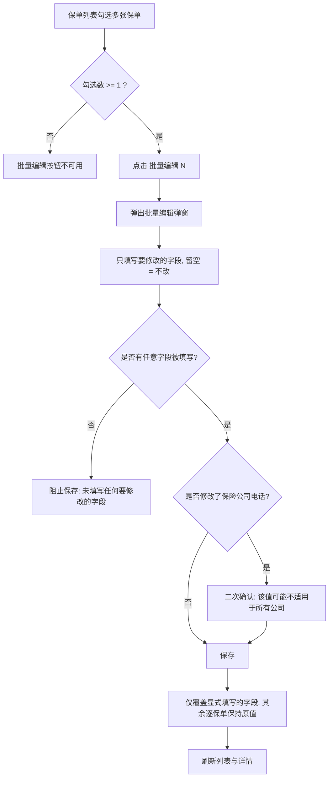
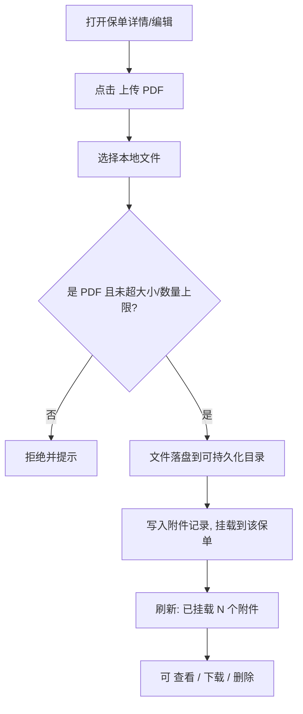
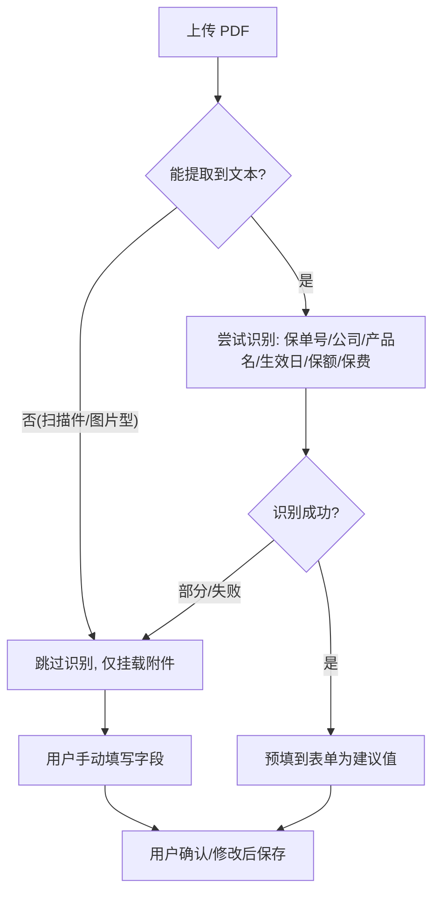

# 家庭保险整理工具 — 产品需求文档（PRD）

## 项目信息

| 项目 | 内容 |
|---|---|
| 文档语言 | 简体中文 |
| 技术栈 | Vite + React + MUI + Tailwind CSS（本地网页先行） |
| 项目代号 | `family_insurance_manager` |
| 部署方式 | 阶段一：本地网页（纯前端 + 本地持久化）；阶段二：转 Docker 部署 |
| 版本 | v1.0 |

**原始需求复述**：开发一个保险整理工具，先通过本地网页测试功能，后期转 Docker 部署。功能包括：录入保单（保险公司、险种、产品名称、投保人、被保人、保单生效日、保多久、交多久、缴费方式月或年、每期保费等信息）；展示界面可以按照家庭成员、险种分开统计，也显示年度总保费、近 60 天内待交保费等统计。

---

## 1. 产品目标与目标用户

**解决什么问题**：普通家庭往往给多个成员配置了多份保单，信息散落在纸质合同、各家保险公司 App 和微信里，导致"记不清给谁买了什么、每年要交多少钱、最近哪张保单该续费"。

**给谁用**：以家庭为单位管理保单的**家庭财务负责人**（通常是家庭中负责缴费与理财的一方）。用户希望在一个页面里看清全家的保障与缴费全貌，避免漏缴导致保单失效。

**产品目标**：
1. **集中归档**：把全家所有保单信息结构化录入到一处，随时可查、可改、可删。
2. **一目了然**：按家庭成员、险种两个维度自动汇总保单数与保费，并给出年度总保费、近 60 天待交保费等核心指标。
3. **防漏缴提醒**：基于保单生效日与缴费方式自动推算缴费日，提前 60 天提示待缴保单，避免保单失效。

---

## 2. 用户故事

| 编号 | 用户故事 |
|---|---|
| US-01 | 作为**家庭财务负责人**，我希望**录入一张保单的全部关键信息**，以便把分散在各处的保单集中归档、随时查阅。 |
| US-02 | 作为**家庭财务负责人**，我希望**编辑已有保单的信息**（如更正保费金额或补充保额），以便信息随实际情况保持准确。 |
| US-03 | 作为**家庭财务负责人**，我希望**删除已退保或录错的保单**，以便列表只保留有效数据。 |
| US-04 | 作为**家庭财务负责人**，我希望**管理家庭成员列表**（新增/编辑/删除成员及其关系、出生日期），以便录入保单时直接选择被保人、投保人。 |
| US-05 | 作为**家庭财务负责人**，我希望**按家庭成员或按险种切换查看统计**，以便了解"每个人/每类险种花了多少钱、有多少份保单"。 |
| US-06 | 作为**家庭财务负责人**，我希望**在总览看板分别看到「当年应缴总保费」与「当年未缴费金额」，以及近 60 天待交保费**，以便分清"全年总共要交多少"与"还有多少没交"，提前准备续费资金、避免漏缴。 |
| US-07 | 作为**家庭财务负责人**，我希望**看到近 60 天内具体哪些保单、哪一天、要交多少钱的待缴清单**，以便按时间顺序安排缴费。 |
| US-08 | 作为**家庭财务负责人**，我希望**看到每张保单的缴费进度（已缴/剩余期数、是否已缴清）**，以便判断这张保单还要交多久。 |

---

## 3. 需求池（P0 / P1 / P2）

> 优先级定义：**P0 = 必须实现（MVP，覆盖用户明确提到的功能）**；P1 = 应该实现（合理增强）；P2 = 可以延后。

| 编号 | 需求描述 | 优先级 | 验收标准 |
|---|---|---|---|
| R-01 | 保单录入：填写公司、险种、产品名、投保人、被保人、生效日、保多久、交多久、缴费方式、每期保费、保额、备注、状态 | P0 | 必填项为空或格式非法时禁止提交并给出提示；提交成功后列表出现该保单 |
| R-02 | 保单列表：表格展示全部保单，支持按成员/险种/状态筛选与关键词搜索 | P0 | 表格列完整、筛选与搜索实时生效、结果条数正确 |
| R-03 | 保单编辑 | P0 | 表单回填原值，保存后列表与统计同步更新 |
| R-04 | 保单删除 | P0 | 二次确认后删除，统计同步更新 |
| R-05 | 家庭成员管理：新增/编辑/删除成员（姓名、关系、出生日期、性别、备注） | P0 | 成员可被保单表单引用；删除被引用成员时给出提示并禁止或要求先处理 |
| R-06 | 总览看板：核心指标卡片（**v1.4 起为 5 张**：当年应缴总保费、当年未缴费金额、近 60 天待交保费、保单总数、在保人数） | P0 | 指标数值与统计口径定义一致、随数据变化实时更新（双口径见 §10） |
| R-07 | 按家庭成员统计 | P0 | 展示每位成员的保单数、年度总保费、待交保费（60 天）、累计已缴保费 |
| R-08 | 按险种统计 | P0 | 展示每类险种的保单数、年度总保费、待交保费（60 天）、累计已缴保费 |
| R-09 | 近 60 天待缴清单：列出待缴保单、缴费日、期次、金额、所属成员 | P0 | 清单按缴费日升序；金额合计与"近 60 天待交保费"卡片一致 |
| R-10 | 缴费进度：每张保单展示已缴期数/剩余期数/是否缴清/进度条 | P0 | 与统计口径定义的计算公式结果一致 |
| R-11 | 本地数据持久化（刷新/重启浏览器不丢数据） | P0 | 关闭重开页面后数据仍存在 |
| R-12 | 数据导出 Excel/CSV（保单清单、待缴清单） | P1 | 导出文件可用 Excel 打开、字段与页面一致 |
| R-13 | 缴费日历视图（按月/年日历标注缴费日） | P1 | 日历正确标注各保单缴费日，点击可查看明细 |
| R-14 | 图表可视化（按成员/险种的饼图或柱状图） | P1 | 图表与统计表数据一致 |
| R-15 | 保单附件上传（合同照片/PDF 本地保存或 Base64） | P1 | 可上传、预览、删除附件 |
| R-16 | 缴费记录勾选（手动标记某期"已缴/未缴"，覆盖自动推算） | P1 | 勾选后待缴与累计已缴随之调整 |
| R-17 | 多币种支持（记录币种与汇率） | P2 | 支持币种选择，统计可折算为人民币 |
| R-18 | 数据导入（从 Excel 模板批量导入保单） | P2 | 模板校验通过后可批量写入 |
| R-19 | 到期/续保提醒通知（浏览器通知） | P2 | 到达设定时间触发通知 |
| R-20 | 多用户/账号体系与云端同步 | P2 | 用户登录后数据隔离并跨设备同步 |

---

## 4. 数据字段定义

### 4.1 保单实体（Policy）

| 字段名 | 类型 | 必填 | 取值范围 / 枚举 | 示例值 | 说明 |
|---|---|---|---|---|---|
| `id` | string(uuid) | 系统生成 | — | `"p_1a2b3c"` | 主键 |
| `company` | string | 是 | 自由文本，≤50 字 | `"中国平安"` | 保险公司 |
| `insuranceType` | enum | 是 | 见 4.4 险种枚举 | `"重疾险"` | 险种 |
| `productName` | string | 是 | 自由文本，≤80 字 | `"平安福 2024"` | 产品名称 |
| `policyholderId` | string | 是 | 必须为已存在的成员 id | `"m_001"` | 投保人（引用家庭成员） |
| `insuredId` | string | 是 | 必须为已存在的成员 id | `"m_002"` | 被保人（引用家庭成员） |
| `effectiveDate` | date(ISO) | 是 | `YYYY-MM-DD`，≤今天+未来 | `"2020-03-15"` | 保单生效日 |
| `coverageTermType` | enum | 是 | `终身` / `固定年限` / `至某年龄` | `"终身"` | 保障期限类型（保多久，见 4.3） |
| `coverageTermValue` | number(int) | 条件必填 | 固定年限:1–100（年）；至某年龄:1–120（岁）；终身为空 | `null` | 保障期限数值（保多久） |
| `paymentTermType` | enum | 是 | `趸交` / `固定年限` / `交至某年龄` | `"固定年限"` | 缴费期限类型（交多久，见 4.3） |
| `paymentTermValue` | number(int) | 条件必填 | 固定年限:1–100（年）；交至某年龄:1–120（岁）；趸交为空 | `20` | 缴费期限数值（交多久） |
| `paymentFrequency` | enum | 是 | `月缴` / `年缴` | `"月缴"` | 缴费方式 |
| `premiumPerPeriod` | number(2 位小数) | 是 | >0，单位：元 | `500.00` | 每期保费 |
| `insuredAmount` | number(2 位小数) | 否 | ≥0，单位：元 | `500000.00` | 保额（可选） |
| `status` | enum | 是 | `生效中` / `已缴清` / `已退保` / `已失效` | `"生效中"` | 保单状态（默认 `生效中`） |
| `remark` | string | 否 | 自由文本，≤200 字 | `"含轻症豁免"` | 备注 |
| `createdAt` | datetime | 系统生成 | ISO8601 | `"2025-05-20T10:00:00Z"` | 创建时间 |
| `updatedAt` | datetime | 系统生成 | ISO8601 | `"2025-05-20T10:00:00Z"` | 更新时间 |

**派生字段（不落库，实时计算）**：`年化保费`、`总缴费期数`、`已到期期数`、`累计已缴保费`、`剩余缴费期数`、`是否已缴清`、`缴费进度百分比`、`是否在保障期内`、`下次缴费日`。计算规则见第 5 节。

### 4.2 家庭成员实体（Member）

| 字段名 | 类型 | 必填 | 取值范围 / 枚举 | 示例值 | 说明 |
|---|---|---|---|---|---|
| `id` | string(uuid) | 系统生成 | — | `"m_001"` | 主键 |
| `name` | string | 是 | 自由文本，≤20 字 | `"张三"` | 姓名 |
| `relation` | enum | 是 | 见 4.5 关系枚举 | `"本人"` | 与本人关系 |
| `birthDate` | date(ISO) | 是 | `YYYY-MM-DD`，≤今天 | `"1988-06-01"` | 出生日期（用于"至某年龄"计算） |
| `gender` | enum | 否 | `男` / `女` / `未知` | `"男"` | 性别 |
| `remark` | string | 否 | 自由文本，≤100 字 | `"家庭主要经济来源"` | 备注 |

### 4.3 关键建模：「保多久」与「交多久」的结构化方案

**结论：两者均采用「类型 + 数值」的双字段建模。**

#### （1）保障期限（保多久）

| 方案 | 存储 | 说明 |
|---|---|---|
| ✅ **推荐** | `coverageTermType` + `coverageTermValue` | 类型决定语义，数值承载长度，覆盖全部常见形态 |

| `coverageTermType` | `coverageTermValue` | 含义 | 示例 |
|---|---|---|---|
| `终身` | `null` | 保障至终身 | 重疾险保终身 |
| `固定年限` | 年数（int） | 从生效日起保障 N 年 | `30` → 保 30 年 |
| `至某年龄` | 年龄（int） | 保障至被保人 A 周岁 | `80` → 保至 80 岁 |

**推荐理由**：保险行业保障期只有"终身 / 定期年限 / 定期年龄"三类，双字段用最少列覆盖全部情况；`至某年龄` 依赖被保人 `birthDate` 动态计算，避免存冗余的截止日期导致数据不一致。**唯一约束**：`固定年限`/`至某年龄` 时 `coverageTermValue` 必填，`终身` 时必须为空。

#### （2）缴费期限（交多久）

| 方案 | 存储 | 说明 |
|---|---|---|
| ✅ **推荐** | `paymentTermType` + `paymentTermValue` | 与保障期限对称建模 |

| `paymentTermType` | `paymentTermValue` | 含义 | 示例 |
|---|---|---|---|
| `趸交` | `null` | 一次性交清（总期数 = 1） | 一次性缴 5 万 |
| `固定年限` | 年数（int） | 连续交 N 年 | `20` → 交 20 年 |
| `交至某年龄` | 年龄（int） | 交至被保人 A 周岁 | `60` → 交至 60 岁 |

**推荐理由**：与保障期限同构，前端表单可复用同一组件；"交多久"的**实际总期数需结合 `paymentFrequency` 二次换算**（固定年限 20 年 + 月缴 = 240 期；+ 年缴 = 20 期），因此数值统一以「年/岁」为单位存储，换算逻辑集中在统计层，避免录入端歧义。**唯一约束**：`趸交` 时 `paymentTermValue` 必须为空。

### 4.4 险种枚举（`insuranceType`）

`重疾险` / `医疗险` / `意外险` / `寿险` / `年金险` / `教育金` / `车险` / `财产险` / `其他`

> 说明：将"年金险/教育金"拆为两个独立枚举，便于教育金专项统计；如后续需要合并，可在展示层做分组。

### 4.5 与本人关系枚举（`relation`）

`本人` / `配偶` / `子女` / `父亲` / `母亲` / `其他`

> 约定：每个家庭**有且仅有一个** `本人` 成员（建议在成员管理中约束）。

---

## 5. 统计口径定义（可直接实现）

> 约定：`今天` 指运行时的系统当前日期（仅取年月日，不含时分秒）；所有日期比较为**日期级闭区间**比较。`每年期数` = 月缴 ? 12 : 1。

### 5.0 基础派生量（先算这些，再算统计）

| 派生量 | 公式 | 说明 |
|---|---|---|
| `年化保费` | 年缴 → `premiumPerPeriod`；月缴 → `premiumPerPeriod × 12`；趸交 → `0` | 趸交无持续年支出，年化为 0 |
| `总缴费期数` | 趸交 → `1`；固定年限 N → `N × 每年期数`；交至某年龄 A → `max(0, A − 生效日时被保人周岁) × 每年期数` | 缴费总期数上限 |
| `已到期期数` | `min(k_max + 1, 总缴费期数)`，其中 k_max 见下 | 从生效日算起已到缴费日的期次数（含第 0 期） |
| `累计已缴保费` | `已到期期数 × premiumPerPeriod` | 已到期即视为已缴（P0 不做缴费记录，见 R-16） |
| `剩余缴费期数` | `max(0, 总缴费期数 − 已到期期数)` | — |
| `是否已缴清` | `剩余缴费期数 == 0` | — |
| `缴费进度百分比` | `总缴费期数 == 0 ? 100 : round(已到期期数 / 总缴费期数 × 100, 1)` | 保留 1 位小数 |
| `是否在保障期内` | 终身 → `true`；固定年限 N → `今天 ≤ 生效日 + N 年`；至某年龄 A → `今天 ≤ 被保人出生日 + A 年` | — |

**`k_max` 计算（第 k 期缴费日 = 生效日 + k 个缴费周期，k 从 0 开始）**：
- 月缴：`k_max = (今天.年 − 生效.年) × 12 + (今天.月 − 生效.月) − (今天.日 < 生效.日 ? 1 : 0)`
- 年缴：`k_max = 今天.年 − 生效.年 − (今天 < 生效日当年周年日 ? 1 : 0)`

> `k_max` 为"最后一个缴费日 ≤ 今天"的期次序号；若为负（生效日在未来）则取 0 处理。

### 5.1 年度总保费

> **⚠️ v1.4 已变更，见 §10「v1.4 增量：看板保费双口径」。** 本节原口径（"生效中且未缴清"）自 v1.4 起**对应看板新增卡片「当年未缴费金额」**；看板**主卡片**已放宽为**「当年应缴总保费」**（含"生效中"与"已缴清"）。下列 v1.0 原文**仅作历史记录保留，请勿据此实现**，以实现口径为准见 §10。

**定义（v1.0 原文；v1.4 起该口径改称「当年未缴费金额」卡片）**：统计"当前仍需持续缴费"的保单的年化保费之和。**仅统计 `status = 生效中` 且 `是否已缴清 = false` 的保单**；趸交保单年化保费为 0（不贡献），`已退保`/`已失效` 保单不计入。

**公式**：
```
年度总保费 = Σ 年化保费
  其中 年化保费 = 年缴 ? 每期保费 : (月缴 ? 每期保费 × 12 : 0)
  过滤条件：status == '生效中' 且 是否已缴清 == false
```

**算例**（今天 = 2025-05-20）：

| 保单 | 缴费方式 | 每期保费 | 状态 | 是否缴清 | 年化保费 |
|---|---|---|---|---|---|
| A | 月缴 | 500 | 生效中 | 否 | 6000 |
| B | 年缴 | 8000 | 生效中 | 否 | 8000 |
| C | 年缴 | 3000 | 生效中 | 否 | 3000 |
| D | 趸交 | 50000 | 已缴清 | 是 | 0（不计入） |

→ **年度总保费 = 6000 + 8000 + 3000 = 17000 元**

### 5.2 近 60 天内待交保费

**定义**：对每张 `status = 生效中` 且 `是否已缴清 = false` 的保单，推算其所有缴费日，取**落在闭区间 `[今天, 今天 + 60 天]`** 内的期次，累加其 `premiumPerPeriod`。

**公式**：
```
待交窗口 = [今天, 今天 + 60天]   // 两端均包含
待交期次 = { k | k_max < k ≤ k_max + ceil(60 / 周期) 且 生效日 + k×周期 ∈ 窗口 }
近60天待交保费 = Σ (待交期次数量 × premiumPerPeriod)  // 逐保单累加
```

**边界规则**：
- **闭区间**：缴费日 = 今天 或 = 今天+60 天，均计入。
- **不含已逾期未缴期次**：`k ≤ k_max` 的期次视为已缴（P0 默认），不进入待缴清单；如需跟踪逾期，见 P1 需求 R-16（缴费记录勾选）。
- **不含已缴清保单**：趸交或缴费期满的保单不产生待交。
- 同一天多张保单缴费，分别列出、金额累加。

**算例**（今天 = 2025-05-20，窗口 = `[2025-05-20, 2025-07-19]`）：

| 保单 | 生效日 | 缴费方式 | 每期保费 | 窗口内缴费日（期次） | 待交金额 |
|---|---|---|---|---|---|
| A | 2020-03-15 | 月缴 | 500 | 2025-06-15(k=63)、2025-07-15(k=64) | 1000 |
| B | 2021-08-01 | 年缴 | 8000 | 无（下次 2025-08-01 超出窗口） | 0 |
| C | 2024-06-01 | 年缴 | 3000 | 2025-06-01(k=1) | 3000 |

→ **近 60 天待交保费 = 1000 + 0 + 3000 = 4000 元**

### 5.3 按家庭成员统计

以每位成员为一行（成员按 `relation` 排序：本人 → 配偶 → 子女 → 父母 → 其他），统计口径：**以「被保人」归属家庭成员**（即一张保单计入其被保人所在行）。

| 指标 | 公式 |
|---|---|
| 保单数 | 该成员作为被保人的保单总数（可再分"生效中"数） |
| 年度总保费 | 该成员被保保单的年化保费之和（**口径同「当年未缴费金额」：仅"生效中且未缴清"**，见 §10；**不随看板主卡片放宽**） |
| 近 60 天待交保费 | 该成员被保保单的待交保费之和（口径同 5.2） |
| 累计已缴保费 | 该成员被保保单的累计已缴之和（口径同 5.0） |

> 展示层同时给出"投保人"维度切换开关（同一份数据，改按 `policyholderId` 分组），默认按被保人。

### 5.4 按险种统计

以每个 `insuranceType` 为一行，指标与 5.3 相同（保单数、年度总保费、近 60 天待交保费、累计已缴保费），按年度总保费降序排列。**其中「年度总保费」口径同「当年未缴费金额」（仅"生效中且未缴清"），见 §10；不随看板主卡片放宽。**

### 5.5 其余统计指标口径

| 指标 | 公式 | 备注 |
|---|---|---|
| 累计已缴保费 | `已到期期数 × 每期保费` | 见 5.0 |
| 已缴期数 | `已到期期数` | 见 5.0 |
| 剩余缴费期数 | `max(0, 总缴费期数 − 已到期期数)` | — |
| 是否已缴清 | `剩余缴费期数 == 0` | 趸交保单首期后即为已缴清 |
| 保单是否仍在保障期内 | 见 5.0 `是否在保障期内` | 终身恒为 true |
| 缴费进度百分比 | `已到期期数 / 总缴费期数 × 100%`（保留 1 位小数） | 上限 100% |
| 保单总数 | 全部保单数（含各状态） | 看板卡片口径 |
| 在保人数 | `是否在保障期内 = true` 的保单所涉及的**去重被保人**数 | 看板卡片口径 |
| **当年应缴总保费**（v1.4 新增卡片） | `Σ 年化保费`，过滤 `status ∈ {生效中, 已缴清}` | 看板主卡片口径，见 §10 |
| **当年未缴费金额**（v1.4 新增卡片） | `Σ 年化保费`，过滤 `status = 生效中 且 是否已缴清 = false` | 看板卡片口径，见 §10 |

---

## 6. UI 设计稿

### 6.1 总览看板（Dashboard）

```
┌──────────────────────────────────────────────────────────────────────────────┐
│  家庭保险整理工具           [总览] [保单列表] [家庭成员]            [+ 新增保单] │
├──────────────────────────────────────────────────────────────────────────────┤
│  ┌────────────┐ ┌────────────┐ ┌────────────┐ ┌────────────┐ ┌────────────┐   │
│  │ 当年应缴   │ │ 当年未缴   │ │ 近60天待交 │ │  保单总数  │ │  在保人数  │   │
│  │ 总保费     │ │ 费金额     │ │ ¥4,000     │ │    4 份    │ │   3 人     │   │
│  │ ¥17,000    │ │ ¥17,000    │ │ 3 笔待缴   │ │ 生效中 3 份│ │ 覆盖成员   │   │
│  └────────────┘ └────────────┘ └────────────┘ └────────────┘ └────────────┘   │
│                                                                              │
│  ┌───────────────────────────┐  ┌───────────────────────────┐              │
│  │ 按家庭成员分布  [被保人▾]  │  │ 按险种分布                 │              │
│  │  ● 本人    ¥10,000  2份    │  │  ● 重疾险  ¥6,000   1份   │              │
│  │  ● 配偶    ¥4,000   1份    │  │  ● 医疗险  ¥8,000   1份   │              │
│  │  ● 子女    ¥3,000   1份    │  │  ● 意外险  ¥3,000   1份   │              │
│  │  （饼图 + 明细列表）       │  │  （饼图 + 明细列表）       │              │
│  └───────────────────────────┘  └───────────────────────────┘              │
│                                                                              │
│  近 60 天待缴清单                                              [导出 Excel]  │
│  ┌──────────┬────────┬──────────┬────────┬────────┬──────────────┐        │
│  │ 缴费日    │ 被保人  │ 产品名称  │ 期次   │ 金额   │ 操作         │        │
│  ├──────────┼────────┼──────────┼────────┼────────┼──────────────┤        │
│  │2025-06-01│ 张三   │ 平安福   │ 第2/20 │ ¥3,000 │ [标记已缴]   │        │
│  │2025-06-15│ 张三   │ 康健医疗 │第63/240│ ¥500   │ [标记已缴]   │        │
│  │2025-07-15│ 张三   │ 康健医疗 │第64/240│ ¥500   │ [标记已缴]   │        │
│  └──────────┴────────┴──────────┴────────┴────────┴──────────────┘        │
│                                        合计待交：¥4,000（3 笔）             │
└──────────────────────────────────────────────────────────────────────────────┘
```
**交互**：顶部指标卡**共 5 张**（v1.4 起新增「当年未缴费金额」，主卡片为「当年应缴总保费」，二者口径见 §10）、只读、随数据实时刷新；分布图切换"被保人/投保人"维度；待缴清单按缴费日升序，[标记已缴] 为 P1 功能，P0 可先隐藏；[导出 Excel] 为 P1。

### 6.2 保单列表页（Policy List）

```
┌──────────────────────────────────────────────────────────────────────────────┐
│  保单列表                                                    [+ 新增保单]      │
├──────────────────────────────────────────────────────────────────────────────┤
│  筛选：[被保人 ▾] [险种 ▾] [状态 ▾] [缴费方式 ▾]   搜索[____________] 🔍      │
├──────┬────────┬──────────┬────────┬──────┬────────┬──────┬──────┬───────────┤
│ 公司 │ 险种    │ 产品名称  │ 被保人  │ 生效日│ 保多久  │ 交多久│ 每期  │ 进度/操作  │
├──────┼────────┼──────────┼────────┼──────┼────────┼──────┼──────┼───────────┤
│平安  │ 重疾险  │ 平安福   │ 张三   │2020-…│ 终身    │20年  │¥500  │ ▓▓░ 26%   │
│      │        │          │        │      │        │ 月缴  │      │ 编辑|删除 │
│人保  │ 医疗险  │ 康健医疗 │ 李四   │2021-…│ 保30年  │10年  │¥8000 │ ▓▓░ 40%   │
│      │        │          │        │      │        │ 年缴  │      │ 编辑|删除 │
│平安  │ 意外险  │ 综合意外 │ 小张   │2024-…│ 保1年   │20年  │¥3000 │ ▓░░ 5%    │
│      │        │          │        │      │        │ 年缴  │      │ 编辑|删除 │
├──────┴────────┴──────────┴────────┴──────┴────────┴──────┴──────┴───────────┤
│  共 4 条    当年未缴费 ¥17,000    近60天待交 ¥4,000      [导出 Excel]         │
└──────────────────────────────────────────────────────────────────────────────┘
```
**交互**：筛选/搜索实时生效；表格底部展示当前筛选结果的汇总（**「当年未缴费」= 结果集内"未缴清"保单的年化保费合计，口径同「当年未缴费金额」卡片，见 §10**）；行内 [编辑] 打开 6.3 表单，[删除] 二次确认；进度条 hover 显示"已缴 63/240 期，剩余 177 期"。

### 6.3 保单录入 / 编辑表单（弹窗）

```
┌──────────────────────── 新增 / 编辑保单 ──────────────────────────┐
│  保险公司 * [中国平安________]    险种 * [重疾险 ▾]                │
│  产品名称 * [平安福2024________________________]                  │
│  投保人 *  [张三 ▾] (+新增)      被保人 * [张三 ▾] (+新增)         │
│  保单生效日 * [2020-03-15 📅]                                      │
│  ── 保多久（保障期限）──                                           │
│    类型 * ( ) 终身 (•) 固定年限 ( ) 至某年龄   数值 * [ 30 ] 年/岁  │
│  ── 交多久（缴费期限）──                                           │
│    类型 * ( ) 趸交 (•) 固定年限 ( ) 交至某年龄  数值 * [ 20 ] 年/岁 │
│  缴费方式 * ( ) 月缴 (•) 年缴       每期保费 * [ 500.00 ] 元       │
│  保额（可选） [ 500000.00 ] 元       状态 * [ 生效中 ▾]            │
│  备注 [含轻症豁免____________________________]                     │
│                                                                    │
│   提示：月缴 + 固定年限20年 → 共 240 期；年化保费 ¥6,000           │
│                                   [取消]  [保存]                    │
└────────────────────────────────────────────────────────────────────┘
```
**交互**：带 `*` 为必填；选择 `终身` 时"数值"自动置灰禁用；选择 `趸交` 时缴费数值置灰；底部**实时预览**由类型推导的总期数与年化保费；保存前做校验（日期、数值范围、投保人/被保人已选）。

### 6.4 家庭成员管理页（Members）

```
┌──────────────────────────────────────────────────────────────────────────────┐
│  家庭成员管理                                                [+ 新增成员]      │
├──────┬────────┬──────────┬────────────┬──────┬────────┬───────────────┤
│ 姓名 │ 关系    │ 出生日期  │ 性别       │ 保单数│ 年保费  │ 操作          │
├──────┼────────┼──────────┼────────────┼──────┼────────┼───────────────┤
│ 张三 │ 本人    │1988-06-01│ 男         │  2   │¥6,000  │ 编辑 | 删除   │
│ 李四 │ 配偶    │1990-03-12│ 女         │  1   │¥8,000  │ 编辑 | 删除   │
│ 小张 │ 子女    │2015-09-20│ 男         │  1   │¥3,000  │ 编辑 | 删除   │
├──────┴────────┴──────────┴────────────┴──────┴────────┴───────────────┤
│  共 3 位成员                                                          │
└──────────────────────────────────────────────────────────────────────────────┘
```
**交互**：新增/编辑弹出小表单（姓名、关系、出生日期、性别、备注）；删除被保单引用的成员时弹提示"该成员关联 N 份保单，无法删除"；"本人"唯一性校验。

---

## 7. 待确认问题（含默认假设）

> 因后续不逐条等待用户确认，以下每条均给出**本次采用的默认假设**，直接按默认实现即可。

| 编号 | 问题 | 默认假设（本次采用） |
|---|---|---|
| Q1 | 年度总保费是否包含已缴清 / 趸交保单？ | **⚠️ v1.4 已变更，见 §10。** 原答案"不包含"（仅"生效中且未缴清"）自 v1.4 起**对应新增卡片「当年未缴费金额」**；看板主卡片「当年应缴总保费」**包含"生效中"与"已缴清"**（含"状态生效中但期次已缴完"的保单）。趸交年化保费仍为 0。 |
| Q2 | "待交"是否包含已逾期未缴期次？是否需要缴费记录功能？ | **不包含逾期**；P0 按生效日自动推算，`k ≤ k_max` 视为已缴。手动勾选缴费记录列为 P1（R-16）。 |
| Q3 | 家庭成员统计以"被保人"还是"投保人"归属？ | **默认按被保人**归属，界面提供切换到投保人的开关。 |
| Q4 | 数据存储方式？是否需要后端？ | P0 用**浏览器本地持久化**（IndexedDB / localStorage）满足"本地网页测试"；阶段二转 Docker 时再引入后端与数据库，数据模型保持一致。 |
| Q5 | 币种？ | 默认**仅人民币（¥）**，多币种列为 P2（R-17）。 |

---

*文档结束 — 版本 v1.0，可直接进入架构设计与开发。*

---

## 8. 增量需求（v1.1）：缴费记录与当年缴费状态

> 本章为 v1.0 交付后的**增量需求**，仅描述本次变更部分。未在本章提及的章节、字段与统计规则**一律沿用 v1.0**，不做改动。

### 8.1 需求背景与用户痛点

**用户原话**：
> 「保单录入后没办法录入已经缴费几年了，当年是否已缴费等信息」
> 「工具怎么知道我今年缴费了呢？」

**问题拆解（用大白话讲）**：

v1.0 的工具有一个"想当然"的假设：**只要缴费日到了，就默认这笔钱已经交了**。所以它算出来的"已缴 63/240 期"，其实是"按时间**应该**交的期数"，**不是**"用户**真的**交了的期数"。

这对一个家庭用户会带来两个麻烦：

1. **补录历史时算不准**：比如一份保单其实是从 2023 年才开始交、或中间漏交过一年，工具却按生效日一路推算，显示的"已缴期数"和现实对不上，用户会觉得"这工具在瞎算"。
2. **当年到底交没交，工具根本不知道**：用户最关心的是一句大白话——**「我今年的保费交了吗？别漏了。」** 而 v1.0 只能回答"按时间该交了"，回答不了"我交没交"。

**为什么重要**：家庭保单漏缴会导致**保障中断、甚至保单失效**，这是用户最怕的事。因此"缴费状态"必须由用户说了算，工具负责**记录 + 提醒**，而不是替用户默认"已交"。

**本次缺口**：v1.0 需求池中的 **R-16「缴费记录勾选」** 只是笼统提了一句、且列为 P1 未实现。本次将其正式落地，并补齐 **「已缴期数录入 + 待缴打勾 + 逾期识别」** 这一套最小闭环。

---

### 8.2 用户故事

| 编号 | 用户故事 |
|---|---|
| US-09 | 作为**家庭财务负责人**，我希望**在录入/编辑保单时填写「已经交了几期」**，以便把中途才开始交、或漏交过的保单补录准确，而不是被工具按生效日"自动算错"。 |
| US-10 | 作为**家庭财务负责人**，我希望**在待缴清单里对某一期点一下「已缴」就登记掉**，以便交完钱随手记一笔，工具马上就知道"这期我交过了"。 |
| US-11 | 作为**家庭财务负责人**，我希望**工具能一眼看出哪些保单「过了缴费日却没交」（逾期）**，以便我赶紧补缴、避免保单失效。 |
| US-12 | 作为**家庭财务负责人**，我希望**保单列表直接显示「已缴 x/y 期」和逾期徽章**，以便不用把鼠标悬停在进度条上就能看清每张保单的缴费状态。 |

---

### 8.3 需求池（增量）

> 优先级沿用 v1.0 定义：**P0 = 必须实现**；P1 = 应该实现；P2 = 可以延后。

| 编号 | 需求描述 | 优先级 | 验收标准 |
|---|---|---|---|
| R-21 | **已缴期数录入**：保单表单新增「已缴期数」字段（选填）。**留空 = 按生效日期自动推算**（保持 v1.0 行为、兼容存量数据）；**填写 = 以用户记录为准**（用于补录历史、纠正漏缴/提前缴）。 | P0 | ①留空时"已缴 x/y 期"与 v1.0 自动推算结果一致；②填写 N 后，"已缴 x/y 期"、剩余期数、累计已缴保费、进度条、是否已缴清同步更新；③再次编辑时回填已填数值；④填写值非法（负数 / 超过总期数）时给出提示（见 8.5）。 |
| R-22 | **待缴清单打勾登记**：看板「近 60 天待缴清单」每行提供「已缴」按钮，点一下即**登记「最早未缴的那一期」**。为避免"到底登记了哪一期"的歧义，该按钮**只出现在每张保单最早的一行**，其余行不显示。 | P0 | ①点「已缴」后，该保单已缴期数 +1，清单与统计实时刷新；②同一保单其他行不出现「已缴」按钮；③点击后给出轻提示（如"已登记第 64 期缴费"）；④该保单存在逾期时按钮不出现，改为文字提示（见 R-23）。 |
| R-23 | **逾期识别与呈现**：当用户填的已缴期数**少于**按时间应缴的期数时，判定这些期次"过了缴费日却没交"。呈现四处：①保单列表「状态」列显示「逾期 N 期」徽章；②看板顶部警示横幅；③看板新增「逾期未缴」面板（最早应缴日 / 逾期期数 / 逾期金额 / 「补缴一期」按钮）；④该保单在待缴清单中不显示「已缴」按钮，改为提示「有逾期，请先补缴」（强制先补历史，符合现实缴费顺序）。 | P1 | ①逾期保单状态列出现「逾期 N 期」徽章，N = 应缴期数 − 已缴期数；②存在逾期时看板顶部出现横幅，并显示涉及保单数与金额合计；③「逾期未缴」面板字段与按钮齐全，「补缴一期」点击后逾期期数 −1、已缴期数 +1；④逾期未补缴前，该保单在待缴清单不出现「已缴」按钮；⑤全部补缴后，徽章、横幅、面板自动消失。 |
| R-24 | **缴费进度列直显**：保单列表「缴费进度」列直接显示「已缴 x/y 期」，不再只靠鼠标悬停；由用户手动记录（填期数 / 打勾）得到的数值加「手动」标记，以区别于自动推算。 | P1 | ①列表直接可见「已缴 x/y 期」；②手动来源显示「手动」小标记，自动推算不显示；③数值与保单详情、统计口径一致。 |
| R-25 | 逐期缴费历史明细（记录每一期的具体缴费日期、金额、操作人） | P2 | 可查看某保单逐期流水；**本次不做**。 |
| R-26 | 缴费凭证附件（每期缴费可上传截图/回执，本地保存） | P2 | 可上传、预览、删除；**本次不做**。 |
| R-27 | 缴费记录导出（把各保单逐期缴费记录导出为 Excel/CSV） | P2 | 导出文件字段与页面一致；**本次不做**。 |

**本次范围小结**：**P0（R-21、R-22）必做**；**P1（R-23、R-24）本次一并交付**；**P2（R-25 ~ R-27）本次不实现**，仅登记待排期。

---

### 8.4 交互与 UI 设计稿

> 以下 wireframe 仅标注**本次新增 / 变更**的部分；未画出的部分沿用 v1.0 第 6 节。

#### 8.4.1 保单表单：新增「已缴期数」字段

```
┌──────────────────────── 新增 / 编辑保单 ──────────────────────────┐
│  保险公司 * [中国平安________]    险种 * [重疾险 ▾]                │
│  产品名称 * [平安福2024________________________]                  │
│  投保人 *  [张三 ▾] (+新增)      被保人 * [张三 ▾] (+新增)         │
│  保单生效日 * [2020-03-15 📅]                                      │
│  ── 保多久（保障期限）──                                           │
│    类型 * ( ) 终身 (•) 固定年限 ( ) 至某年龄   数值 * [ 30 ] 年/岁  │
│  ── 交多久（缴费期限）──                                           │
│    类型 * ( ) 趸交 (•) 固定年限 ( ) 交至某年龄  数值 * [ 20 ] 年/岁 │
│  缴费方式 * ( ) 月缴 (•) 年缴       每期保费 * [ 500.00 ] 元       │
│  保额（可选） [ 500000.00 ] 元       状态 * [ 生效中 ▾]            │
│  ── 缴费记录（本次新增）──                                         │
│    已缴期数 [ 63 ] 期   （选填，共 240 期）        ← 本次新增       │
│    💡 留空 = 按生效日自动推算；填写 = 以你记录的为准               │
│       用于补录中途才开始交、或漏交过的情况                          │
│  备注 [含轻症豁免____________________________]                     │
│                                                                    │
│   提示：月缴 + 固定年限20年 → 共 240 期；年化保费 ¥6,000           │
│                                   [取消]  [保存]                    │
└────────────────────────────────────────────────────────────────────┘
```
**交互**：该字段选填；留空时右侧灰字提示"将按生效日自动推算（当前约 63 期）"；输入框实时校验不得超过"共 y 期"；切换缴费方式 / 期限时同步刷新"共 y 期"。

#### 8.4.2 看板顶部警示横幅（存在逾期时出现）

```
┌──────────────────────────────────────────────────────────────────────────────┐
│  ⚠️  有 1 张保单存在逾期未缴，共 3 期、¥1,500，请尽快补缴，以免保单失效。 [查看 ↓]│
└──────────────────────────────────────────────────────────────────────────────┘
```
**交互**：仅在存在逾期保单时出现；点击「查看」滚动到「逾期未缴」面板；全部补缴后横幅自动消失。

#### 8.4.3 看板「近 60 天待缴清单」（含「操作」列）

```
│  近 60 天待缴清单                                              [导出 Excel]  │
│  ┌──────────┬────────┬──────────┬────────┬────────┬──────────────────┐      │
│  │ 缴费日    │ 被保人  │ 产品名称  │ 期次   │ 金额   │ 操作              │      │
│  ├──────────┼────────┼──────────┼────────┼────────┼──────────────────┤      │
│  │2025-06-01│ 张三   │ 平安福   │ 第2/20 │ ¥3,000 │ [已缴]            │←最早行 │
│  │2025-06-15│ 张三   │ 康健医疗 │第63/240│ ¥500   │ 有逾期，请先补缴   │←逾期   │
│  │2025-07-15│ 张三   │ 康健医疗 │第64/240│ ¥500   │ —（同一保单非首行）│        │
│  └──────────┴────────┴──────────┴────────┴────────┴──────────────────┘      │
│                                        合计待交：¥4,000（3 笔）             │
```
**交互**：每张保单**只有最早的一行**显示「已缴」按钮；同一保单后续行显示"—"；该保单若有逾期，最早行不显示按钮，改为「有逾期，请先补缴」并跳转逾期面板；点击「已缴」登记"最早未缴的那一期"并实时刷新。

#### 8.4.4 看板「逾期未缴」面板（存在逾期时出现）

```
│  逾期未缴（请优先处理）                                                       │
│  ┌──────────────┬──────────┬──────────┬────────┬──────────┬────────────┐   │
│  │ 产品名称      │ 被保人    │ 最早应缴日│ 逾期期数│ 逾期金额  │ 操作        │   │
│  ├──────────────┼──────────┼──────────┼────────┼──────────┼────────────┤   │
│  │ 康健医疗      │ 张三     │2025-03-15│  3 期   │ ¥1,500   │ [补缴一期]  │   │
│  └──────────────┴──────────┴──────────┴────────┴──────────┴────────────┘   │
```
**交互**：按最早应缴日升序；「补缴一期」登记最早的一期逾期（已缴期数 +1、逾期期数 −1）；补完一期后自动刷新，补清后该行与横幅一起消失。

#### 8.4.5 保单列表：「缴费进度」列与「状态」列徽章

```
├──────┬────────┬──────────┬────────┬──────┬────────┬──────┬──────┬────────────────┤
│ 公司 │ 险种    │ 产品名称  │ 被保人  │ 生效日│ 保多久  │ 交多久│ 每期  │ 缴费进度 / 状态  │
├──────┼────────┼──────────┼────────┼──────┼────────┼──────┼──────┼────────────────┤
│平安  │ 重疾险  │ 平安福   │ 张三   │2020-…│ 终身    │20年  │¥500  │ 已缴 26/240 期  │
│      │        │          │        │      │        │ 月缴  │      │ 状态：生效中    │
│人保  │ 医疗险  │ 康健医疗 │ 李四   │2021-…│ 保30年  │10年  │¥8000 │ 已缴 63/120 期  │
│      │        │          │        │      │        │ 年缴  │      │ 状态：[逾期 3 期]│
│平安  │ 意外险  │ 综合意外 │ 小张   │2024-…│ 保1年   │20年  │¥3000 │ 已缴 5/20[手动] │
│      │        │          │        │      │        │ 年缴  │      │ 状态：生效中    │
```
**交互**：「缴费进度」直接显示「已缴 x/y 期」；手动来源（填期数 / 打勾）追加「手动」标记，自动推算不加；「状态」列在逾期时显示红色「逾期 N 期」徽章，否则显示原状态（生效中 / 已缴清 / 已退保 / 已失效）。

---

### 8.5 边界与异常场景

| # | 场景 | 期望行为 |
|---|---|---|
| B-01 | **生效日在未来** | 尚不存在已到期期次，自动推算的已缴期数为 0；用户手动填写时允许填 0；不产生待缴与逾期。 |
| B-02 | **趸交（总期数 = 1）** | 总期数固定为 1；已缴期数只能是 0 或 1；打勾一次即"已缴清"，之后不再出现在待缴清单。 |
| B-03 | **已缴清后再点打勾** | 已缴期数不会超过总期数；按钮应不可用，或点击后提示"该保单已缴清"，不重复累加。 |
| B-04 | **手动填的期数超过总期数** | 视为非法输入：表单即时提示"不能超过共 y 期"并阻止保存（或自动截断为 y，最终按 8.6 Q8 确认）。 |
| B-05 | **「交至某年龄」无法预先判定总期数** | 若被保人出生日期缺失、或缴费到龄已过，总期数可能算不出：此时"共 y 期"显示"—"，已缴期数仍可填；该保单不参与"是否已缴清"的强制判断，也不产生逾期。 |
| B-06 | **存量数据（未填该字段）** | `已缴期数` 视为"未填"，完全沿用 v1.0 自动推算，界面与统计不变；用户一旦手动填写，即切换为"以用户记录为准"并加「手动」标记。 |
| B-07 | **填写的期数少于应缴期数（即逾期）** | 判定为逾期：状态列徽章 + 顶部横幅 + 逾期面板 + 待缴清单禁用打勾（见 R-23）。 |
| B-08 | **同一保单在待缴清单有多行** | 只有最早一行显示「已缴」按钮，避免"到底登记了哪一期"的歧义。 |

---

### 8.6 待确认问题

| 编号 | 问题 | 备选 / 倾向 |
|---|---|---|
| Q6 | 逾期是否需要**更强的提醒**（如打开工具即弹窗、或置顶红条常驻）？ | 倾向：先用"横幅 + 徽章 + 面板"三处呈现；是否再加弹窗请用户拍板。 |
| Q7 | 是否需要记录**每一期的具体缴费日期**（而非只记总数）？ | 倾向：本次只记"已缴期数"总数（简单）；逐期明细列为 P2（R-25）。 |
| Q8 | 手动填写期数**超过总期数**时，是"阻止保存"还是"自动截断为总期数"？ | 倾向：阻止保存并提示（数据更诚实）；如需更"傻瓜"可改为自动截断。 |

---

*增量文档结束 — 版本 v1.1，仅描述本次缴费记录相关变更。*

---

## 9. 增量需求（v1.2）：保单售后信息 · 批量编辑 · 电子保单 PDF 导入

> 本章为 v1.1 交付后的**增量需求**，仅描述本次变更部分。未在本章提及的章节、字段与统计规则**一律沿用 v1.0 / v1.1**，不做改动。

### 9.1 版本背景与目标

**用户原话**：
> 「增加几个功能。一是增加保单售后信息（服务顾问、投保渠道、保险公司联系方式等），二是增加电子保单 pdf 导入功能（可以对应录入的保单）。」
> （补充确认）「批量编辑：需要。」

**要解决的问题（大白话）**：
1. **「保单买完就找不到人」**：理赔、保全、续费都要联系服务顾问或保险公司，但顾问的姓名/电话/微信/邮箱、投保渠道、保险公司客服电话，散落在微信聊天记录和纸质合同里，急用时翻不到。
2. **「换个顾问要改一整天」**：顾问离职或换渠道后，名下十几张保单要逐张打开编辑，重复劳动、还容易漏改。
3. **「电子保单躺在微信里」**：电子保单 PDF 存在微信、邮箱、下载目录，和保单记录对不上号，用时找不到。

**本次目标（3 个正交目标）**：
1. **售后信息归档**：把服务顾问、投保渠道、保险公司联系电话结构化记录到**每张保单**上，随保单一起查、改、删。
2. **批量维护**：在保单列表多选后一次性更新售后信息，且**只覆盖用户显式填写的字段**，杜绝误清空。
3. **电子保单归位**：把 PDF 电子保单**挂载到对应保单**下，可在线查看、下载、删除；存储目录可被 Docker 卷挂载持久化。

**范围边界（一句话）**：本次把「售后信息 + 批量编辑」做扎实（P0）；PDF **上传/查看/下载/删除**一并交付（P1）；PDF **自动识别预填**作为增强、可延后（P2）。

---

### 9.2 用户故事

| 编号 | 用户故事 |
|---|---|
| US-13 | 作为**家庭财务负责人**，我希望**在保单上记录服务顾问（姓名/电话/微信/邮箱）、投保渠道（名称/电话）、保险公司联系电话**，以便理赔或咨询时立刻找得到人。 |
| US-14 | 作为**家庭财务负责人**，我希望**填写这些联系方式时能从「以前填过的值」里一键选择**，以便不用每次重复输入同一个顾问/渠道的信息。 |
| US-15 | 作为**家庭财务负责人**，我希望**不打开编辑弹窗也能看到一张保单的关键售后联系方式**，以便快速取用。 |
| US-16 | 作为**家庭财务负责人**，我希望**在保单列表勾选多张保单后一次性修改服务顾问或投保渠道**，以便换顾问/换渠道时不用逐张编辑。 |
| US-17 | 作为**家庭财务负责人**，我希望**批量编辑时「没填的字段保持原样」**，以便不会因为漏填而把其他保单已有的信息清空。 |
| US-18 | 作为**家庭财务负责人**，我希望**给保单上传电子保单 PDF，并能在浏览器里查看、下载、删除**，以便电子保单和保单记录放在一起、随取随用。 |
| US-19 | 作为**家庭财务负责人**，我希望**上传 PDF 后工具能自动识别保单号、公司、产品名、生效日、保额、保费并预填**，以便少打字、少填错。 |

---

### 9.3 需求池（增量）

> 优先级沿用 v1.0 定义：**P0 = 必须实现**；P1 = 应该实现；P2 = 可以延后。

| 编号 | 需求描述 | 优先级 | 验收标准 |
|---|---|---|---|
| R-28 | **售后信息字段录入**：保单表单新增「售后信息」区块，含 7 个**选填**字段——服务顾问姓名/电话/微信号/邮箱、保险公司联系电话、投保渠道名称/电话（见 9.4）。 | P0 | ①保单表单出现「售后信息」区块；②**全部留空也能正常保存**；③保存后重新打开，已填值正确回填；④不影响 v1.0/v1.1 任何展示与统计。 |
| R-29 | **常用值快捷提示**：填写服务顾问（姓名/电话/微信/邮箱）与投保渠道（名称/电话）时，输入框旁提供「常用·▾」快捷下拉，选项来自**全部保单中该字段的历史非空值**去重。 | P0 | ①六个输入框各有快捷下拉；②选项按出现次数降序、去重；③选中某项即填入该输入框；④无历史值时下拉不显示或提示「暂无历史值」；⑤**仅填入被选中的字段**，不跨字段自动带出（避免张冠李戴）。 |
| R-30 | **售后信息快捷查看**：保单列表提供「联系方式」入口，不打开编辑弹窗即可查看该保单已填的售后信息。 | P1 | ①列表行内可打开「联系方式」弹层/悬浮卡；②展示全部 7 个字段，未填显示「—」；③不显著加宽表格（用弹层而非新增列）。 |
| R-31 | **列表多选 + 批量编辑入口**：保单列表每行首列加勾选框、表头加全选；勾选 ≥1 时出现「批量编辑（N）」按钮。 | P0 | ①行首勾选框、表头全选可用；②勾选数实时显示在按钮上；③未勾选时按钮禁用/隐藏。 |
| R-32 | **批量编辑弹窗（仅覆盖显式填写字段）**：一次性修改勾选保单的服务顾问 4 项、投保渠道 2 项、保险公司电话；**留空字段保持各保单原值不变**。 | P0 | ①弹窗顶部显示「将修改 N 张保单」；②每个字段有明确「留空=不改」提示；③保存后**只有被显式填写的字段**写入勾选保单，其余字段逐保单保持原值；④列表与详情实时刷新。 |
| R-33 | **批量编辑边界与确认**：0 选中、全字段留空、跨不同保险公司改「保险公司电话」、以及「需要清空某字段」的处理。 | P0 | ①0 选中→按钮不可用；②所有字段留空→阻止保存并提示「未填写任何要修改的字段」；③修改保险公司电话且勾选保单来自多家公司时→二次确认提示「该值可能不适用于所有公司」；④提供独立的「设为空（高级）」显式清空方式，与「留空不改」区分。 |
| R-34 | **PDF 上传与挂载**：保单详情/编辑弹窗提供「电子保单附件」区，可上传 PDF 并挂载到该保单；文件落盘到**可被 Docker 卷挂载**的目录。 | P1 | ①可选择一个或多个 PDF 上传；②上传成功后附件出现在该保单下；③非 PDF 被拒绝并提示；④超过大小/数量上限被拒绝（见 B-21）。 |
| R-35 | **PDF 在线查看与下载**：附件可在线预览、可下载。 | P1 | ①点击附件名在浏览器内预览（新标签/内嵌查看器）；②提供「下载」，下载文件名保持原始文件名；③不支持内联预览的浏览器至少可下载。 |
| R-36 | **PDF 删除**：附件可删除。 | P1 | ①每个附件有「删除」，二次确认后执行；②删除后磁盘文件与记录一并移除，计数同步更新。 |
| R-37 | **附件计数展示**：保单详情显示已挂载附件数量。 | P1 | ①显示「已挂载 N 个附件」；②N=0 时显示「暂无附件」。 |
| R-38 | **PDF 自动识别预填**：上传 PDF 后自动解析文本、识别并预填字段（保单号、公司、产品名、生效日、保额、保费），用户确认后保存。 | P2 | ①可提取文本时尝试识别并**预填为建议值**；②用户确认/修改后才保存；③识别失败或部分识别**不阻塞上传**，附件照常挂载、缺失字段留空由用户手填；④扫描件/图片型 PDF 不做 OCR，直接降级为人工（见 B-19）。 |

**本次范围小结**：**P0（R-28、R-29、R-31、R-32、R-33）必做**；**P1（R-30、R-34 ~ R-37）本次一并交付**；**P2（R-38）本次可延后**，仅登记待排期（与用户原话「识别难就以后开发」一致）。

---

### 9.4 字段定义

> 保单**新增字段**如下（全部选填）；命名沿用既有 camelCase 约定。金额仍用整数分存储（`Money`），本节新增字段均为文本，不涉及金额。

| 字段名（camelCase） | 中文名 | 类型 | 是否必填 | 长度/取值范围 | 校验规则 | 备注 |
|---|---|---|---|---|---|---|
| `advisorName` | 服务顾问姓名 | string | 否 | ≤20 | 自由文本，首尾去空格 | 对应截图「服务顾问 · 姓名」 |
| `advisorPhone` | 服务顾问电话 | string | 否 | ≤30 | 允许数字、`+`、`-`、空格、括号、`/` | 不强校验位数（兼容座机/分机/多号码） |
| `advisorWechat` | 服务顾问微信号 | string | 否 | ≤50 | 自由文本 | 对应截图「微信号」 |
| `advisorEmail` | 服务顾问邮箱 | string | 否 | ≤80 | 宽松：含 `@` 且 `@` 后有 `.` | 对应截图「邮箱」 |
| `companyPhone` | 保险公司联系电话 | string | 否 | ≤50 | 允许含分隔符的**多号码**（如 `1010-9955/952299`） | **新增字段**；公司名复用既有 `company`（见 B-11） |
| `channelName` | 投保渠道名称 | string | 否 | ≤30 | 自由文本 | 对应截图「投保渠道 · 渠道名称」 |
| `channelPhone` | 投保渠道电话 | string | 否 | ≤30 | 同 `advisorPhone` 规则 | 对应截图「渠道电话」 |
| `company`（**既有**） | 保险公司名称 | string | 是 | ≤50 | 沿用 v1.0 | **不新增公司名字段**，直接复用（见 B-11） |

**派生 / 关联字段（不落库于保单行，随响应返回）**：

| 字段名（camelCase） | 中文名 | 类型 | 说明 |
|---|---|---|---|
| `attachmentCount` | 已挂载附件数 | int（≥0） | 保单详情显示「已挂载 N 个附件」 |
| `attachments` | 附件列表 | array | 每项含 `fileName`（原始文件名）、`fileSize`（字节）、`uploadedAt`（上传时间）；提供预览/下载/删除 |

> 说明：附件文件**落盘目录必须可被 Docker 卷挂载持久化**（本次硬约束）；具体目录、表结构与接口路径由架构师设计，本 PRD 只约束产品行为。

---

### 9.5 UI 草图

#### 9.5.1 保单表单新增「售后信息」区块（照参考截图结构）

```
┌──────────────────────── 新增 / 编辑保单 ──────────────────────────┐
│  ...（既有字段：保险公司/险种/产品名称/投保人/被保人/生效日/期限/保费/已缴期数/备注）│
│  ── 售后信息（本次新增，全部选填）──────────────────────────────  │
│  服务顾问   常用顾问·▾        ← 从历史值给快捷选项                  │
│    姓名    [ 王小明__________ ]   电话 [ 13800000000______ ]      │
│    微信号  [ wx_wangxm_______ ]   邮箱 [ wxm@example.com____ ]    │
│  保险公司                                                          │
│    公司名  [ 众安在线财险 ]（沿用「保险公司」字段，只读展示）        │
│    联系电话[ 1010-9955/952299 ]                                    │
│  投保渠道   常用渠道·▾        ← 从历史值给快捷选项                  │
│    渠道名称[ 支付宝蚂蚁保______ ]   渠道电话 [ 95188_________ ]    │
│                                                                    │
│   提示：售后信息全部选填，留空不影响保单保存与统计。                │
│                                   [取消]  [保存]                    │
└────────────────────────────────────────────────────────────────────┘
```

#### 9.5.2 常用值快捷下拉

```
   姓名 [ 王小明        ▾]   ← 点击箭头展开历史值
        ┌───────────────────────────────┐
        │ 王小明   （出现在 8 张保单）   │
        │ 李丽     （出现在 3 张保单）   │
        │ 张伟     （出现在 1 张保单）   │
        └───────────────────────────────┘
```
**交互**：选项来自全部保单历史非空值去重、按出现次数降序；选中后**只填入该输入框**，不自动带出电话/微信/邮箱（避免张冠李戴）；无历史值时下拉不出现或提示「暂无历史值」。

#### 9.5.3 保单列表页批量编辑入口

```
┌──────────────────────────────────────────────────────────────────────────────┐
│  保单列表                                        [批量编辑 (2)] [+ 新增保单]  │
├──────────────────────────────────────────────────────────────────────────────┤
│ 筛选：[被保人▾][险种▾][状态▾][缴费方式▾]  搜索[__________]                    │
├──┬──────┬────────┬───────────┬───────┬────────┬──────┬─────────┬───────────┤
│☑ │公司   │险种    │产品名称    │被保人  │生效日   │ …    │缴费进度  │操作        │
├──┼──────┼────────┼───────────┼───────┼────────┼──────┼─────────┼───────────┤
│☑ │众安   │医疗险  │小圆满医疗  │张三   │2024-…  │ …    │已缴 2/… │编辑|删除   │
│☑ │平安   │重疾险  │平安福2021 │张三   │2020-…  │ …    │已缴26/… │编辑|删除   │
│☐ │人保   │意外险  │综合意外    │小张   │2024-…  │ …    │已缴5/…  │编辑|删除   │
├──┴──────┴────────┴───────────┴───────┴────────┴──────┴─────────┴───────────┤
│ 共 3 份   已勾选 2 份                        年化合计 ¥…   累计已缴 ¥…         │
└──────────────────────────────────────────────────────────────────────────────┘
```

#### 9.5.4 批量编辑弹窗

```
┌────────────── 批量编辑（将修改 2 张保单）──────────────┐
│  💡 只填写你要修改的字段；留空的字段保持各保单原值不变。│
│                                                          │
│  服务顾问                                                │
│    姓名    [ 李丽______________ ]                        │
│    电话    [ 13900000000_______ ]                        │
│    微信号  [ __________________ ]   （留空 = 不改）      │
│    邮箱    [ __________________ ]   （留空 = 不改）      │
│  投保渠道                                                │
│    渠道名称[ 明亚保险经纪______ ]                        │
│    渠道电话[ __________________ ]   （留空 = 不改）      │
│  保险公司                                                │
│    联系电话[ __________________ ]   （留空 = 不改；     │
│              勾选保单来自多家公司时保存前二次确认）       │
│                                                          │
│  ☐ 高级：我要把某些字段清空  ← 勾选后出现「设为空」项    │
│                                   [取消]  [保存]         │
└──────────────────────────────────────────────────────────┘
```

#### 9.5.5 PDF 附件区（保单详情 / 编辑弹窗）

```
┌──────────── 电子保单附件（本次新增）────────────┐
│  [ + 上传 PDF ]    已挂载 2 个附件                │
│  ┌────────────────────────────────────────────┐ │
│  │ 📄 小圆满医疗险_电子保单.pdf   1.2MB        │ │
│  │    2025-05-20 上传   [查看] [下载] [删除]   │ │
│  ├────────────────────────────────────────────┤ │
│  │ 📄 平安福2021_保单合同.pdf     3.4MB        │ │
│  │    2025-05-21 上传   [查看] [下载] [删除]   │ │
│  └────────────────────────────────────────────┘ │
│  （P2 预留）上传后自动识别并预填字段；识别失败不影响上传 │
└──────────────────────────────────────────────────┘
```

---

### 9.6 交互流程

#### 9.6.1 批量编辑流程



#### 9.6.2 PDF 上传流程（P1）



#### 9.6.3 PDF 识别预填流程（P2，可降级）



---

### 9.7 边界与异常场景

| # | 场景 | 期望行为 |
|---|---|---|
| B-09 | **售后字段全部留空** | 允许保存；不影响既有展示与统计，列表/详情对应处显示「—」。 |
| B-10 | **存量保单（无售后字段）** | 视为「未填」，沿用既有行为；用户编辑保存时不受影响。 |
| B-11 | **保险公司名称字段** | **复用既有 `company` 字段，不新增公司名字段**；仅新增 `companyPhone`（保险公司联系电话）。理由：`company` 已是公司名，重复字段会产生双写与数据不一致。 |
| B-12 | **常用值历史为空（首次使用）** | 快捷下拉不出现或显示「暂无历史值」，不报错。 |
| B-13 | **批量编辑 0 选中** | 按钮禁用；若可点击则提示「请先勾选要修改的保单」。 |
| B-14 | **批量编辑所有字段留空** | 阻止保存并提示「未填写任何要修改的字段」，不做任何写入。 |
| B-15 | **批量编辑跨不同保险公司并修改「保险公司电话」** | 允许，但保存前二次确认：「将把 N 张保单的保险公司电话统一改为 X，可能不适用于所有公司」。 |
| B-16 | **批量编辑只填了部分字段** | **只写入被显式填写的字段；未填字段逐保单保持原值（严禁「留空即清空」）。** |
| B-17 | **需要批量清空某字段** | 通过弹窗内「高级：设为空」显式勾选实现，与「留空 = 不改」明确区分。 |
| B-18 | **上传非 PDF 文件** | 拒绝并提示「仅支持 PDF 文件」。 |
| B-19 | **扫描件 / 图片型 PDF（已知能力边界）** | 纯 Python 离线环境**无 OCR 能力**，无法提取文本，自动识别降级为纯人工填写；**上传、查看、下载、删除均不受影响**。 |
| B-20 | **识别失败 / 超时** | **不阻塞上传**；附件照常挂载，缺失字段留空由用户手填。 |
| B-21 | **超大 PDF / 超量附件** | 单文件超过上限（默认 ≤20MB）拒绝；附件数量超过上限（默认 ≤10）拒绝（上限见 Q9 / Q10）。 |
| B-22 | **删除保单时其附件** | 随保单一起删除，删除前二次确认提示「将同时删除 N 个附件」。 |
| B-23 | **附件存储目录未做持久化** | 容器重启后附件丢失：**该目录必须能被 Docker 卷挂载持久化**（本次硬约束，架构师据此设计）。 |

---

### 9.8 待确认问题

| 编号 | 问题 | 备选 / 倾向 |
|---|---|---|
| Q9 | 单个 PDF 附件的大小上限？ | 倾向 **≤20MB**。 |
| Q10 | 单张保单的附件数量上限？ | 倾向 **≤10 个**。 |
| Q11 | PDF 自动识别预填（R-38）本次是否实现？ | 倾向本次只做 P1 的**上传/查看/下载/删除**，识别预填作为 **P2 延后**（与用户原话「识别难就以后开发」一致）。 |
| Q12 | 删除保单时其附件如何处理？ | 倾向**随保单删除**（B-22）；如需保留请用户拍板。 |
| Q13 | 批量编辑是否需要「整套带出常用顾问」（选中姓名自动带出电话/微信/邮箱）？ | 倾向本次只做**按字段**的历史提示；整套带出列为可选增强。 |

---

*增量文档结束 — 版本 v1.2，仅描述本次售后信息、批量编辑与 PDF 导入相关变更。*

---

## 10. 增量需求（v1.4）：看板保费双口径

> **版本说明**：v1.3 增量（多被保人 / 成员保障类型统计 / 分红险 / 列表直达 PDF）见独立文档 `docs/PRD-v13-increment.md`（该文记为"第 10 章"）。**本章为 v1.4 增量**，在本文件内续接 §9，记为第 10 章。未在本章提及处一律沿用 v1.0 ~ v1.3。
> **需求编号续接项目全局最大编号 R-48**（v1.3 的 R-39 ~ R-48 见上述独立文档），**避免与 v1.3 编号冲突**；用户故事续接 US-25 → US-26，待确认问题续接 Q21 → Q22。

### 10.1 版本背景与目标

**用户诉求（意）**：把首页「年度总保费」拆成两个指标——「**当年应缴总保费**」与「**当年未缴费金额**」。

**要解决的问题（大白话）**：
原来首页只有一张「年度总保费」，口径是"生效中且未缴清"。这会让两类保单**被漏掉**：① 状态已标为「已缴清」的保单（保费早交完、但保单仍在保障期）；② 状态还是「生效中」、但期次其实已缴完的保单。于是用户看到的总额**小于**"这一年全家到底要交多少"，对不上账。

拆成两张卡后：主卡片回答"**这一年全家总共要交多少保费**"（应缴），新卡片回答"**其中还有多少没交**"（未缴），二者之差即"已缴部分"。

**本次目标（3 个正交目标）**：
1. **口径更完整**：主卡片「当年应缴总保费」覆盖 `生效中 + 已缴清`，不再漏掉已缴清 / 已缴完的保单。
2. **对账更清晰**：新增「当年未缴费金额」，与"成员 / 险种 / 投保人保费合计"口径一致、可直接对账。
3. **旧口径零回退**：「当年未缴费金额」= 旧「年度总保费」口径，**数值逐值不变**，不破坏既有不变式。

**范围边界**：仅看板卡片拆分 + 口径澄清（P0）；**成员页 / 按险种 / 按投保人的保费口径一律不变**。

### 10.2 用户故事

| 编号 | 用户故事 |
|---|---|
| US-26 | 作为**家庭财务负责人**，我希望在首页**分别**看到「当年应缴总保费」与「当年未缴费金额」，以便分清"全年总共要交多少"和"还有多少没交"。 |

### 10.3 需求池（增量）

> 优先级沿用既有定义：**P0 = 必须实现**。

| 编号 | 需求描述 | 优先级 | 验收标准 |
|---|---|---|---|
| R-49 | **看板主卡片口径放宽为「当年应缴总保费」**：由原"生效中且未缴清"放宽为 `status ∈ {生效中, 已缴清}`（含"状态生效中但期次已缴完"的保单）；卡片改名为「当年应缴总保费」。 | P0 | ①主卡片值 = `Σ 年化保费`，过滤 `status ∈ {生效中, 已缴清}`；②不再排除"已缴清"与"生效中但已缴完"的保单；③"已退保 / 已失效"仍不计入；④趸交年化仍为 0。 |
| R-50 | **看板新增卡片「当年未缴费金额」**：`Σ 年化保费`，过滤 `status = 生效中 且 是否已缴清 = false`（= 旧「年度总保费」口径）。 | P0 | ①新增卡片独立展示；②数值与旧「年度总保费」**逐值相同**；③与「按成员 / 按险种 / 按投保人」的保费合计**对账一致**（Σ成员保费 == 当年未缴费金额）；④主卡片 − 本卡片 = 已缴部分。 |

**本次范围小结**：**R-49、R-50 均为 P0，且已由工程师实现、QA 正在验证**。

### 10.4 口径定义（唯一真源）

> 两卡片均为 `Σ 年化保费`（年化保费口径见 §5.0：年缴 → 每期保费；月缴 → 每期保费 × 12；趸交 → 0），**仅过滤条件不同**。

| 卡片 | 公式 | 过滤条件 | 相对旧版 |
|---|---|---|---|
| **当年应缴总保费**（主卡片） | `Σ 年化保费` | `status ∈ {生效中, 已缴清}` | **放宽**（新增"已缴清"） |
| **当年未缴费金额**（新卡片） | `Σ 年化保费` | `status = 生效中 且 是否已缴清 = false` | **= 旧「年度总保费」，逐值不变** |
| 两者之差 | 主卡片 − 新卡片 | — | = 已缴部分（含"已缴清"与"生效中已缴完"保单的年化） |

**不变式（QA 对账基准）**：
```
Σ(按成员统计的年度总保费)   == 当年未缴费金额
Σ(按险种统计的年度总保费)   == 当年未缴费金额
Σ(按投保人统计的年度总保费) == 当年未缴费金额
```
> 说明：成员 / 险种 / 投保人三处保费口径**均未变**（仍是"生效中且未缴清"），故它们现在对账的是**「当年未缴费金额」**，而**不是**主卡片。**切勿**把成员页合计去与主卡片比较。

**算例（示例数据）**：应缴 **6,000**、未缴 **4,000**、差 **2,000**（差额来自两张"状态生效中但期次已缴完"的保单）。

### 10.5 UI 草图（看板 5 张卡片）

> 线框图见 **§6.1**（已更新为 5 张卡片）。要点如下：

| 卡片 | 值（算例） | 副标题建议 |
|---|---|---|
| 当年应缴总保费（主卡片） | ¥17,000 | 含已缴清 |
| 当年未缴费金额（新卡片） | ¥17,000 | 尚需缴纳 |
| 近 60 天待交 | ¥4,000 | 3 笔待缴 |
| 保单总数 | 4 份 | 生效中 3 份 |
| 在保人数 | 3 人 | 覆盖成员 |

**交互**：5 张卡片只读、随数据实时刷新；主卡片与新卡片**相邻排列**，便于"应缴 − 未缴 = 已缴"的心算对照。

### 10.6 对既有功能的影响与兼容性

| # | 既有功能 | 影响 | 兼容性处理 |
|---|---|---|---|
| 1 | 看板「年度总保费」卡片 | 拆为两张 | 旧值**完整保留**在新卡片「当年未缴费金额」；主卡片放宽，**旧口径零回退**。 |
| 2 | 按成员 / 按险种 / 按投保人统计 | **不变** | 仍为"生效中且未缴清"；对账目标改为「当年未缴费金额」。 |
| 3 | 近 60 天待交 / 缴费进度 / 逾期 | **不受影响** | 口径未变。 |
| 4 | 保单列表页底部汇总 | 标签对齐 | 列表汇总本就按"未缴清"口径求和，标签改为「当年未缴费」，与新卡片一致。 |
| 5 | 既有不变式表述 | 需更新理解 | `Σ成员保费 == 当年未缴费金额`（原表述"== 年度总保费"中的"年度总保费"应理解为**新卡片**，非主卡片）。 |

### 10.7 边界与异常

| # | 场景 | 期望行为 |
|---|---|---|
| B-34 | 保单状态「已缴清」 | 计入**主卡片**，**不计入**「当年未缴费金额」。 |
| B-35 | 保单状态「生效中」但期次已缴完 | 计入**主卡片**，**不计入**「当年未缴费金额」（差额即来自此类）。 |
| B-36 | 保单状态「已退保 / 已失效」 | **两张卡片均不计入**。 |
| B-37 | 趸交保单 | 年化保费为 0，两张卡片均不贡献金额。 |
| B-38 | 成员 / 险种 / 投保人合计与主卡片不等 | **正常**：应比对「当年未缴费金额」，不是主卡片。 |

### 10.8 待确认问题

| 编号 | 问题 | 结论 |
|---|---|---|
| Q22 | 主卡片是否改名为「当年应缴总保费」？ | **已定：是**（避免与「当年未缴费金额」混淆）。 |
| Q23 | 成员页 / 险种 / 投保人保费是否也放宽为"含已缴清"？ | **否**，保持"生效中且未缴清"（否则与「当年未缴费金额」无法对账）。 |

---

*增量文档结束 — 版本 v1.4，仅描述本次看板保费双口径（应缴 / 未缴）相关变更。*
